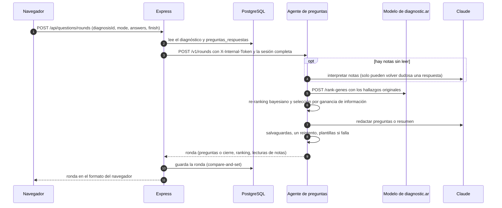

# diagnosticar-preguntas

Agente de preguntas de seguimiento (repreguntas) de diagnostic.ar. Recibe los
síntomas (términos HPO) que ya se cargaron, pide al modelo de diagnostic.ar el
ranking de genes, elige unas pocas preguntas de sí/no sobre síntomas que mejor
separan a los genes candidatos, las redacta con Claude para una familia o para
un médico y, con las respuestas, reordena el ranking. Hace como mucho 3 rondas
de 3 preguntas y cierra con un resumen para llevar a la consulta.

> Sugiere preguntas para conversar con un médico. No diagnostica.

Versión 2 (`2.0.0.dev0`), en la rama `feat/agente-claude`. Todavía no está
desplegada en ningún entorno.

## Cómo encaja en diagnostic.ar

El navegador nunca llama al agente: cada ronda gasta llamadas a un LLM, así que
pasa por el backend Express, que autentica, limita, arma el pedido con la
evidencia guardada del diagnóstico y guarda la sesión. El agente no guarda
estado entre llamadas.



Detalle de cada paso en [docs/ARQUITECTURA.md](docs/ARQUITECTURA.md) y del lado
de la plataforma en [docs/INTEGRACION.md](docs/INTEGRACION.md).

## Uso local

Solo hace falta `python3` en el PATH (y `docker` para la imagen).

```sh
make install   # crea .venv e instala el paquete con las dependencias de desarrollo
make kb        # descarga las fuentes HPO fijadas, construye data/kb.sqlite e imprime su sha256
make run       # sirve la API en :8010 contra el modelo en http://127.0.0.1:18021
make ci        # ruff (lint y formato), mypy estricto y pytest sin los tests "live"
```

`make run` activa `PREGUNTAS_ALLOW_UNAUTHENTICATED=true` porque localmente no hay
token; cambiá el modelo con `make run PREGUNTAS_MODEL_SERVICE_URL=...`. Sin
credenciales de Claude el agente funciona igual, con preguntas y resumen de
plantilla (`PREGUNTAS_LLM_PROVIDER=template` lo fuerza).

## Configuración

Variables `PREGUNTAS_*`, leídas del entorno o de `.env` en el directorio de
trabajo (el entorno gana; un valor vacío cuenta como no definido). Fuente:
`src/diagnosticar_preguntas/config.py`; plantilla comentada en `.env.example`.

| Variable | Por defecto | Qué controla |
|---|---|---|
| `PREGUNTAS_MODEL_SERVICE_URL` | `http://localhost:8000` | Servicio del modelo de diagnostic.ar (`POST /rank-genes`, `GET /healthz`). |
| `PREGUNTAS_MODEL_SERVICE_TIMEOUT_S` | `10` | Tope de la llamada al modelo de cada ronda. |
| `PREGUNTAS_KB_PATH` | `data/kb.sqlite` | Base de conocimiento (en la imagen, `/app/data/kb.sqlite`). |
| `PREGUNTAS_LLM_PROVIDER` | `claude-cli` | `claude-cli` (`claude -p`, suscripción), `anthropic` (API de Claude) o `template` (sin LLM). |
| `PREGUNTAS_LLM_MODEL` | `claude-opus-5` | Modelo de Claude. |
| `PREGUNTAS_LLM_TIMEOUT_S` | `60` | Tope de una llamada al LLM; nunca recibe más de lo que le queda a la ronda. |
| `PREGUNTAS_LLM_EFFORT` | `high` | `low`, `medium`, `high`, `xhigh` o `max`. |
| `PREGUNTAS_SHORTLIST_SIZE` | `8` | Síntomas candidatos que el selector le pasa a Claude por ronda. |
| `PREGUNTAS_QUESTIONS_PER_ROUND` | `3` | Preguntas por ronda (1 a 3, límite del contrato). |
| `PREGUNTAS_MAX_ROUNDS` | `3` | Rondas con preguntas (1 a 3, límite del contrato). |
| `PREGUNTAS_CONFIDENT_THRESHOLD` | `0.9` | Cierra si el puntaje refinado del primer gen llega a este valor. |
| `PREGUNTAS_MIN_INFORMATION_GAIN` | `0.05` | Cierra si ninguna pregunta aporta al menos esta ganancia (bits). |
| `PREGUNTAS_RERANK_STRATEGY` | `fixed_prior` | Qué hallazgos ve el modelo: `fixed_prior` (solo los originales) o `model_sees_present` (también los "sí"). |
| `PREGUNTAS_ROUND_BUDGET_S` | `75` | Segundos que una ronda puede gastar en llamadas al LLM. |
| `PREGUNTAS_HOST` | `0.0.0.0` | Interfaz del servidor HTTP. |
| `PREGUNTAS_PORT` | `8010` | Puerto del servidor HTTP. |
| `PREGUNTAS_SERVICE_TOKEN` | (vacío) | Secreto que Express manda en `X-Internal-Token`. Sin él, toda ronda responde 401. |
| `PREGUNTAS_ALLOW_UNAUTHENTICATED` | `false` | Acepta rondas sin token si no hay uno configurado. Solo para desarrollo local. |
| `PREGUNTAS_MAX_CONCURRENT_ROUNDS` | `2` | Rondas en ejecución a la vez. |
| `PREGUNTAS_MAX_QUEUED_ROUNDS` | `4` | Rondas que pueden esperar lugar; más allá, 503 `busy`. |
| `PREGUNTAS_QUEUE_TIMEOUT_S` | `10` | Espera máxima por un lugar antes de 503 `busy`. |
| `PREGUNTAS_LOG_LEVEL` | `INFO` | Nivel de log. |

Credenciales de Claude, leídas solo del entorno del proceso (nunca de `.env`):
`CLAUDE_CODE_OAUTH_TOKEN` (de `claude setup-token`, para `claude-cli`),
`ANTHROPIC_API_KEY` (para `anthropic`; `claude-cli` también la acepta) y
`CLAUDE_BINARY` si `claude` no está en el PATH. Localmente, una sesión de
`claude /login` también sirve para `claude-cli`.

El que llama tiene que esperar más que `PREGUNTAS_QUEUE_TIMEOUT_S +
PREGUNTAS_ROUND_BUDGET_S + PREGUNTAS_MODEL_SERVICE_TIMEOUT_S` (95 s con los
valores por defecto); la plataforma espera 100 s.

## API

| Método y ruta | Qué hace |
|---|---|
| `POST /v1/rounds` | Una ronda. Exige `X-Internal-Token`. Cuerpo de hasta 64 KiB. |
| `GET /healthz` | Versión, base de conocimiento, proveedor LLM y si tiene credenciales, y si el modelo responde. Siempre 200 mientras el proceso vive; `status: "degraded"` indica un problema de dependencias. No pide token. |

El contrato (versión 2) está en `src/diagnosticar_preguntas/api/schemas.py`,
con un ejemplo completo en
[docs/contrato/rondas-ejemplo.json](docs/contrato/rondas-ejemplo.json) (un test
lo valida contra los esquemas). Resumen de campos y errores en
[docs/INTEGRACION.md](docs/INTEGRACION.md). Los errores responden
`{"error": "<código>"}` sin repetir nada del pedido.

## Imagen

```sh
make docker-build   # etiqueta diagnosticar-question-agent:dev
```

La imagen reconstruye la base de conocimiento desde las fuentes fijadas
(verificadas por sha256), trae el CLI de Claude fijado (`@anthropic-ai/claude-code`
2.1.270, sin Node ni npm), deja la base como archivo de solo lectura y corre como
el usuario `app` (uid 10001). El `Dockerfile` documenta cómo correr los tests
dentro de la imagen, que es lo que hace el job de release de la plataforma.

## Tests

`make ci` corre ruff, mypy estricto y pytest excluyendo `live`. En c3d7033 pasan
502 tests (1 `live` excluido). Los que necesitan `data/kb.sqlite` se saltean si
no se construyó. `make test-live` llama de verdad a `claude -p` y gasta cuota.

## Evaluación

Sobre 300 pacientes simulados de prueba, con el modelo real y respuestas con
ruido, el agente sube el top-1 del gen verdadero de 72,0 % a 79,3 % y el MRR de
0,787 a 0,842 (Δ +0,054, IC 95 % [+0,033; +0,078]) con 3,25 preguntas en promedio.
La simulación es circular (pacientes y agente comparten la base HPO), así que es
una cota optimista; falta validar con pacientes reales. Todo el detalle en
[docs/EVALUACION.md](docs/EVALUACION.md). Cada mejora cuantificada en términos
absolutos y relativos (por subgrupo, por ronda, por pregunta y frente a las
alternativas), con sus advertencias, en [docs/IMPACTO.md](docs/IMPACTO.md).

## Estructura

| Ruta | Contenido |
|---|---|
| `src/diagnosticar_preguntas/api/` | HTTP: app y tabla de errores, contrato v2 (`schemas.py`), token, límite de cuerpo, cola de rondas, `/healthz`. |
| `src/diagnosticar_preguntas/agent/` | La ronda (`round.py`), respuestas y evidencia (`evidence.py`), salvaguardas (`guardrails.py`). |
| `src/diagnosticar_preguntas/ranking/` | Cliente del modelo, verosimilitud `P(síntoma \| enfermedad)`, re-ranking bayesiano, estrategia. |
| `src/diagnosticar_preguntas/selection/` | Términos preguntables, ganancia de información, diversificación, selector. |
| `src/diagnosticar_preguntas/kb/` | Fuentes fijadas, construcción y lectura de la base SQLite. |
| `src/diagnosticar_preguntas/llm/` | Proveedores (`claude_cli.py`, `anthropic_api.py`, `template.py`), prompts (`prompts/*.md`), esquemas de salida. |
| `src/diagnosticar_preguntas/config.py`, `domain.py`, `wiring.py` | Configuración, tipos compartidos, armado de componentes. |
| `tests/` | Tests por paquete, con una base de conocimiento chica sintética (`tests/fixtures/tiny_kb.py`). |
| `eval/` | Arnés de evaluación (casos simulados, respondedor, políticas, ajuste, prueba en vivo). |
| `docs/` | [Arquitectura](docs/ARQUITECTURA.md), [decisiones](docs/DECISIONES.md), [integración](docs/INTEGRACION.md), [evaluación](docs/EVALUACION.md), [impacto](docs/IMPACTO.md), [contrato](docs/contrato/rondas-ejemplo.json), [créditos](docs/CREDITOS.md), [antes y después](docs/ANTES_Y_DESPUES.md). |

## Créditos

Mariano Brizuela creó este repositorio y el primer prototipo del agente; la
versión 2 conserva sus reglas clínicas y su esquema de preguntas trazables.
Detalle, y los datos HPO usados, en [docs/CREDITOS.md](docs/CREDITOS.md). Qué
era el prototipo, qué se encontró al integrarlo y cómo se reestructuró, con
mediciones reproducibles, en [docs/ANTES_Y_DESPUES.md](docs/ANTES_Y_DESPUES.md).
