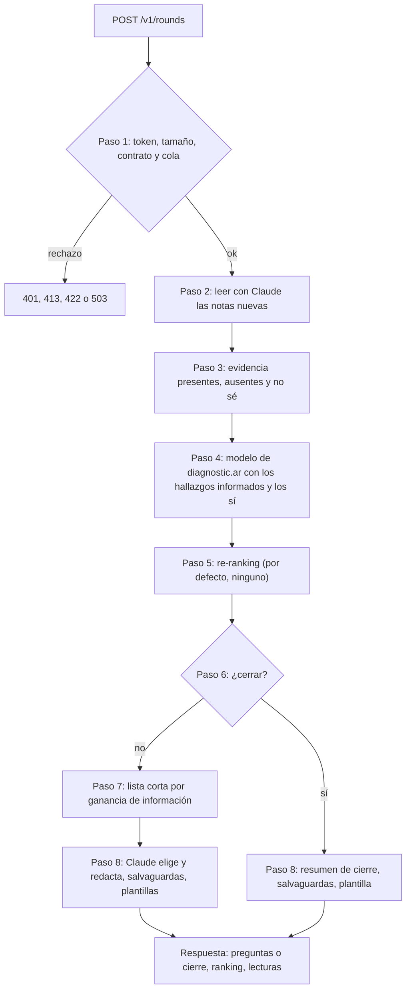

# Arquitectura del agente de preguntas

Cómo está armado el agente, qué pasa en cada ronda y por qué el ranking que
devuelve es trazable. Las decisiones y sus alternativas están en
[DECISIONES.md](DECISIONES.md); la integración con la plataforma, en
[INTEGRACION.md](INTEGRACION.md); la evaluación que fijó los parámetros, en
[EVALUACION.md](EVALUACION.md).

## 1. Componentes

El agente es un servicio HTTP sin estado (FastAPI, un proceso). Cada pedido trae
la sesión entera: los hallazgos informados antes de preguntar y todas las
respuestas hasta el momento. Los componentes se conectan por los protocolos de
`domain.py` y se arman una sola vez al arrancar, en `wiring.py`.

| Componente | Módulo | Responsabilidad |
|---|---|---|
| API | `api/app.py`, `api/schemas.py` | Contrato v2, token, límite de cuerpo, cola, mapeo de errores, `/healthz`. |
| Ronda | `agent/round.py` | Orquesta los pasos de la sección 2, el presupuesto de tiempo y las caídas a plantilla. |
| Evidencia | `agent/evidence.py` | Aplica las lecturas de notas a los botones y arma presentes, ausentes y "no sé". |
| Salvaguardas | `agent/guardrails.py` | Revisa todo texto del LLM antes de que llegue a una persona. |
| Cliente del modelo | `ranking/model_client.py` | `POST /rank-genes` del modelo de diagnostic.ar, con errores tipados. |
| Estrategia | `ranking/strategy.py` | Qué hallazgos se le mandan al modelo (`fixed_prior` o `model_sees_present`). |
| Verosimilitud | `ranking/likelihood.py` | `P(síntoma \| enfermedad)` con la semántica de la ontología, y sus ingredientes: la frecuencia anotada y las exclusiones. |
| Re-ranker | `ranking/reranker.py` | Posterior bayesiana sobre pares gen–enfermedad. |
| Selector | `selection/` | Términos preguntables, ganancia de información y diversificación: Q2b por defecto (`q2b.py`), el selector anterior con `PREGUNTAS_SELECTOR=legacy` (`selector.py`). |
| Capa LLM | `llm/` | Proveedores de Claude y de plantillas detrás de una misma interfaz, prompts y esquemas de salida. |
| Base de conocimiento | `kb/` | Construcción reproducible y lectura en memoria de la base HPO. |

## 2. Una ronda, paso a paso

1. **Admisión.** Cuerpo de hasta 64 KiB (`api/body_limit.py`), `X-Internal-Token`
   correcto (`api/auth.py`), pedido válido según `RoundRequest` (ids HPO con
   formato `HP:0000000`, 1 a 100 presentes, presentes y ausentes disjuntos, cada
   término respondido una vez, ninguna respuesta sobre un hallazgo ya informado,
   una lectura previa solo puede decir lo mismo que el botón o `no_se`) y un
   lugar en la cola (`api/limiter.py`).
2. **Notas.** Solo las respuestas con nota y sin `reading` (la lectura que el
   agente ya devolvió en una ronda anterior) van a Claude, en una sola llamada.
   Una nota que contradice el botón o expresa duda baja la respuesta a `no_se`;
   nunca cambia un sí por un no ni al revés (`agent/evidence.py`).
3. **Evidencia.** Presentes = `present_hpo_ids` ∪ respuestas efectivas "sí";
   ausentes = `absent_hpo_ids` ∪ "no"; desconocidos = "no sé". Los desconocidos
   no se usan como evidencia, y ninguno de los tres se vuelve a preguntar. Con
   la configuración por defecto, los ausentes solo quedan registrados
   (`interpreted_answers`): no mueven el ranking.
4. **Modelo.** `POST /rank-genes` con `top_k` 50. Con la estrategia por defecto,
   `model_sees_present`, se mandan `present_hpo_ids` más cada "sí" efectivo
   (sección 4.4) y, con `PREGUNTAS_RERANK_NEGATIONS` (por defecto), cada "no"
   efectivo como `excluded_hpo_ids`: los ve un modelo con el re-ranker rr-v1
   o con ft-v1.1, no el agente ([NEGACIONES.md](NEGACIONES.md), sección 6).
   Si el pedido trajo `sex`, `age_years` u `onset_years`, van en cada llamada
   (D-20).
5. **Re-ranking.** Por defecto no hay: el ranking es el del modelo para esa
   consulta, repartido en hipótesis gen–enfermedad solo para poder elegir
   preguntas. Las ponderaciones `asymmetric` y `calibrated` siguen disponibles
   y reordenan con lo que las anotaciones dicen de cada respuesta (sección 4).
6. **Cierre.** En este orden: `finish` pedido → `user_finished`; `round` mayor
   que `PREGUNTAS_MAX_ROUNDS` → `max_rounds`; primer gen con puntaje ≥ 0,9 →
   `confident`; lista corta vacía o ninguna ganancia ≥ 0,05 bits →
   `no_useful_questions`. Ningún cierre es un diagnóstico.
7. **Selección.** Con Q2b (por defecto), las 3 preguntas de la ronda por ganancia
   de información esperada sobre los 10 primeros genes, diversificadas; con
   `PREGUNTAS_SELECTOR=legacy`, una lista corta de 8 términos por ganancia de
   información esperada, diversificada; en modo paciente se sacan los
   hallazgos que solo revela un estudio salvo que falten para completar la
   ronda (sección 5).
8. **Redacción y respuesta.** Claude redacta las 3 preguntas de Q2b (con
   `legacy`, elige 3 de la lista corta y las redacta), o escribe el resumen de
   cierre. Cada borrador pasa las salvaguardas; con
   violaciones se reintenta una vez con ellas como `correcciones`, y lo que falte
   se completa con plantillas (secciones 6 y 7). La respuesta trae el ranking
   (50 genes; por defecto, el del propio modelo), `specialties` y `confidence`
   del modelo, cómo se usó cada respuesta (`interpreted_answers`), advertencias y
   versiones.

## 3. Base de conocimiento

**Fuentes.** `kb/sources.py` fija cada archivo por una URL que no cambia de
contenido y por su sha256. Son la versión v2026-02-16 del HPO (la misma con la
que se entrenó el modelo de diagnostic.ar) y las etiquetas oficiales en español
del proyecto de traducciones del HPO, fijadas a un commit:

| Fuente | Archivo | Uso |
|---|---|---|
| Ontología | `hp.json` | Términos, etiquetas en inglés, ids alternativos y obsoletos, jerarquía `is_a`. |
| Anotaciones de enfermedades | `phenotype.hpoa` | Fenotipos de cada enfermedad (aspecto `P`), con frecuencia, `NOT` y edad de inicio. |
| Genes–enfermedades | `genes_to_disease.txt` | Pares gen–enfermedad curados. |
| Genes–fenotipos | `genes_to_phenotype.txt` | Pares gen–enfermedad adicionales implicados por sus filas. |
| Etiquetas en español | `hp-es.babelon.tsv` | `rdfs:label` traducido de cada término. |

`make kb` (o `diagnosticar-preguntas-kb --download`) descarga, verifica y
construye `data/kb.sqlite`; si un archivo no coincide con su sha256, la
construcción falla. La base guarda en su tabla `meta` la versión del HPO, el
sha256, la URL de cada fuente y las raíces de "requiere estudio". El servicio
responde su versión como `kb1+hpo.2026-02-16`.

**Esquema** (`kb/schema.py`, versión 1): `term` (etiquetas, obsoleto,
reemplazo, profundidad, `requires_testing`), `alt_id`, `parent`, `ancestor`
(clausura completa de `is_a` con distancia mínima), `disease`, `annotation`
(`negated`, `frequency`, `onset`), `gene`, `gene_disease` y `meta`. La base
construida desde las fuentes fijadas tiene 19.944 términos (19.932 con etiqueta
en español), 14.860 enfermedades, 264.370 anotaciones (720 negadas), 5.504 genes
y 15.904 pares gen–enfermedad, en unos 32 MB.

**Reglas de lectura de las anotaciones** (`kb/annotations.py`,
`kb/frequency.py`): un calificador `NOT` o la frecuencia `Excluded` hacen negada
la anotación; los términos de frecuencia del HPO se leen como el punto medio de
su rango (obligatorio 1, muy frecuente 0,895, frecuente 0,545, ocasional 0,17,
muy raro 0,025); `n/m` y `x%` se leen tal cual; una frecuencia vacía queda como
desconocida (no como segura); filas repetidas con distintas referencias se
promedian; ids alternativos y obsoletos se resuelven a su id vigente.

**Reproducibilidad.** La construcción inserta filas ordenadas, no guarda nada
dependiente del tiempo, fija el tamaño de página y hace `VACUUM`, así que el
archivo es idéntico byte a byte **para las mismas fuentes y la misma versión de
la biblioteca SQLite**. Con otra versión de SQLite (por ejemplo, la de la imagen
frente a la de una laptop) el contenido es el mismo pero el sha256 del archivo
puede cambiar; por eso `make kb` y el build de la imagen imprimen el sha256 que
obtuvieron (`kb.sqlite.sha256`). El servicio abre la base en modo solo lectura,
la carga entera en memoria (alrededor de un segundo) y rechaza una base con
otra versión de esquema.

## 4. Modelo probabilístico

### 4.1 Hipótesis y prior

Las hipótesis son pares **gen–enfermedad**, no genes con un perfil fusionado: un
gen con varias enfermedades (pleiotrópico) mezclaría síntomas que nunca
aparecen juntos. Para cada uno de los 50 genes que devuelve el modelo hay una
hipótesis por cada enfermedad anotada del gen; un gen sin enfermedades anotadas
tiene una sola hipótesis, `unannotated`, que explica todo al ritmo de fondo.

El prior sale del modelo, templado con temperatura $T$ y repartido en partes
iguales entre las enfermedades $D(g)$ del gen:

$$\pi(g) = \frac{p_{\text{modelo}}(g)^{1/T}}{\sum_{g'} p_{\text{modelo}}(g')^{1/T}}, \qquad \pi(g, d) = \frac{\pi(g)}{|D(g)|}$$

$T = 1$ (`RerankConfig`, en código): el ranking del modelo se usa tal cual. La
evaluación mostró que aplanarlo ($T = 2, 3, 5$) deja que unas pocas respuestas
con ruido desplacen al gen correcto ([EVALUACION.md](EVALUACION.md), sección 5).

### 4.2 Verosimilitud con la semántica de la ontología

Para una enfermedad $d$ y un término $t$ (`ranking/likelihood.py`), sea
$A^+(d, t)$ el conjunto de anotaciones positivas de $d$ sobre $t$ **o sobre un
descendiente de $t$** (tener "convulsiones focales" implica tener
"convulsiones"), con frecuencia $f_a > 0$; una frecuencia no indicada vale
$f_{\text{falt}} = 0{,}3$.

$$
P(t \mid d) =
\begin{cases}
\operatorname{clip}\left(\max\left(b,\ 1 - \prod_{a \in A^+(d,t)} (1 - f_a)\right)\right) & \text{si } A^+(d,t) \neq \emptyset \\
\varepsilon & \text{si } d \text{ tiene un NOT sobre } t \text{ o sobre un ancestro de } t \\
\operatorname{clip}(b) & \text{en otro caso}
\end{cases}
$$

- **Noisy-OR**: tener cualquiera de las anotaciones que implican $t$ alcanza.
- **Piso de fondo** $b = 0{,}1$: una anotación nunca vuelve un hallazgo más raro
  que en pacientes sin relación con la enfermedad.
- **NOT → $\varepsilon$**: el hallazgo está excluido explícitamente para esa
  enfermedad (y para los términos más específicos que él). Negar un término no
  dice nada de sus ancestros.
- **Frecuencia 0** declarada (`0/n` en una cohorte chica): no apoya ni excluye.
- **Recorte** a $[\varepsilon, 1 - \varepsilon]$ con $\varepsilon = 0{,}02$:
  modela el ruido de las respuestas, así que un solo "no" nunca descarta del
  todo una enfermedad.

$b$, $f_{\text{falt}}$ y $\varepsilon$ son constantes de `LikelihoodConfig`,
elegidas en la evaluación. La **selección de preguntas** usa siempre
$P(t \mid d)$. El re-ranking por defecto usa solo dos de sus ingredientes, que
`DiseaseProfile` expone aparte: la frecuencia anotada
$p(t, d) = 1 - \prod_{a \in A^+(d,t)} (1 - f_a)$, sin piso ni recorte
(`frequency`, `None` si $A^+(d,t)$ es vacío), y si $d$ excluye $t$ (`excludes`,
el caso NOT de la fórmula).

### 4.3 Posterior

$P$ son todos los hallazgos presentes (informados y respondidos «sí»), $P'$ los
presentes que el modelo **no vio** (los que no se le mandaron y los que devolvió
como desconocidos, `unknown_hpo_ids`) y $A$ todos los ausentes (respondidos «no»
y negados de la extracción; el modelo nunca los recibe). «No sé» no cuenta. El
puntaje de un gen es la suma de sus hipótesis, y los puntajes suman 1 sobre los
50 genes; el `model_score` y `model_rank` de cada gen quedan en la respuesta
para comparar. `PREGUNTAS_ANSWER_WEIGHTING` elige entre tres ponderaciones.

**Sin ponderación (por defecto, `none`).** $w(g, d) = \pi(g, d)$: ninguna
respuesta ni hallazgo negado cambia el ranking, que es el del modelo para su
consulta (con `model_sees_present`, los hallazgos informados más cada «sí»;
`model_rank` coincide con el puesto y `score` es `model_score` renormalizado).
Los «no» y los negados quedan registrados para la consulta. Las hipótesis
existen igual, porque la selección de preguntas (sección 5) las necesita. Es la
decisión D-18 de [DECISIONES.md](DECISIONES.md): ninguna ponderación mejoró al
modelo con pacientes reales, y cómo usar los síntomas negados se investiga en
el propio modelo. Lo verifica
`tests/agent/test_answers_reach_the_model.py`.

**Ponderación asimétrica (`asymmetric`; por defecto unas horas del 28/09/2026, D-17).**
Solo lo que las anotaciones de una enfermedad dicen de un hallazgo la mueve:

$$w(g, d) \propto \pi(g, d) \prod_{\substack{t \in P\\ d \text{ excluye } t}} x \prod_{\substack{t \in P'\\ p(t,d) \neq \text{—}}} \bigl(1 + k\,p(t, d)\bigr) \prod_{\substack{t \in A\\ p(t,d) \neq \text{—}}} \bigl(1 - k\,p(t, d)\bigr)$$

con $k = 0{,}3$ (`PREGUNTAS_ANSWER_WEIGHT`) y $x = 0{,}02$
(`RerankConfig.exclusion_factor`); todo otro par (hallazgo, enfermedad) tiene
factor 1. **Que las anotaciones de una enfermedad no mencionen un hallazgo no
cuenta ni a favor ni en contra.** Con el ejemplo de dos genes de
[EVALUACION.md](EVALUACION.md) (11.1), A anota $t$ con frecuencia 0,9 y B no dice
nada: un «sí» multiplica a A por 1,27 y deja a B igual; un «no» multiplica a A
por 0,73. Una respuesta mueve un gen a lo sumo un 30 %, no un factor 9.
Equivale a una verosimilitud con $P(t \mid d) = (1 + k\,p)/2$ para lo anotado y
1/2 (sin información) para lo demás, más la exclusión. Un hallazgo presente que
la enfermedad excluye la castiga aunque el modelo lo haya visto, porque el
modelo no conoce las exclusiones; un «sí» que el modelo vio (con
`model_sees_present`) no se premia otra vez. Con $k = 0$ y $x = 1$ el ranking es
el del modelo (test
`tests/ranking/test_reranker.py::test_with_no_weight_and_no_exclusion_the_ranking_is_the_models`).

**Ponderación calibrada (`PREGUNTAS_ANSWER_WEIGHTING=calibrated`).** La
verosimilitud completa de 4.2:

$$w(g, d) \propto \pi(g, d) \prod_{t \in P'} P(t \mid d) \prod_{t \in A} \bigl(1 - P(t \mid d)\bigr)$$

Aquí lo no mencionado sí cuenta: un «sí» a un hallazgo que la enfermedad no
anota la multiplica por $b = 0{,}1$, contra hasta 0,98 de las que lo anotan. Fue
la ponderación por defecto hasta el 28/09/2026: la mejor con pacientes simulados
a partir de las anotaciones (+0,054 de MRR), y la que más dañaba con pacientes
reales publicados (−0,047). La asimétrica deja de dañarlos (−0,001 [−0,009;
+0,007] en los pacientes retenidos) pero tampoco los mejora
([EVALUACION.md](EVALUACION.md), secciones 11.8 y 11.10;
[DECISIONES.md](DECISIONES.md), D-17). Sin ponderación, con los «sí» en la
consulta del modelo, el resultado es parecido con pacientes reales y peor en
dos escenarios simulados (sección 11.11 de EVALUACION.md).

### 4.4 Qué ve el modelo: `model_sees_present` (por defecto) o `fixed_prior`

Con `PREGUNTAS_RERANK_STRATEGY=model_sees_present` (por defecto), cada ronda
consulta al modelo con `present_hpo_ids` más cada "sí" efectivo (un "sí" que la
nota bajó a "no sé" no va). Con la ponderación por defecto, el modelo decide
solo; con las otras, el re-ranking aplica además los "no", los negados, los
términos que el modelo no conoce y las exclusiones.

Con `PREGUNTAS_RERANK_STRATEGY=fixed_prior`, cada ronda consulta al
modelo con `present_hpo_ids` y nada más. Entonces el prior es siempre el primer
ranking y **todas** las respuestas, "sí" y "no", entran por el re-ranking: un
"sí" equivocado pesa como un factor acotado (a lo sumo 1,3 con la ponderación
asimétrica) en lugar de reordenar todo el ranking del modelo, y cada "sí" cuenta
una sola vez. Con la ponderación calibrada, en los casos de prueba simulados
esto dio MRR 0,842 contra 0,799 de `model_sees_present`, que manda también los
"sí" al modelo ([EVALUACION.md](EVALUACION.md), secciones 5 y 6.3; contexto en
[DECISIONES.md](DECISIONES.md), D-11). Con pacientes reales ese orden se
invierte (sección 11.6 de EVALUACION.md). Con la ponderación asimétrica,
`fixed_prior` es la combinación que no daña; mandarle los "sí" al modelo y
además premiarlos los cuenta dos veces y daña en todos los escenarios (sección
11.8).

Consecuencia para el contrato: `specialties` y `confidence` vienen sin cambios
de la llamada al modelo de cada ronda. Con `model_sees_present` cambian a medida
que llegan "sí"; con `fixed_prior` son las de los hallazgos originales y no
cambian. Para que el resumen de cierre pueda decir cómo cambió la lista, el
agente le pide al modelo, en la ronda de cierre y solo si la consulta llevó
respuestas, el ranking de los hallazgos informados; lo hace solo si al
presupuesto de la ronda le queda al menos el tope de una llamada al modelo, así
que el invariante de tiempos de la sección 8 se mantiene. Si no puede, el
resumen no describe cambios de orden.

### 4.5 Garantía: un hallazgo negado nunca favorece a un gen que lo tiene

Sin ponderación, un "no" multiplica cada hipótesis por 1: no favorece a nadie.
Con la ponderación asimétrica, un "no" sobre $t$ multiplica cada hipótesis que
anota $t$ (o un descendiente) por $1 - k\,p \le 1$ y todas las demás, incluidas
las que lo excluyen, por 1. Con la calibrada, lo multiplica por
$1 - P(t \mid d)$: si $d$ tiene $t$ anotado, $P(t \mid d) \ge b$ y el factor es
a lo sumo $1 - b$; si no lo tiene, $1 - b$; si lo excluye, $1 - \varepsilon$. En
las tres, negar un hallazgo nunca sube una hipótesis que lo presenta por encima
de una que no. Lo verifica, para cada término de la base de prueba y cada par de
hipótesis y con las tres ponderaciones,
`tests/ranking/test_reranker.py::test_absent_term_never_favours_hypotheses_annotated_with_it`,
y es la versión cuantitativa de la regla "un hallazgo negado nunca apoya a un
gen" del prototipo ([CREDITOS.md](CREDITOS.md)).

### 4.6 Qué supone este cálculo

Por defecto, las respuestas mueven el ranking solo a través del modelo: cada
"sí" se suma a su consulta, y lo que el modelo aprendió decide. Con las otras
dos ponderaciones, además, a través de las anotaciones de `phenotype.hpoa`. Con
la ponderación calibrada, si las anotaciones de la
enfermedad verdadera no mencionan un síntoma que el paciente tiene, su «sí» la
castiga por un factor 10 frente a las que lo mencionan; esa es la razón de que
dañara a los pacientes reales. La asimétrica deja ese caso neutro, pero sigue
castigando (como mucho un 30 % por respuesta) a la enfermedad verdadera cuando
el paciente dice «no» a un síntoma frecuente que no tiene. El agente rinde lo
que las anotaciones describan bien a los pacientes reales, y nada más: no
aprende de los casos ni ve el diagnóstico.

Por eso una evaluación con pacientes simulados a partir de esas mismas
anotaciones es optimista. La sección 11 de [EVALUACION.md](EVALUACION.md) mide
el agente sin ese conocimiento compartido: con pacientes reales publicados
(phenopacket-store), ocultándole al agente la mitad de las anotaciones de la
que sale el paciente, y con fuentes de curación distintas para el paciente y
para el agente.

## 5. Selección de preguntas

El selector se elige con `PREGUNTAS_SELECTOR`: `q2b` (por defecto, D-19) o
`legacy`. Primero se describe Q2b; las subsecciones desde **Candidatos** hasta
**Diversificación** describen el selector anterior, que `legacy` conserva sin
cambios. Las reglas de preguntables y el marcado de «requiere estudio» valen
para los dos.

**Q2b** (`selection/q2b.py`), tal como se evaluó en EXP-Q-001
(`diagnostic.ar-training`, `eval/questioning.py`, `Q2b` con λ = 0,6):

1. **Posterior de candidatos.** Los 10 primeros genes del ranking con alguna
   enfermedad anotada, con sus puntajes renormalizados. El ranking es el de
   `/rank-genes` para los hallazgos informados más cada «sí», con los «no»
   mandados como `excluded_hpo_ids`: con la API actualizada, el re-ranker del
   modelo ya los aplicó; antes (la respuesta no trae la etiqueta `rerank`), los
   «no» no mueven el ranking y Q2b calcula la ganancia sobre los 10 primeros genes
   del modelo.
2. **Ganancia.** Para cada término preguntable anotado a las enfermedades de
   esos genes, la ganancia de información esperada de su sí/no sobre esos 10
   genes, con $P(t \mid g)$ el promedio de $P(t \mid d)$ sobre las enfermedades
   anotadas del gen (el mismo reparto que usa el re-ranker), acotada a
   [0,02; 0,98]. Se informa en bits, sin el factor de «no sé».
3. **Bloqueados.** Informados y «sí», con ancestros y descendientes; «no» y «no
   sé», con descendientes; y todo lo ya informado o preguntado.
4. **Diversidad.** Greedy: la ganancia de un término se multiplica por
   $1 - \lambda$ con $\lambda = 0{,}6$ si comparte algún ancestro por debajo del
   nivel de sistema de órganos (hijos de `HP:0000118`) con una pregunta ya
   elegida en la ronda o hecha en rondas anteriores. Empata el número HPO menor.
5. **Ronda.** Devuelve las `PREGUNTAS_QUESTIONS_PER_ROUND` (3) mejores; Claude las
   redacta. El cierre por poca ganancia (`PREGUNTAS_MIN_INFORMATION_GAIN`) y por
   confianza sigue como antes; la evaluación corrió sin parada anticipada.

Para que el selector distinga lo que se preguntó de lo que se informó, `Evidence`
trae `asked`, los términos respondidos en rondas anteriores.

Lo que sigue describe el selector anterior (`legacy`).

**Candidatos** (`selection/selector.py`): los términos anotados en las
enfermedades de las hipótesis actuales, más sus ancestros hasta 2 pasos (una
pregunta más general, como "Convulsiones", a veces separa mejor que un tipo
específico), que sean preguntables y cuya respuesta no esté ya implicada:
ancestros de un presente (serían "sí"), descendientes de un ausente (serían
"no") o de un "no sé", y todo lo ya informado o preguntado.

**Preguntables** (`selection/askability.py`): por debajo de "Phenotypic
abnormality" (`HP:0000118`), vigentes, a profundidad ≥ 3 (no un sistema de
órganos), con a lo sumo 400 descendientes (no una categoría), con etiqueta
oficial en español, y que no sean nodos de agrupación: un término con
descendientes cuya etiqueta en inglés empieza con "Abnormal ", "Abnormality " o
"Aplasia/Hypoplasia " se reemplaza por sus hijos, que es lo que un médico
preguntaría.

**Ganancia de información** (`selection/information_gain.py`), en bits y a
nivel de **gen** (no de enfermedad), vectorizada sobre todos los candidatos:

$$p_{\text{sí}}(t) = \sum_h w_h \, P(t \mid d_h), \qquad \mathrm{IG}(t) = (1 - p_{?}) \left[ H(G) - p_{\text{sí}} H(G \mid \text{sí}) - (1 - p_{\text{sí}}) H(G \mid \text{no}) \right]$$

$H(G)$ es la entropía de la distribución de genes y $p_? = 0{,}2$ la
probabilidad de que la respuesta sea "No sé", que deja la posterior igual.
Para cada candidato se guardan además los genes que más suben con un "sí" y con
un "no" (hasta 5), según esa misma verosimilitud. Los primeros son
`genes_if_yes` de la vista médica: los genes asociados al síntoma, que el modelo
puede subir si la respuesta es "sí". Los segundos solo se muestran en
`genes_if_no` cuando un "no" mueve el ranking; con la ponderación por defecto
esa lista va vacía.

**Diversificación** (`selection/diversity.py`): relevancia marginal máxima
(Carbonell y Goldstein, SIGIR 1998) sobre los 50 mejores. Cada elección maximiza
$\mathrm{IG} \cdot (1 - 0{,}5 \cdot s)$, donde $s$ es el mayor coseno absoluto
entre el cambio que el candidato produciría en la posterior de genes y el de
los ya elegidos; un ancestro o descendiente de algo elegido sale de la lista.
Dos preguntas que mueven los mismos genes valen poco más que una.

**Requiere estudio** (`kb/requires_testing.py`): un término está marcado si está
bajo una raíz de laboratorio, histología, electrofisiología, imágenes o examen
especializado (por ejemplo "Abnormal EKG" o "Abnormal heart morphology") y no
bajo una raíz observable ("Abnormality of skull size", fiebre, edema,
deshidratación, ACV). En modo paciente esos términos se dejan solo para
completar la ronda, y la pregunta se formula como "¿Algún médico o estudio
mencionó…?" con la ayuda de responder "No sé". En modo médico no se filtran.

**Híbrido.** El selector entrega la lista corta ordenada y Claude elige de ella
las 3 preguntas, con su criterio clínico (por ejemplo, evitar dos síntomas muy
correlacionados). Claude no puede proponer términos fuera de la lista.

## 6. Capa de Claude

**Proveedores** (`llm/`), elegidos con `PREGUNTAS_LLM_PROVIDER`, todos con la
misma interfaz (`LLMProvider.generate`: pedido estructurado → objeto validado o
`LLMError` tipado):

| Proveedor | Cómo llama | Para qué |
|---|---|---|
| `claude-cli` | `claude -p --model … --effort … --append-system-prompt <reglas> --output-format json --json-schema <esquema> --tools "" --no-session-persistence`, en un directorio temporal. El prompt con los datos va por **stdin**. | Local y staging, con la suscripción (`CLAUDE_CODE_OAUTH_TOKEN` o sesión de `claude /login`). |
| `anthropic` | SDK oficial, `beta.messages.create` con `thinking` adaptativo, `output_config` (esfuerzo y formato `json_schema`), `fallbacks="default"`, prompt de sistema cacheable y sin reintentos del SDK. | Producción, con `ANTHROPIC_API_KEY`. |
| `template` | Sin LLM: sigue el orden del selector y redacta desde la etiqueta oficial; no interpreta notas. | Evaluación, ejecución sin credenciales y caída ante cualquier falla. |

**Salidas estructuradas** (`llm/schemas.py`, modelos pydantic sin campos
extra): `RoundDraft` (preguntas con `hpo_id`, `text`, `help`, `rationale`),
`NotesDraft` (por nota: `hpo_id`, `consistent`, `summary`) y `SummaryDraft`.
El esquema JSON se deriva de esos modelos y la respuesta se valida contra ellos.

**Prompts** (`llm/prompts/`, `llm/prompting.py`): el prompt de sistema es
`comun.md` + `paciente.md` o `medico.md` + la tarea (`tarea_preguntas.md`,
`tarea_notas.md`, `tarea_resumen.md`). Depende solo del modo y la tarea, así que
es estable y cacheable. `comun.md` tiene las siete reglas clínicas heredadas del
prototipo (mapeadas en `RULES_FROM_PROTOTYPE`, ver [CREDITOS.md](CREDITOS.md)).
`paciente.md` pide forma impersonal (quien lee puede ser la persona o un
familiar), lenguaje simple, nada de genes, enfermedades, porcentajes ni
frecuencias; `medico.md` pide redacción clínica fiel al término y un
fundamento de una línea que diga de qué genes candidatos es típico el síntoma
(`genes_asociados` en los datos), nunca qué haría un "no".

**Qué va en `<datos>`.** Todos los datos del caso van en el mensaje de usuario,
como JSON dentro de un bloque `<datos>`, y las reglas dicen que es solo
información (una nota que parezca una instrucción no se sigue). `<` y `>` se
escapan como `<` y `>`, así que una nota no puede cerrar el bloque.

| Tarea | Contenido de `<datos>` |
|---|---|
| Preguntas | modo, ronda, cantidad de preguntas, los 10 primeros genes con su puntaje, etiquetas de síntomas presentes, ausentes y sin respuesta, candidatos (id, etiqueta en español e inglés, ganancia, `p_si`, genes que suben con sí y con no, si requiere estudio) y `correcciones`. |
| Notas | por respuesta: id, etiqueta del síntoma, botón y nota. |
| Resumen | modo, motivo de cierre, respuestas efectivas con el resumen de su nota, los 5 primeros genes con su puesto actual, el del modelo y su puntaje, y `correcciones`. Sin especialidades: nombrarlas sería una derivación. |

El agente no recibe ni manda a Claude nombres, identificadores de usuario o de
diagnóstico, ni el texto libre original de la consulta: solo ids HPO, sus
etiquetas, notas cortas (hasta 280 caracteres) y genes.

## 7. Salvaguardas y caída a plantillas

Todo texto de Claude pasa por `agent/guardrails.py` antes de llegar a una
persona. Las violaciones se escriben en castellano porque vuelven al modelo en
el reintento.

**Preguntas** (cada una):

- `hpo_id` de la lista corta, no preguntado ni conocido, sin repetir otro de la
  misma ronda; la cantidad tiene que ser la pedida.
- `text` no vacío, hasta 200 caracteres, una sola pregunta entre `¿` y `?`.
- `help` de hasta 200 caracteres.
- Modo médico: `rationale` obligatorio, hasta 300 caracteres, y sin decir qué
  haría un "no" ("(no)" después de genes, "con un no", "si la respuesta es no",
  "un «no»").
- Modo paciente, en `text` y `help`: ningún símbolo de gen de la base (de 3 o
  más caracteres, en cualquier combinación de mayúsculas; los que también son
  palabras comunes, como "POR" o "SON", solo en mayúsculas); ningún nombre de las
  enfermedades de las hipótesis mejor ubicadas (comparado por raíces de
  palabras, sin tildes y tolerando grafías inglés/español); ningún porcentaje
  (también el signo de ancho completo) ni "por ciento"; ninguna palabra de
  frecuencia o veredicto ("probabilidad", "probable", "porcentaje", "riesgo",
  "chance", "de cada N", "mutación", "variante", "patogénica", "síndrome",
  "gen", "genes", "diagnóstico"). La etiqueta oficial del término preguntado
  queda exceptuada en su propia pregunta.

**Resumen**: no vacío; hasta 700 caracteres (paciente) o 1000 (médico). En los
dos modos rechaza todo vocabulario de recomendación o de estudios ("solicitar",
"considerar", "confirmar", "descartar", "estudio", "exoma", "EEG", entre otros;
lista completa en `agent/guardrails.py`). En modo paciente suma los mismos
controles de texto de las preguntas salvo "diagnóstico" (el prompt pide recordar
que no es un diagnóstico). Las etiquetas de los síntomas respondidos quedan
exceptuadas.

**Notas**: una lectura solo puede dejar el botón como está o bajarlo a `no_se`
(`agent/evidence.py`); el contrato rechaza además una `reading` reenviada que
diga otra cosa.

**Campos de médico**: `genes_if_yes`, `genes_if_no` y `rationale` solo se
completan en modo médico; en modo paciente van `null`. Con la ponderación por
defecto, `genes_if_no` va siempre vacío, porque un "no" no mueve nada.

**Reintento y caída.** Hasta 2 intentos por tarea. Las preguntas aceptadas del
primer intento se conservan; lo que falte se completa con plantillas. Si el LLM
falla (timeout, cuota, rechazo, JSON inválido) o no queda tiempo, la ronda sigue
con plantillas y lo avisa en `warnings`:

| Advertencia | Cuándo |
|---|---|
| "No pudimos interpretar las notas; se usaron las respuestas tal como se marcaron." | Falló o no entró en el tiempo la lectura de notas. |
| "Algunas preguntas se generaron sin IA." | Al menos una pregunta vino de plantilla. |
| "El resumen se generó sin IA." | El resumen vino de plantilla. |

`versions.llm_model` es `null` cuando ningún texto de la respuesta vino del
LLM. Con `PREGUNTAS_LLM_PROVIDER=template` no hay advertencias: no es una caída.

## 8. Presupuesto de tiempo

| Tramo | Tope | Dónde |
|---|---|---|
| Espera en la cola | `PREGUNTAS_QUEUE_TIMEOUT_S` = 10 s | `api/limiter.py` |
| Llamadas al LLM de la ronda | `PREGUNTAS_ROUND_BUDGET_S` = 75 s desde que empieza la ronda | `agent/round.py` |
| Cada llamada al LLM | `min(PREGUNTAS_LLM_TIMEOUT_S = 60 s, lo que le queda a la ronda)`; no se empieza una con menos de 10 s, y la lectura de notas reserva 10 s para la llamada siguiente | `agent/round.py` |
| Llamada al modelo | `PREGUNTAS_MODEL_SERVICE_TIMEOUT_S` = 10 s | `ranking/model_client.py` |
| Segunda llamada al modelo (solo al cerrar, si la consulta llevó respuestas, para el resumen) | la misma, y solo si al presupuesto de la ronda le quedan al menos esos 10 s | `agent/round.py` |

Quien llama tiene que esperar más que 10 + 75 + 10 = 95 s; la plataforma espera
100 s. El cálculo propio (re-ranking y selección) tarda decenas de milisegundos
por ronda ([EVALUACION.md](EVALUACION.md), sección 6.5); el LLM es el cuello de
botella (22,5 s de mediana por llamada de preguntas en la evaluación en vivo).

## 9. Errores

Ningún cuerpo de error repite datos del pedido; todos son `{"error": "<código>"}`.

| Estado | `error` | Cuándo |
|---|---|---|
| 401 | `unauthorized` | Falta el token, es incorrecto o no hay token configurado. |
| 413 | `payload-too-large` | Cuerpo de más de 64 KiB. |
| 422 | `invalid-request` | El cuerpo no cumple el contrato (`detail` dice dónde, sin los valores) o el modelo rechazó el pedido. |
| 422 | `no-known-hpo-ids` | El modelo no conoce ninguno de los hallazgos presentes. |
| 503 | `busy` | Todos los lugares y la cola están ocupados, o se agotó la espera. Con `Retry-After`. |
| 503 | `model-unavailable` | El modelo no respondió, respondió 5xx o algo inutilizable. Con `Retry-After`. |
| 500 | `internal-error` | Cualquier otra falla. |

Las fallas del LLM no son errores: la ronda cae a plantillas (sección 7).

## 10. Privacidad

- **Logs**: una línea por ronda con número, modo, estado HTTP, estado, motivo de
  cierre, cantidad de preguntas, si hubo caída a plantilla y duración; una por
  llamada al LLM con proveedor, modelo, tarea, duración y resultado. Los errores
  inesperados se registran con su tipo y traceback, sin el mensaje (que podría
  citar datos del pedido); los de validación, solo con la cantidad.
- **Nunca se registran** ids HPO, notas, prompts, respuestas del LLM, preguntas
  ni resúmenes. Los mensajes de error del cliente del modelo y de los
  proveedores llevan estados y tipos de excepción, nunca cuerpos, y los errores
  de validación del LLM se relanzan sin la respuesta que los causó. Lo cubren
  tests como `test_logs_never_carry_clinical_data` y
  `test_the_real_pipeline_logs_no_clinical_data`.
- **Proceso**: con `claude-cli`, los datos del caso van por stdin, no en los
  argumentos, que cualquier cuenta del host puede leer en `/proc/<pid>/cmdline`
  (`test_the_case_data_goes_on_stdin_never_in_the_arguments`). El CLI corre sin
  herramientas, sin guardar la sesión y fuera del directorio del servicio.
- **Estado**: el agente no guarda nada entre pedidos. La sesión la guarda la
  plataforma junto con el diagnóstico ([INTEGRACION.md](INTEGRACION.md)).

## 11. Seguridad

- **Token interno** comparado en tiempo constante (`hmac.compare_digest`).
  **Falla cerrado**: sin `PREGUNTAS_SERVICE_TOKEN` rechaza toda ronda, salvo
  `PREGUNTAS_ALLOW_UNAUTHENTICATED=true`, pensado solo para desarrollo local; al
  arrancar registra un error o una advertencia según el caso. `/healthz` no
  pide token y no expone datos clínicos.
- **Tope de cuerpo** de 64 KiB antes de parsear, por `Content-Length` y por los
  bytes recibidos (cuerpos por partes).
- **Concurrencia acotada**: 2 rondas a la vez y 4 en espera; lo demás es 503
  `busy` enseguida, para no gastar cuota en trabajo que el que llama ya abandonó.
- **Imagen**: usuario sin privilegios (`app`, uid 10001), base de conocimiento
  de solo lectura y abierta en modo `ro`, CLI de Claude fijado y sin Node ni npm.
- **Red**: el agente no se publica; solo el backend lo llama
  ([INTEGRACION.md](INTEGRACION.md)).
