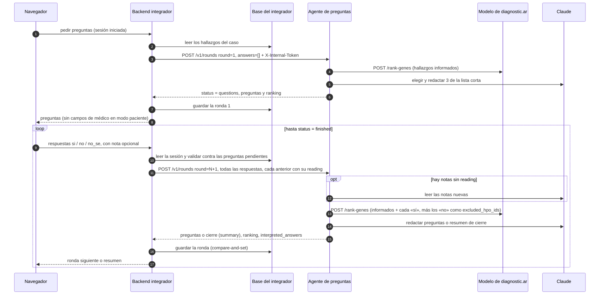

# Guía de integración del agente de preguntas

Qué es este módulo y cómo conectarlo a un sistema: de qué depende, su contrato
HTTP, qué le toca hacer al sistema que lo usa, cómo se despliega y cómo lo
resolvió diagnostic.ar. Está pensada para quien nunca lo vio y para quien
evalúa el trabajo. La arquitectura interna está en
[ARQUITECTURA.md](ARQUITECTURA.md), las decisiones en
[DECISIONES.md](DECISIONES.md) y el detalle específico de diagnostic.ar
(rutas, variables de la plataforma, staging y release) en
[INTEGRACION.md](INTEGRACION.md).

> Describe el código de la rama `feat/agente-v2` (versión `2.0.0.dev0`), que
> todavía no está desplegada en ningún entorno.

## 1. Qué es

Un servicio HTTP sin estado (Python 3.12, FastAPI, un proceso) que entra en
juego **después** de que el modelo de diagnostic.ar devolvió un ranking de genes
para los síntomas de un caso, expresados como términos HPO. En cada ronda:

1. Le pide al modelo de diagnostic.ar el ranking para los hallazgos informados
   más cada respuesta «sí» confirmada.
2. Elige, por ganancia de información esperada sobre las anotaciones HPO, los
   síntomas que mejor separan a los genes candidatos (una lista corta de 8).
3. Claude elige 3 de esa lista y los redacta como preguntas de sí/no para una
   familia (`paciente`) o para un médico (`medico`). Cada texto pasa por
   salvaguardas; si no las pasa después de un reintento, o si el LLM falla, se
   usa una plantilla y la respuesta lo avisa.
4. Devuelve las preguntas y el ranking del modelo.

Hace como mucho **3 rondas de 3 preguntas**. Cada respuesta es un botón (`si`,
`no`, `no_se`) con una nota opcional de hasta 280 caracteres. Con la
configuración por defecto ([DECISIONES.md](DECISIONES.md), D-18):

| Respuesta | Qué hace |
|---|---|
| «sí» | El síntoma se suma a lo que recibe el modelo. El ranking devuelto es el del modelo para esa consulta. |
| «no», y los negados informados antes de preguntar | Quedan registrados (`interpreted_answers`) y no se vuelven a preguntar. **No mueven el ranking.** |
| «no sé» | No cuenta como evidencia y no se vuelve a preguntar. |
| Nota | Claude la lee una sola vez. Solo puede bajar la respuesta a «no sé» (si contradice el botón o expresa duda); nunca cambia un sí por un no. |

Al cerrar (a pedido, al agotar las rondas, cuando el primer gen llega a 0,9 de
puntaje o cuando ninguna pregunta aporta) devuelve un **resumen** para llevar a
la consulta, que solo repasa qué se preguntó, qué se respondió y cómo cambió la
lista. **Nunca diagnostica ni recomienda estudios, pruebas o especialistas**
(D-16): lo piden los prompts, lo exige una salvaguarda y lo cumplen las
plantillas.

**Qué no es:**

| No es | Qué implica para quien lo integra |
|---|---|
| Un chat | No hay conversación libre. Claude redacta preguntas cerradas sobre síntomas que eligió el selector (no puede proponer otros), lee notas cortas y escribe el resumen. |
| Un diagnóstico | Ningún cierre, puntaje ni resumen es un diagnóstico, y la interfaz tiene que decirlo. |
| Un modelo de ranking | El ranking es del modelo de diagnostic.ar; por defecto el agente no reordena nada. Sin el modelo no hay rondas (503). |
| Un servicio para usuarios finales | No autentica personas (solo un token compartido entre servicios), no limita por usuario, no guarda sesiones y no tiene interfaz. Todo eso es del sistema que lo integra (sección 4). |

**Estado de la evaluación.** Con pacientes reales publicados, las preguntas no
mejoran el ranking del modelo: con la configuración por defecto el efecto es
neutro (Δ MRR −0,007, IC 95 % [−0,024; +0,010], en 251 casos retenidos) y, con
respuestas simuladas con un 10 % de errores, lo empeora (hasta −0,043)
([EVALUACION.md](EVALUACION.md), sección 11).

## 2. Dependencias

| Dependencia | Para qué | Cómo se provee | Si falta |
|---|---|---|---|
| Servicio del modelo de diagnostic.ar | El ranking de cada ronda. | `PREGUNTAS_MODEL_SERVICE_URL`. | Cada ronda responde 503 `model-unavailable`; `/healthz` dice `degraded`. |
| Base de conocimiento HPO (`kb.sqlite`, unos 32 MB) | Jerarquía, anotaciones, genes y etiquetas oficiales en español. | Se construye al armar la imagen (`/app/data/kb.sqlite`) o con `make kb`. | El proceso no arranca. |
| Credenciales de Claude | Redactar preguntas y resumen, leer notas. | Variables de entorno del proceso (2.2). | Las rondas funcionan con textos de plantilla y una advertencia; `/healthz` dice `degraded`. |
| Python ≥ 3.12 o Docker | Correr el servicio. | `make install` (solo pide `python3` en el PATH) o la imagen. | — |

### 2.1 Qué espera del modelo de diagnostic.ar

El agente no le manda credenciales al modelo. Le pide
`POST /rank-genes` con los ids ordenados y `top_k` 50:

```json
{"hpo_ids": ["HP:0002205", "HP:0004322"], "top_k": 50}
```

Desde la ronda 2, si hay «no» efectivos y `PREGUNTAS_RERANK_NEGATIONS` está
activo, agrega esos ids ordenados; sin «no» el campo no viaja:

```json
{"hpo_ids": ["HP:0002205", "HP:0004322"], "top_k": 50, "excluded_hpo_ids": ["HP:0001696"]}
```

Solo van las respuestas «no» de los botones que una nota no bajó a «no sé».
Nunca «no sé», nunca `absent_hpo_ids` (los negados del texto no están
validados) y nunca un término que también esté presente. El servicio de hoy
(`services/genphenai/app/main.py`, `RankRequest`) no declara el campo y
pydantic ignora los campos desconocidos, así que no cambia nada hasta que se
actualice ([NEGACIONES.md](NEGACIONES.md), sección 6). La llamada que arma el
resumen de cierre con los hallazgos informados nunca lleva exclusiones.

De la respuesta solo lee estos campos; el resto se ignora
(`ranking/model_client.py`):

| Campo | Tipo | Uso |
|---|---|---|
| `results[].gene_symbol` | string | El gen. Si un símbolo se repite, vale el primero. |
| `results[].score` | número | Probabilidad del modelo; sale como `model_score`. |
| `specialties` | objeto, opcional | Se devuelve tal cual. |
| `confidence` | número, opcional | Se devuelve tal cual. |
| `unknown_hpo_ids` | lista, opcional | Términos que el modelo no conoce. |
| `rerank` | string, opcional | Etiqueta del re-ranker aplicado a las exclusiones (por ejemplo `rr-v1[neg=0.5]`). Solo si viene, el agente da por hecho que los «no» movieron la lista (`genes_if_no`, resumen). |

| El modelo responde | El agente responde |
|---|---|
| 2xx con `results` | Sigue la ronda. |
| 422 con `{"detail": {"error": "no-known-hpo-ids"}}` | 422 `no-known-hpo-ids`. |
| Cualquier otro 4xx | 422 `invalid-request`, sin `detail`. |
| 5xx, error de conexión, cuerpo inutilizable o más de `PREGUNTAS_MODEL_SERVICE_TIMEOUT_S` | 503 `model-unavailable`. |

`GET /healthz` del modelo cuenta como disponible si responde 2xx en 2 s. Cada
ronda hace una llamada al modelo; la de cierre, si la consulta llevó «sí», hace
una segunda con los hallazgos informados solos (para que el resumen diga cómo
cambió la lista), y solo si al presupuesto de la ronda le alcanza.

### 2.2 Credenciales de Claude

Se leen solo del entorno del proceso, nunca de `.env`. `/healthz` informa si
están, sin validarlas (validarlas gastaría cuota).

| `PREGUNTAS_LLM_PROVIDER` | Credencial | Uso previsto |
|---|---|---|
| `claude-cli` (por defecto) | `CLAUDE_CODE_OAUTH_TOKEN` (de `claude setup-token`), `ANTHROPIC_API_KEY` o, localmente, una sesión de `claude /login`. `CLAUDE_BINARY` si `claude` no está en el PATH. | Local y staging, con una suscripción. Llama a `claude -p`; la imagen trae el CLI fijado. |
| `anthropic` | `ANTHROPIC_API_KEY`. | Producción ([DECISIONES.md](DECISIONES.md), D-12). |
| `template` | Ninguna. | Sin LLM: preguntas y resumen de plantilla, notas sin leer. Para desarrollo, pruebas y evaluación. |

### 2.3 Base de conocimiento

`make kb` descarga las fuentes fijadas (HPO v2026-02-16, la versión con la que
se entrenó el modelo, y las etiquetas oficiales en español), verifica el sha256
de cada una, construye `data/kb.sqlite` e imprime el sha256 del resultado. Si
una fuente no coincide, falla. La imagen hace lo mismo al construirse. El
servicio la abre en solo lectura, la carga entera en memoria (alrededor de un
segundo) y responde su versión como `kb1+hpo.2026-02-16`.

## 3. Contrato

Fuente de verdad: `src/diagnosticar_preguntas/api/schemas.py` (versión 2).
Ejemplo completo, validado por `tests/api/test_contract_example.py`:
[contrato/rondas-ejemplo.json](contrato/rondas-ejemplo.json). El esquema
OpenAPI está en `GET /openapi.json`.

### 3.1 `POST /v1/rounds`: pedido

Encabezados `Content-Type: application/json` y `X-Internal-Token`. Cuerpo de
hasta 64 KiB. El contrato es estricto: un campo desconocido es un 422.

| Campo | Tipo | Regla |
|---|---|---|
| `mode` | `"paciente"` \| `"medico"` | Para quién se escriben los textos de esta respuesta. Puede cambiar entre rondas sin cambiar la evidencia. |
| `round` | entero 1–4 | Ronda que se pide. La 1 va sin respuestas. Con `round` mayor que `PREGUNTAS_MAX_ROUNDS` (3) se cierra sin preguntas. El agente no lo cruza con las respuestas: numerar es tarea de quien llama. |
| `present_hpo_ids` | 1–100 ids `HP:0000000` | Hallazgos presentes informados antes de preguntar: los que recibió el modelo para el ranking original. Iguales en toda la sesión. |
| `absent_hpo_ids` | 0–100 ids, opcional | Hallazgos negados informados antes de preguntar, disjuntos con los presentes. Se registran y no se preguntan; con la configuración por defecto no mueven el ranking. |
| `answers[]` | 0–9, opcional | **Todas** las respuestas de la sesión, no solo las nuevas. Cada término una sola vez, y ninguno de `present_hpo_ids` ni `absent_hpo_ids`. |
| `answers[].hpo_id` | id | El `hpo_id` de la pregunta respondida. |
| `answers[].answer` | `"si"` \| `"no"` \| `"no_se"` | El botón. |
| `answers[].note` | texto ≤ 280, opcional | Nota libre (se recortan los espacios de los extremos). |
| `answers[].reading` | `{effective_answer, note_summary}` o `null` | La lectura que el agente ya devolvió para esa respuesta en `interpreted_answers`, copiada tal cual. `effective_answer` tiene que ser igual a `answer` o `no_se`; `note_summary`, de hasta 200 caracteres. Con `reading`, la nota no se vuelve a leer. |
| `finish` | booleano, `false` por defecto | Cerrar ahora, con o sin respuestas nuevas. |

### 3.2 Respuesta

| Campo | Contenido |
|---|---|
| `round`, `mode` | Los del pedido. |
| `status` | `"questions"` o `"finished"`. |
| `finish_reason` | `null`, o `"user_finished"` (`finish` pedido), `"max_rounds"`, `"confident"` (primer gen con puntaje ≥ 0,9) o `"no_useful_questions"`. |
| `questions[]` | Con `"questions"`, de 1 a 3; con `"finished"`, vacía. Ver la tabla siguiente. |
| `ranking[]` | Hasta 50 genes: `gene_id` (hoy igual al símbolo), `gene_symbol`, `score` (suma 1 sobre los 50), `model_score`, `model_rank`. Por defecto es el ranking del propio modelo para los hallazgos informados más cada «sí»: `model_rank` coincide con el puesto y `score` es `model_score` renormalizado. |
| `specialties`, `confidence` | Tal cual de la llamada al modelo de esta ronda (o `null`). Con la estrategia por defecto cambian a medida que llegan «sí». |
| `interpreted_answers[]` | Una por respuesta del pedido: `hpo_id`, `answer`, `effective_answer`, `note_summary`. Es lo que se reenvía como `reading`. |
| `summary` | Resumen de cierre (hasta 700 caracteres en modo paciente y 1000 en modo médico); `null` mientras haya preguntas. |
| `warnings[]` | Textos para mostrar: «Algunas preguntas se generaron sin IA.», «El resumen se generó sin IA.» o «No pudimos interpretar las notas; se usaron las respuestas tal como se marcaron.». |
| `versions` | `agent`, `knowledge_base` y `llm_model` (`null` si todo vino de plantillas). Para auditar, no para mostrar. |

| Campo de `questions[]` | Contenido |
|---|---|
| `id` | `r<ronda>-<hpo_id>`, por ejemplo `r1-HP:0001738`. |
| `hpo_id` | El término preguntado; es la clave de la respuesta. |
| `label` | Etiqueta oficial en español (en inglés si no tiene traducción). Sirve para chips como «No presenta: …». |
| `text`, `help` | La pregunta (una sola, hasta 200 caracteres) y una ayuda opcional (hasta 200). |
| `genes_if_yes` | Solo en modo médico: hasta 5 genes asociados al síntoma, que el modelo puede subir si la respuesta es «sí». En modo paciente, `null`. |
| `genes_if_no` | Solo en modo médico. Con la configuración por defecto, siempre `[]`: un «no» no mueve nada. En modo paciente, `null`. |
| `rationale` | Solo en modo médico: de qué genes candidatos es típico el síntoma, nunca qué haría un «no». En modo paciente, `null`. |

### 3.3 El ciclo que corre quien llama

El agente no recuerda nada entre pedidos: cada uno lleva la sesión entera.



1. **Ronda 1**: `round: 1`, `answers: []`, `finish: false`.
2. Si `status` es `"finished"`, se terminó: mostrar `summary` y `ranking`.
   **Puede pasar en cualquier pedido, también en el primero** (`confident` o
   `no_useful_questions`).
3. Si no, mostrar `questions` y juntar una respuesta por pregunta (`no_se` es
   la forma de saltear una).
4. **Pedido siguiente**: `round` + 1, los mismos `present_hpo_ids` y
   `absent_hpo_ids`, y en `answers` las de todas las rondas: las anteriores con
   su `reading` (copiado de `interpreted_answers` de la primera respuesta que
   las incluyó) y las nuevas sin `reading`.
5. Repetir. Con los valores por defecto, el cuarto pedido (`round: 4`, con las
   9 respuestas) cierra con `max_rounds`.
6. **Terminar antes**: el mismo pedido con `finish: true`, con o sin respuestas
   nuevas. Sin respuestas nuevas, `round` es el de la ronda pendiente y el
   cierre la reemplaza.

Cada respuesta está escrita en el `mode` de su pedido, así que una vista
«familia/médico» puede cambiar el modo de una ronda a otra; como las lecturas
se reenvían, la respuesta efectiva no cambia. Si la lectura de notas falló
(advertencia «No pudimos interpretar las notas…»), `interpreted_answers` trae
el botón tal cual y sin resumen, y al reenviarlo como `reading` esa nota ya no
se vuelve a leer.

El ciclo completo en Python, con `httpx` (en un sistema real, las respuestas y
cada ronda se guardan en la base del integrador; ver sección 4):

```python
import httpx

AGENTE = "http://127.0.0.1:8010"
TOKEN = "..."  # el valor de PREGUNTAS_SERVICE_TOKEN


def correr_sesion(presentes, ausentes, modo="paciente"):
    respuestas = []
    lecturas = {}
    ronda = 1
    with httpx.Client(base_url=AGENTE, timeout=100, headers={"X-Internal-Token": TOKEN}) as http:
        while True:
            pedido = {
                "mode": modo,
                "round": ronda,
                "present_hpo_ids": presentes,
                "absent_hpo_ids": ausentes,
                "answers": [{**r, "reading": lecturas.get(r["hpo_id"])} for r in respuestas],
                "finish": False,
            }
            http_resp = http.post("/v1/rounds", json=pedido)
            http_resp.raise_for_status()
            resultado = http_resp.json()
            for ia in resultado["interpreted_answers"]:
                lecturas.setdefault(
                    ia["hpo_id"],
                    {
                        "effective_answer": ia["effective_answer"],
                        "note_summary": ia["note_summary"],
                    },
                )
            if resultado["status"] == "finished":
                return resultado
            for pregunta in resultado["questions"]:
                boton = input(f"{pregunta['text']} [si/no/no_se] ").strip()
                nota = input("Nota (opcional): ").strip() or None
                respuestas.append({"hpo_id": pregunta["hpo_id"], "answer": boton, "note": nota})
            ronda += 1


final = correr_sesion(["HP:0002205", "HP:0004322"], ["HP:0001250"])
print(final["finish_reason"], final["summary"])
```

Con `curl`, la ronda 1 y el cierre en la ronda 2 del ejemplo del contrato:

```sh
curl -s -X POST http://127.0.0.1:8010/v1/rounds \
  -H "X-Internal-Token: $PREGUNTAS_SERVICE_TOKEN" -H 'Content-Type: application/json' \
  -d '{"mode":"paciente","round":1,"present_hpo_ids":["HP:0002205","HP:0004322"],
       "absent_hpo_ids":["HP:0001250"],"answers":[],"finish":false}'

curl -s -X POST http://127.0.0.1:8010/v1/rounds \
  -H "X-Internal-Token: $PREGUNTAS_SERVICE_TOKEN" -H 'Content-Type: application/json' \
  -d '{"mode":"paciente","round":2,"present_hpo_ids":["HP:0002205","HP:0004322"],
       "absent_hpo_ids":["HP:0001250"],"finish":true,"answers":[
         {"hpo_id":"HP:0001738","answer":"si","note":"desde bebé",
          "reading":{"effective_answer":"si","note_summary":"Desde bebé."}},
         {"hpo_id":"HP:0001696","answer":"no","note":"no, pero al hermano sí","reading":null},
         {"hpo_id":"HP:0012236","answer":"no_se","note":null,"reading":null}]}'
```

En el segundo pedido, la primera respuesta ya trae la lectura de una ronda
anterior y la segunda todavía no; la respuesta devuelve las tres en
`interpreted_answers`. Los términos preguntados dependen de lo que devuelva el
modelo: con otra versión, la ronda 1 puede preguntar otros.

### 3.4 `GET /healthz`

No pide token. Responde 200 mientras el proceso vive; un problema de
dependencias aparece en `status`, no en el código HTTP.

| Campo | Valores |
|---|---|
| `status` | `"ok"`, o `"degraded"` si el modelo no responde o faltan credenciales del LLM. |
| `agent_version` | Por ejemplo `"2.0.0.dev0"`. |
| `knowledge_base` | Por ejemplo `"kb1+hpo.2026-02-16"`. |
| `llm` | `{provider, model, credentials}`; `model` es `null` con `template` y `credentials` es `"ok"` o `"missing"`. |
| `model_service` | `"ok"` o `"unreachable"`. |

### 3.5 Errores

Los cuerpos de error son `{"error": "<código>"}` y nunca repiten datos del
pedido. Las fallas del LLM no son errores: la ronda sigue con plantillas y lo
avisa en `warnings`.

| Estado | `error` | Cuándo | ¿Reintentar? |
|---|---|---|---|
| 401 | `unauthorized` | Falta `X-Internal-Token`, es incorrecto o el servicio no tiene token configurado. | No: es configuración. |
| 413 | `payload-too-large` | Cuerpo de más de 64 KiB. | No. |
| 422 | `invalid-request` | Con `detail` (ubicación y tipo, sin valores): el cuerpo no cumple el contrato. Sin `detail`: el modelo rechazó el pedido. | No: el mismo cuerpo vuelve a fallar. |
| 422 | `no-known-hpo-ids` | El modelo no conoce ninguno de los hallazgos presentes. | No: el caso no tiene síntomas utilizables. |
| 503 | `busy` | No hay lugar en ejecución ni en la cola, o se agotó la espera. `Retry-After: 10`. | Sí, después de `Retry-After`. |
| 503 | `model-unavailable` | El modelo no respondió, respondió 5xx o algo inutilizable. `Retry-After: 10`. | Sí, después de `Retry-After`. |
| 500 | `internal-error` | Cualquier otra falla. | Como mucho una vez. |

Un timeout del lado de quien llama deja el resultado incierto: el agente pudo
haber terminado la ronda y gastado las llamadas a Claude. Ver «reenvío» en la
sección 4.

## 4. Qué tiene que hacer el sistema que lo integra

El agente resuelve la ronda; todo lo demás es del sistema que lo usa.

**Red y acceso**

- [ ] **Dejarlo en una red interna y nunca exponerlo al navegador.** Cada ronda
  gasta llamadas a Claude y el token es un secreto entre servicios. Sin
  `ports:` publicados; la red sí necesita salida a internet para llegar a
  Claude (salvo con `template`).
- [ ] **Mandar `X-Internal-Token`** con el valor de `PREGUNTAS_SERVICE_TOKEN`
  (generado, por ejemplo, con `openssl rand -hex 32`). Sin token configurado
  el agente rechaza todo con 401, salvo `PREGUNTAS_ALLOW_UNAUTHENTICATED=true`,
  que es solo para desarrollo local.
- [ ] **Autenticar a las personas y atar cada sesión a su dueño.** El agente
  no sabe quién pregunta: el sistema verifica que el caso sea de quien llama.

**Sesión**

- [ ] **Guardar la sesión**, porque el agente no guarda nada, y mandar el
  estado completo en cada ronda (sección 3.3). Guardar la respuesta entera,
  con `versions`, junto al caso.
- [ ] **Armar la evidencia en el servidor**, desde el caso guardado: los
  `present_hpo_ids` son los que recibió el modelo para el ranking original y
  los `absent_hpo_ids`, los negados que no estén también presentes. Nunca
  tomarlos del navegador.
- [ ] **Verificar que las respuestas correspondan a las preguntas pendientes.**
  El agente no recuerda qué preguntó y acepta respuestas sobre cualquier
  término.
- [ ] **Reenvío idempotente.** Repetir un pedido vuelve a correr la ronda (y a
  gastar llamadas; el texto puede salir distinto). Si se perdió la respuesta,
  devolver la ronda guardada en lugar de llamar de nuevo; ante un timeout o un
  conflicto, releer la sesión guardada antes de reenviar respuestas.
- [ ] **Validar la respuesta del agente** contra el contrato antes de guardarla
  o mostrarla (tamaño, `round` y `mode` iguales al pedido, preguntas no vacías
  con `status: "questions"`), y no reenviar sus cuerpos de error al navegador.

**Tiempos y límites**

- [ ] **Esperar lo suficiente.** El timeout de quien llama tiene que superar
  `PREGUNTAS_QUEUE_TIMEOUT_S + PREGUNTAS_ROUND_BUDGET_S +
  PREGUNTAS_MODEL_SERVICE_TIMEOUT_S` (10 + 75 + 10 = 95 s por defecto). Si no,
  se abandonan rondas que el agente termina y la cuota se gasta igual. Si se
  sube uno de esos valores, subir el timeout con él.
- [ ] **Limitar el gasto.** El agente solo acota la concurrencia (2 rondas en
  curso y 4 en espera por proceso). Los topes por usuario y globales van en el
  sistema, en un almacenamiento compartido, contando solo las rondas que
  llegan al agente y devolviendo las que rechazó sin trabajar (`busy`,
  `no-known-hpo-ids`). Respetar `Retry-After` en los 503.

**Qué mostrar**

- [ ] **Un «no» no reordena nada.** Con la configuración por defecto
  `genes_if_no` llega vacío y la interfaz no debe decir ni sugerir que un «no»
  sube o baja genes.
- [ ] **Mostrar primero la lista original del modelo**, y la lista con las
  respuestas solo a pedido. Para decir cuánto se movió un gen, comparar con la
  lista que se mostró antes de las preguntas: `model_rank` es el puesto en la
  lista nueva, no en la original.
- [ ] **Aviso visible** de que no es un diagnóstico, junto a las preguntas y
  al resumen. Mostrar `warnings` y el `summary` tal cual, sin agregarle
  recomendaciones.
- [ ] **Vista familia sin genes, porcentajes ni fundamentos.** `genes_if_yes`,
  `genes_if_no` y `rationale` solo en modo médico, y quitarlos también del lado
  del servidor en modo paciente. Una ronda escrita en modo médico que se
  muestra en la vista familia va con la etiqueta (`label`) y una formulación
  neutra, no con su `text`.

**Privacidad**

- [ ] **Nada clínico en los logs**: ni ids HPO, ni notas, ni preguntas, ni
  resúmenes, ni cuerpos del agente. El agente ya lo cumple de su lado.
- [ ] **Notas de hasta 280 caracteres**, sin bytes nulos. Las notas llegan a
  Claude: no mandar nombres ni identificadores (el agente no los necesita:
  solo ids HPO, notas cortas y genes).

## 5. Despliegue

### 5.1 Imagen

Desde este repositorio:

```sh
make docker-build        # docker build -t diagnosticar-question-agent:dev .
```

O desde diagnostic.ar-api, con el agente como contexto de build (es lo que usa
el release de la plataforma):

```sh
docker buildx build -f services/question-agent/Dockerfile \
  --build-context agent=../qa-agente-claude \
  -t diagnosticar-question-agent:dev .
```

Las dos recetas reconstruyen la base de conocimiento desde las fuentes fijadas,
instalan las dependencias exactas de `constraints.txt`, traen el CLI de Claude
fijado (versión 2.1.270, sin Node ni npm), dejan la base de
solo lectura en `/app/data/kb.sqlite`, corren como el usuario `app` (uid 10001)
y sirven en el puerto 8010 (`python -m diagnosticar_preguntas.api`). El
`Dockerfile` de este repositorio trae un `HEALTHCHECK`; el de diagnostic.ar-api
no, así que ahí va en compose. Los tests corren dentro de la imagen con el
comando que documenta el `Dockerfile`.

### 5.2 Variables de entorno

Variables `PREGUNTAS_*`, leídas del entorno o de `.env` en el directorio de
trabajo (el entorno gana; un valor vacío cuenta como no definido). Fuente:
`src/diagnosticar_preguntas/config.py`; plantilla comentada en `.env.example`.

| Variable | Por defecto | Qué controla |
|---|---|---|
| `PREGUNTAS_MODEL_SERVICE_URL` | `http://localhost:8000` | URL del modelo de diagnostic.ar. |
| `PREGUNTAS_MODEL_SERVICE_TIMEOUT_S` | `10` | Tope de cada llamada al modelo. |
| `PREGUNTAS_KB_PATH` | `data/kb.sqlite` | Base de conocimiento (en la imagen, `/app/data/kb.sqlite`). |
| `PREGUNTAS_LLM_PROVIDER` | `claude-cli` | `claude-cli`, `anthropic` o `template` (2.2). |
| `PREGUNTAS_LLM_MODEL` | `claude-opus-5` | Modelo de Claude. |
| `PREGUNTAS_LLM_TIMEOUT_S` | `60` | Tope de una llamada al LLM; nunca más de lo que le queda a la ronda. |
| `PREGUNTAS_LLM_EFFORT` | `high` | Esfuerzo para leer notas y escribir el resumen (`low`, `medium`, `high`, `xhigh`, `max`). |
| `PREGUNTAS_LLM_QUESTION_EFFORT` | `medium` | Esfuerzo para redactar preguntas, reintento incluido ([EVALUACION_ESFUERZO.md](EVALUACION_ESFUERZO.md)). |
| `PREGUNTAS_SHORTLIST_SIZE` | `8` | Síntomas candidatos que recibe Claude por ronda. |
| `PREGUNTAS_QUESTIONS_PER_ROUND` | `3` | Preguntas por ronda (1 a 3). |
| `PREGUNTAS_MAX_ROUNDS` | `3` | Rondas con preguntas (1 a 3). |
| `PREGUNTAS_CONFIDENT_THRESHOLD` | `0.9` | Cierra si el puntaje del primer gen llega a este valor. |
| `PREGUNTAS_MIN_INFORMATION_GAIN` | `0.05` | Cierra si ninguna pregunta aporta al menos estos bits. |
| `PREGUNTAS_RERANK_STRATEGY` | `model_sees_present` | Qué ve el modelo: los informados más cada «sí» (`model_sees_present`) o solo los informados (`fixed_prior`). |
| `PREGUNTAS_ANSWER_WEIGHTING` | `none` | Cómo reordena el agente después del modelo: `none` (no reordena), `asymmetric` o `calibrated` ([ARQUITECTURA.md](ARQUITECTURA.md), 4.3). |
| `PREGUNTAS_RERANK_NEGATIONS` | `true` | Manda al modelo los «no» efectivos como `excluded_hpo_ids` (2.1). Hoy el servicio lo ignora. |
| `PREGUNTAS_ANSWER_WEIGHT` | `0.3` | $k$ de `asymmetric`, en [0, 1). |
| `PREGUNTAS_ROUND_BUDGET_S` | `75` | Segundos que una ronda puede gastar en llamadas al LLM. |
| `PREGUNTAS_HOST` | `0.0.0.0` | Interfaz del servidor HTTP. |
| `PREGUNTAS_PORT` | `8010` | Puerto del servidor HTTP. |
| `PREGUNTAS_SERVICE_TOKEN` | (vacío) | Secreto esperado en `X-Internal-Token`. Vacío: toda ronda es 401. |
| `PREGUNTAS_ALLOW_UNAUTHENTICATED` | `false` | Acepta rondas sin token si no hay uno configurado. Solo desarrollo local. |
| `PREGUNTAS_MAX_CONCURRENT_ROUNDS` | `2` | Rondas en ejecución a la vez. |
| `PREGUNTAS_MAX_QUEUED_ROUNDS` | `4` | Rondas que pueden esperar lugar; más allá, 503 `busy`. |
| `PREGUNTAS_QUEUE_TIMEOUT_S` | `10` | Espera máxima por un lugar antes de 503 `busy`. |
| `PREGUNTAS_LOG_LEVEL` | `INFO` | Nivel de log. |

Fuera de `PREGUNTAS_*`, solo del entorno del proceso: `CLAUDE_CODE_OAUTH_TOKEN`,
`ANTHROPIC_API_KEY` y `CLAUDE_BINARY` (2.2).

### 5.3 Docker Compose

Un ejemplo mínimo, con el agente alcanzable solo por el backend:

```yaml
services:
  question-agent:
    image: diagnosticar-question-agent:dev
    init: true
    restart: unless-stopped
    # Sin "ports": solo lo alcanzan los servicios de la red del proyecto.
    environment:
      PREGUNTAS_MODEL_SERVICE_URL: http://model:18020
      PREGUNTAS_SERVICE_TOKEN: ${QUESTION_AGENT_TOKEN:?falta QUESTION_AGENT_TOKEN}
      PREGUNTAS_LLM_PROVIDER: anthropic
      ANTHROPIC_API_KEY: ${ANTHROPIC_API_KEY:?falta ANTHROPIC_API_KEY}
    healthcheck:
      # La imagen trae python pero no curl.
      test: ["CMD", "python", "-c", "import urllib.request; urllib.request.urlopen('http://127.0.0.1:8010/healthz', timeout=3)"]
      interval: 30s
      timeout: 5s
      retries: 3
      start_period: 20s

  backend:
    # ...
    environment:
      QUESTION_AGENT_URL: http://question-agent:8010
      QUESTION_AGENT_TOKEN: ${QUESTION_AGENT_TOKEN:?falta QUESTION_AGENT_TOKEN}
```

`model` es el servicio del modelo de diagnostic.ar en la misma red. No usar
una red `internal: true` para el agente: le cortaría la salida hacia Claude. El
healthcheck solo dice que el proceso vive (`/healthz` responde 200 aunque esté
`degraded`); para alertas, mirar el campo `status`.

### 5.4 Prueba local mínima

Con un modelo de diagnostic.ar escuchando en `http://127.0.0.1:18021` y sin
credenciales de Claude:

```sh
make install
make kb
PREGUNTAS_LLM_PROVIDER=template make run    # sirve en :8010, sin token
```

En otra terminal:

```sh
curl -s http://127.0.0.1:8010/healthz
curl -s -X POST http://127.0.0.1:8010/v1/rounds -H 'Content-Type: application/json' \
  -d '{"mode":"paciente","round":1,"present_hpo_ids":["HP:0002205","HP:0004322"],"absent_hpo_ids":["HP:0001250"],"answers":[],"finish":false}'
```

`make run` activa `PREGUNTAS_ALLOW_UNAUTHENTICATED=true`; otro modelo se elige
con `make run PREGUNTAS_MODEL_SERVICE_URL=...`. Con la imagen:

```sh
TOKEN=$(openssl rand -hex 32)
docker run -d --name question-agent --network host \
  -e PREGUNTAS_MODEL_SERVICE_URL=http://127.0.0.1:18021 \
  -e PREGUNTAS_LLM_PROVIDER=template \
  -e PREGUNTAS_SERVICE_TOKEN="$TOKEN" \
  diagnosticar-question-agent:dev
curl -s http://127.0.0.1:8010/healthz
docker rm -f question-agent
```

### 5.5 Producción

- **Proveedor**: `anthropic` con `ANTHROPIC_API_KEY` (D-12). `claude-cli` es
  para usar una suscripción en local y staging.
- **Réplicas y concurrencia**: un proceso por contenedor, con la base en
  memoria. La concurrencia la fijan `PREGUNTAS_MAX_CONCURRENT_ROUNDS` y
  `PREGUNTAS_MAX_QUEUED_ROUNDS`; con `claude-cli` cada ronda en curso lanza un
  proceso `claude`. Como no guarda estado se puede replicar, pero cada réplica
  tiene su propia cola, así que los topes de gasto tienen que vivir en el
  sistema integrador.
- **Costo y latencia**: cada ronda hace de 1 a 3 llamadas a Claude (lectura de
  notas si hay notas nuevas; preguntas o resumen, con un reintento si las
  salvaguardas rechazan el borrador), y una sesión son hasta 4 pedidos (3
  rondas con preguntas y el cierre). Una llamada de preguntas costó unos
  US$ 0,32 equivalentes por `claude -p`
  ([EVALUACION_ESFUERZO.md](EVALUACION_ESFUERZO.md), sección 5) y tarda 22,5 s
  de mediana ([EVALUACION.md](EVALUACION.md), sección 7.1). El cálculo propio
  de la ronda tarda decenas de milisegundos.
- **Monitoreo**: `/healthz` (`status`) y una línea de log por ronda con número,
  modo, estado HTTP, motivo de cierre, si hubo caída a plantilla y duración.

## 6. Integración de referencia: diagnostic.ar

diagnostic.ar integra el agente detrás de su backend Express, con la sesión en
PostgreSQL y un panel en la interfaz Next.js. El código está en el repositorio
de la plataforma, rama `integration/question-agent` (que une
`feat/question-agent-backend` y `feat/question-agent-ui`), y la receta de la
imagen en diagnostic.ar-api, `services/question-agent/Dockerfile`. Rutas,
variables, staging y release en [INTEGRACION.md](INTEGRACION.md).

| Responsabilidad (sección 4) | Dónde | Cómo |
|---|---|---|
| Red interna | `docker-compose.yml`, servicio `question-agent` | Sin puertos publicados, detrás del perfil `question-agent`; el navegador solo llama a `/api/questions/*`. |
| Token interno | `backend/src/services/questionAgentClient.ts`, `backend/src/config.ts` | `X-Internal-Token` desde `QUESTION_AGENT_TOKEN`, obligatorio y de 32 caracteres o más en producción; compose lo pasa también como `PREGUNTAS_SERVICE_TOKEN`. |
| Autenticación y dueño | `backend/src/routes/questions.ts`, `backend/src/repositories/diagnosisRepository.ts` | Sesión iniciada en todas las rutas; `getQuestionContext` filtra el diagnóstico por `user_id`. |
| Evidencia desde el servidor | `backend/src/services/questionSession.ts` | `deriveEvidence`: presentes = `symptoms_extracted`; ausentes = negados de `phenotypes` que no estén presentes. |
| Sesión y estado completo | `backend/src/services/questionSession.ts`, `backend/src/repositories/diagnosisRepository.ts` | `planRound` numera la ronda, reenvía todas las respuestas con su lectura y exige que cubran las preguntas pendientes; `saveQuestionSession` guarda en `diagnoses.preguntas_respuestas` con compare-and-set. |
| Reenvío idempotente | `backend/src/services/questionSession.ts`, `frontend/src/lib/question-session.ts` | `isResend` y la ronda pendiente sin respuestas se devuelven desde la base sin llamar al agente; la interfaz relee la sesión guardada tras un timeout o un conflicto. |
| Validación y errores | `backend/src/services/questionAgentClient.ts`, `backend/src/routes/questions.ts` | Respuesta validada con zod y con tope de tamaño; errores traducidos a códigos propios (`FAILURES`), sin reenviar el cuerpo del agente. |
| Tiempos | `backend/src/config.ts`, `frontend/src/lib/question-session.ts` | Express espera 100 s (`QUESTION_AGENT_TIMEOUT_MS`); la interfaz, 110 s (`ROUND_TIMEOUT_MS`), para que el 504 del backend llegue antes. |
| Límites de gasto | `backend/src/repositories/questionRoundRepository.ts`, `backend/src/routes/questions.ts` | 20 rondas por hora por cuenta y 50 cada 5 horas para toda la plataforma, contadas en PostgreSQL bajo un advisory lock; se devuelven si el agente contestó `busy` o `no-known-hpo-ids`. Además, 60 `POST` y 120 `GET` por minuto y una ronda en curso por cuenta. |
| Un «no» no reordena | `frontend/src/app/nuevo/question-row.tsx` | La capa médica muestra solo `genesIfYes`, con la leyenda "Un «Sí» se suma a los síntomas que usa el modelo." |
| Lista original y movimientos | `frontend/src/app/nuevo/list-toggle.tsx`, `frontend/src/lib/question-insights.ts` | «Original» por defecto y «Con tus respuestas» a pedido; `originsIn` y `listChanges` comparan con la lista mostrada antes, nunca con `modelRank`. |
| Aviso de no diagnóstico | `frontend/src/lib/disclaimer.ts`, `frontend/src/app/nuevo/question-panel.tsx` | `RESULTS_DISCLAIMER`, siempre visible en el encabezado del panel. |
| Vista familia | `backend/src/services/questionSession.ts`, `frontend/src/lib/questions-api.ts`, `frontend/src/app/nuevo/question-row.tsx` | `toBrowserQuestion` quita los campos de médico en modo paciente; `questionWording` muestra una ronda escrita en modo médico con su etiqueta; la capa médica solo aparece con la vista profesional. |
| Privacidad | `backend/src/routes/questions.ts` | Notas de hasta 280 caracteres sin bytes nulos; los logs llevan solo clase y mensaje del error. |
| Cliente y panel | `frontend/src/lib/questions-api.ts`, `frontend/src/app/nuevo/question-dock.tsx` | Cliente tipado de `/api/questions` con mensajes propios por código; panel lateral, cajón u hoja según el ancho, que nunca se abre solo. |

## 7. Checklist final para integrar

- [ ] El servicio del modelo de diagnostic.ar responde `POST /rank-genes` y
  `GET /healthz` con la forma de la sección 2.1.
- [ ] La imagen se construye y `GET /healthz` dice `status: "ok"`.
- [ ] `PREGUNTAS_SERVICE_TOKEN` configurado, y `PREGUNTAS_ALLOW_UNAUTHENTICATED`
  en `false`.
- [ ] Proveedor y credenciales de Claude elegidos (`anthropic` en producción);
  `/healthz` muestra `credentials: "ok"`.
- [ ] El agente no tiene puertos publicados y solo el backend lo alcanza.
- [ ] Las personas están autenticadas y cada sesión está atada a su caso y a
  su dueño.
- [ ] La evidencia sale del caso guardado, no del navegador.
- [ ] La sesión se guarda en el sistema y cada pedido lleva todas las
  respuestas, con su `reading`.
- [ ] Las respuestas se validan contra las preguntas pendientes y la numeración
  de `round` es consecutiva.
- [ ] Una respuesta perdida o repetida se devuelve desde la base, sin volver a
  llamar al agente.
- [ ] El timeout de quien llama supera cola + presupuesto + modelo (95 s por
  defecto).
- [ ] Hay topes de rondas por usuario y globales, y se respeta `Retry-After`.
- [ ] Se maneja `status: "finished"` desde la primera ronda.
- [ ] La interfaz muestra el aviso de no diagnóstico, la lista original por
  defecto, ningún efecto de un «no» y ningún campo de médico en la vista
  familia.
- [ ] Ningún log del sistema guarda ids HPO, notas, preguntas ni resúmenes.
