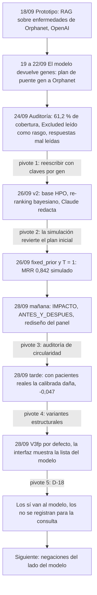

# Cómo se desarrolló el agente de preguntas: camino, pivotes y hallazgos

Relato cronológico del agente de preguntas de seguimiento de diagnostic.ar,
desde el prototipo de Mariano Brizuela hasta la decisión de que las respuestas
solo alimenten al modelo, con los hallazgos de cada etapa y lo que dejaron como
lección. Está escrito para quienes evalúan el Trabajo Profesional (FIUBA) y
para el equipo.

**Fuentes.** Las fechas y horas son las de los commits (hora de Argentina,
−03:00) de este repositorio (rama `feat/agente-v2`), de la plataforma
(`diagnostic.ar`, ramas `feat/question-agent-backend`, `feat/question-agent-ui`
e `integration/question-agent`) y de `diagnostic.ar-api` (rama
`feat/question-agent-service`). Las cifras salen de los documentos de `docs/`,
que dicen de qué corrida sale cada una. `docs/QUESTION_PANEL_DESIGN.md` de la
plataforma (rama `feat/question-agent-ui`) fecha el 29/09 algunas decisiones
que los commits registran el 28/09 por la noche; acá manda la fecha del commit.

## Resumen

- **Cinco pivotes en once días**: de un RAG sobre enfermedades de Orphanet a
  claves por gen; del plan inicial (mandar los «sí» al modelo, temperatura 3) a
  `fixed_prior` y T = 1; de la mejora simulada (+0,054 de MRR) a medir con
  pacientes reales (−0,047); a una ponderación que no daña (V3fp); y, por
  último, a que las respuestas «sí» solo alimenten al modelo y los «no» se
  registren (D-18).
- **Lo que funcionó y se mantiene**: la selección de preguntas por ganancia de
  información, la redacción con Claude dentro de salvaguardas en código, los
  botones con nota que solo puede bajar a «no sé», el agente sin estado detrás
  de Express y la base HPO fijada por sha256.
- **Lo que no funcionó**: reordenar los genes con las respuestas usando las
  anotaciones HPO. Con 501 pacientes reales publicados ninguna de las formas
  probadas mejora al modelo ([EVALUACION.md](EVALUACION.md) §11).
- **La línea abierta**: que el modelo use lo que se descarta
  ([NEGACIONES.md](NEGACIONES.md)).

## 1. Línea de tiempo

### 18/09/2026 — El prototipo

| Hora | Commit | Autor | Qué |
|---|---|---|---|
| 12:35 | 0a39103 | Mariano Brizuela | Crea el repositorio. |
| 19:32 | c2e3548 | Mariano Brizuela | «mecanismo/agente de repreguntas»: 37 archivos, 2742 líneas. |

Un sistema RAG en FastAPI (puerto 8010): indexaba en Chroma, con embeddings de
OpenAI (`text-embedding-3-large`), las enfermedades de Orphadata
(`en_product4.xml`: 3883 enfermedades con al menos 8 fenotipos, 68 573
fenotipos indexados), y `gpt-4o-mini` proponía preguntas trazables y un
diagnóstico diferencial con una certeza de 0 a 100. Las candidatas se
identificaban por código de Orphanet. Traía 27 tests, scripts de PowerShell y
reglas clínicas cuidadosas en sus prompts
([ANTES_Y_DESPUES.md](ANTES_Y_DESPUES.md) §2).

### 19 a 22/09 — Primera mirada desde la plataforma

El plan de integración de la plataforma (`docs/INTEGRATION_PLAN.md`, «Locked
2026-09-19», y `docs/MODULES_OVERVIEW.md` §2, incorporados en el commit
bbd1c10 del 22/09) encontró el desajuste que bloqueaba todo:

- `POST /sessions` del prototipo espera `top_candidates` con `orpha_code`, y
  `/rank-genes` devuelve **símbolos de genes**. No había códigos de Orphanet
  para mandarle.
- Opciones, en orden: puentear gen → enfermedad de Orphanet con
  `en_product6.xml` (la recomendada para medir primero), re-indexar por
  términos HPO, o usar solo el relato e ignorar el ranking del modelo.
- Además: `pytest` fallaba al recolectar sin instalar dependencias
  (`No module named 'langchain_core'`), las herramientas eran solo de Windows,
  había dependencia dura de OpenAI (también para embeddings) y `data/` era
  grande y con archivos que el agente nunca leía.

El 21/09 se escribió el brief de trabajo del módulo con el mismo plan: medir
primero el puente a Orphanet.

### 24/09/2026 — Auditoría completa del prototipo

Código, datos, tests y encaje con la plataforma, antes de escribir una línea de
integración ([DECISIONES.md](DECISIONES.md) D-01;
[ANTES_Y_DESPUES.md](ANTES_Y_DESPUES.md) §3, re-verificado el 28/09 con
`eval/prototipo/`):

| Hallazgo | Evidencia | Fuente |
|---|---|---|
| Claves por enfermedad de Orphanet | El puente gen → Orphanet alcanza el 61,2 % de los genes del modelo; las claves por gen del HPO, el 97,8 % (97,5 % con la base de hoy) | D-01; ANTES_Y_DESPUES §3.1, §6.4 |
| «Excluded (0%)» indexado como rasgo | 306 términos excluidos en 150 enfermedades; 26, de 13 enfermedades, aparecen como sugerencia de pregunta | ANTES_Y_DESPUES §3.2 |
| Intérprete de respuestas en texto libre | «Sí» y «No» sueltos quedan como desconocidos; 5 de 14 respuestas cortas bien leídas; hasta 4 inversiones sí ↔ no en 24 notas | ANTES_Y_DESPUES §3.3, §6.2, §6.3 |
| La certeza la estimaba el LLM | Topes fijos de 70 / 50 / 40; sin respuestas confirmadas, no pasa de 50 | ANTES_Y_DESPUES §3.4 |
| Salida con `diagnostico_principal` | Una enfermedad como resultado, contra la regla de no diagnosticar | ANTES_Y_DESPUES §3.6 |
| Sesiones en memoria y sin autenticación | `POST /sessions` guardaba la sesión antes de evaluarla: un 500 la dejaba guardada; el relato (hasta 12 000 caracteres) iba a OpenAI en cada evaluación | ANTES_Y_DESPUES §3.7 |
| Tests | 27; pasan tras instalar dependencias sin versión, pero no cubren LLM, recuperación ni API | ANTES_Y_DESPUES §3.8 |
| Datos | `data/` de 78 archivos y 2,2 GB fuera de git; `en_product1.xml` es idéntico byte a byte a `en_product6.xml`, y `en_product2.xml` a `en_product3.xml` | ANTES_Y_DESPUES §2.3, §3.8 |

**Decisión**: reescribir en el mismo repositorio, porque el trabajo de cada
integrante se acredita en los repositorios de los módulos que creó (D-01,
D-15), y conservar y acreditar lo que seguía siendo válido: reglas clínicas,
esquema de pregunta trazable, condiciones de corte
([CREDITOS.md](CREDITOS.md)).

Ese mismo día, del lado de la plataforma, se probó el extractor de texto libre
contra staging: nunca marca una negación («no presenta convulsiones» vuelve
como presente en 12 de 12 frases; `docs/SYMPTOM_INPUT_DESIGN.md` de la
plataforma). Es el origen del problema que retoma
[NEGACIONES.md](NEGACIONES.md).

### 26/09/2026 — Diseño y construcción en paralelo

Decisiones de diseño con Mate, todas registradas en
[DECISIONES.md](DECISIONES.md):

| Id | Decisión |
|---|---|
| D-02, D-03 | Claves por gen sobre las anotaciones HPO; hipótesis por par gen–enfermedad. |
| D-04 | Selección híbrida: ganancia de información arma una lista corta de 8; Claude elige 3 y redacta. |
| D-05 | Rondas de 3 preguntas, como mucho 3 rondas. |
| D-06 | Botones sí / no / no sé; la nota solo puede bajar la respuesta a «no sé». |
| D-07, D-09 | Agente sin estado detrás de Express; sesión en `diagnoses.preguntas_respuestas`. |
| D-08 | Base de conocimiento propia, fijada por sha256. |
| D-10 | Pacientes y médicos («Ver detalle médico»), con modo por ronda. |
| D-12, D-13, D-14 | `claude-cli` en local y staging, API en producción; prompt por stdin; presupuesto de tiempo por ronda. |

Las tres piezas se construyeron en paralelo:

| Hora | Repositorio | Commit | Qué |
|---|---|---|---|
| 10:23 | agente | 188b83c | Esqueleto limpio y contrato de `POST /v1/rounds`. |
| 10:24 | agente | 3ecd86f | Marca los síntomas que solo revela un estudio. |
| 10:42 | plataforma, backend | 496223d | Proxy en Express; la sesión vive con el diagnóstico. |
| 10:46 | plataforma, interfaz | 9937e8d | Panel de preguntas para familias y médicos. |
| 10:53 | agente | c662a10 | Base HPO fijada, re-ranking bayesiano y selector por ganancia de información. |
| 10:53 | agente | b8e50db | Capa LLM dentro de salvaguardas, con reintento y plantillas. |
| 11:22 | agente | 2a9c2e5 | Servicio HTTP con token, imagen sin root; el prompt va por stdin. |
| 11:29 | agente | ea4b766 | Evaluación con 500 pacientes simulados contra el modelo real, y prueba en vivo. |
| 11:47 | plataforma, backend | e01eb12 | Contrato v2; rondas que se pueden reenviar sin gastar otra. |
| 12:01 | plataforma, interfaz | 788b980 | Recupera rondas perdidas; sigue el modo de la vista en cada ronda. |
| 12:05 | agente | 4b93a36 | Valores evaluados por defecto; rondas endurecidas para el contrato v2. |
| 12:17 | plataforma, backend e interfaz | a11acce, 22d3778 | Códigos de error legibles por máquina, y la interfaz ramifica por código. |
| 12:20 | agente | 02f7b14 | Documentación en español y créditos del prototipo. |
| 12:28 | plataforma, backend | 74c9b33 | Quita el fundamento en modo paciente; corrige la aritmética de tiempos. |

Lo que se aprendió ese día:

- **La evaluación revirtió el plan inicial.** Con la configuración de partida
  (los «sí» al modelo, T = 3) las preguntas no ayudaban en la simulación: Δ MRR
  −0,029 [−0,063; +0,006], y −0,112 con el respondedor pesimista. Con
  `fixed_prior` y T = 1, elegidos en el conjunto de ajuste, en PRUEBA: MRR
  0,787 → 0,842 (+0,054 [+0,033; +0,078]) y top-1 72,0 % → 79,3 %
  ([EVALUACION.md](EVALUACION.md) §5, §6; D-11).
- **Claude en vivo**: 12 de 12 rondas aceptadas al primer intento, 36 preguntas
  sin violaciones, 24 notas sin invertir ninguna respuesta; mediana de 22,5 s
  por llamada de preguntas. La persona gramatical se mezclaba en modo paciente y
  los prompts se reescribieron con una forma impersonal
  ([EVALUACION.md](EVALUACION.md) §7).
- **Pasada «contrato v2»**, después de revisar el código de las tres piezas:
  salvaguardas contra nombres de enfermedades, símbolos de genes y porcentajes
  en texto para pacientes; ningún texto clínico en los logs; presupuesto de 75 s
  por ronda; token obligatorio; reenvío de una respuesta perdida desde la base
  sin volver a llamar al agente; modo por ronda; códigos de error (4b93a36,
  e01eb12, 788b980, a11acce, 22d3778).
- **Prueba real de punta a punta** en la máquina de desarrollo: navegador →
  Express → agente → modelo → Claude.

### 28/09/2026, mañana — Documentación y experiencia de uso

| Hora | Repositorio | Commit | Qué |
|---|---|---|---|
| 13:22 | agente | 36aa3db | [IMPACTO.md](IMPACTO.md): cada mejora simulada en términos absolutos y relativos, con `eval/impact.py`. |
| 13:22 | agente | 89ff204 | [ANTES_Y_DESPUES.md](ANTES_Y_DESPUES.md) y `eval/prototipo/`, que corre el intérprete del prototipo desde la historia de git. |
| 13:22 | agente | 51a2fa0 | El resumen para familias deja de sugerir que hay algo que confirmar. |
| 14:31 | plataforma, interfaz | 2602f4a | Diseño del panel desde una auditoría de 146 capturas (escritorio y celular, las dos vistas, todos los estados). |
| 14:31 | plataforma, interfaz | 51221bb | Panel por pasos; corrige un P0: `main` con `overflow-hidden` dejaba el encabezado de resultados 224 px fuera de la pantalla en celular. |

La metáfora de chat se descartó porque sugiere una consulta con un agente
clínico, y el ranking en vivo se postergó porque, para una familia, corona al
primer gen (`docs/QUESTION_PANEL_DESIGN.md` de la plataforma, §1 y §3).

### 28/09/2026, tarde — La revisión de Mate y la auditoría

Mate revisó el trabajo y pidió lo siguiente; esto es lo que salió de cada pedido:

| Pedido | Resultado | Commits |
|---|---|---|
| Auditar el 0,84 | Auditoría de circularidad y evaluación con pacientes reales (abajo) | 5756ddd (20:03) |
| Medir el esfuerzo del LLM antes de elegir | Regla registrada antes de correr; `medium` para redactar preguntas (−24,1 % de mediana), `high` para notas y resumen ([EVALUACION_ESFUERZO.md](EVALUACION_ESFUERZO.md) §4) | 170e5bb, 11036b4 (19:46) |
| Nunca recomendar estudios | El resumen solo repasa lo preguntado y respondido, con salvaguarda en los dos modos (D-16) | 7173342 (19:06) |
| Sacar las preguntas de la grilla | Panel lateral: acoplado, cajón u hoja inferior según el ancho | 73c9b87 (19:49) |
| Topes de gasto durables | 20 rondas por hora por cuenta y 50 cada 5 horas para todo el despliegue, contados en PostgreSQL | 77b0abc (19:08) |
| Desplegar como el reconocedor | La imagen se construye desde `diagnostic.ar-api` | 9e8b2d2 (19:11), 8be473d y 65f901d (19:21) |
| Publicar en el repositorio de Mariano | Rama `feat/agente-v2` en `MarBL00126/diagnosticar-question-agent`; su `main` no se toca | — |
| Integrar solo en ramas internas | `integration/question-agent` fija el commit del agente y el de `diagnostic.ar-api` | d2cf780 (20:29) |

También se fijaron las dependencias de ejecución (`constraints.txt`, 43e4a0d,
19:21).

**La auditoría** ([EVALUACION.md](EVALUACION.md) §11) cambió la lectura de
todo lo anterior:

- El 0,842 no era sobreajuste a los casos de prueba (las particiones no
  comparten genes ni enfermedades), sino **optimismo del simulador**: los
  pacientes salían de las mismas anotaciones y del mismo noisy-OR con los que
  el agente interpreta las respuestas (§11.2, §11.7).
- Con 501 pacientes reales de phenopacket-store, sin el artículo de cada uno en
  la base, la ponderación calibrada **empeoraba** el ranking: top-1 43,1 % →
  37,5 %, MRR 0,508 → 0,461 (Δ −0,047 [−0,065; −0,029]). También empeoraba con
  anotaciones retenidas (−0,041) y con fuentes cruzadas (−0,055 y −0,095)
  (§11.3 a §11.5).
- Ninguna de 44 configuraciones de parámetros y ninguna de nueve variantes
  estructurales mejora a los pacientes reales; la menos dañina, V3fp, queda
  neutra: −0,001 [−0,009; +0,007] en los retenidos (§11.6, §11.8).

Consecuencias esa misma noche: V3fp pasó a ser la ponderación por defecto
(94a4bf9, 20:28; D-17), y la interfaz pasó a mostrar por defecto la lista del
modelo, con «Con tus respuestas» como vista opcional (21dffa3, 20:20).

### 28/09/2026 — Decisión final: las respuestas solo alimentan al modelo

Con la evidencia de que ninguna ponderación mejora al modelo, Mate decidió
(D-18) que el agente solo sume los «sí» efectivos a la consulta del modelo y
muestre el ranking del propio modelo. Los «no» y los hallazgos negados quedan
registrados para la consulta y no mueven ninguna lista; hacer que el modelo use
lo descartado es la línea siguiente. Detalle, cifras y traspaso en
[NEGACIONES.md](NEGACIONES.md).

## 2. Hallazgos

### Evaluación

| Hallazgo | Cifra | Dónde |
|---|---|---|
| La simulación era circular | +0,054 solo cuando paciente y agente comparten la fuente; +0,054 y +0,055 en los controles de C | [EVALUACION.md](EVALUACION.md) §11.2 (a), §11.5 |
| No era sobreajuste a PRUEBA | 0 genes y 0 enfermedades compartidos; el ajuste terminó antes de la primera corrida de prueba | §11.2 (f) |
| La configuración inicial ya dañaba en la simulación | −0,029; −0,112 con el respondedor pesimista | §6.2, §6.4 |
| La temperatura era el parámetro dominante | T = 1 es un óptimo interior (0,831 contra 0,815 con T = 0,5 y 0,816 con T = 1,5) | §5 |
| Con pacientes reales, la calibrada daña | Δ MRR −0,047; el gen correcto baja en el 17,6 % de los casos | §11.3 |
| HPO deriva anotaciones de los mismos artículos | Cita el artículo del paciente en 366 de 501 casos (73 %); con él en la base, +0,014 | §11.2 (g) |
| Los artículos describen pocos rasgos | 82 % de «no sé» (2335 de 2850 respuestas) | §11.3 |
| No es un problema de parámetros | 44 configuraciones: la mejor, +0,005 sobre los 501 | §11.6 |
| La forma del cálculo tampoco alcanza | La mejor de nueve variantes queda en −0,001 | §11.8, §11.10 |
| Mandarle al modelo los «sí» verdaderos no mueve el MRR | V1 en los 501: −0,000 [−0,012; +0,011] | [NEGACIONES.md](NEGACIONES.md) §2.6 |
| Una regla fijada de antemano habría elegido mal | La mayor MRR en la mitad de selección es V4, que daña en B y C | §11.8 |
| Validar con casos de la plataforma requiere muchos casos | Del orden de 103 casos confirmados para +0,054; de 1214 para +0,018 | [IMPACTO.md](IMPACTO.md) §10 |

### Modelo de diagnostic.ar

| Hallazgo | Cifra | Dónde |
|---|---|---|
| Fuera de su terreno con pacientes reales | top-1 72,0 % simulado contra 43,1 % real; top-50 98,7 % contra 77,0 % | [EVALUACION.md](EVALUACION.md) §11.2 (c) |
| Entrenado solo con pacientes sintéticos de las anotaciones HPO | Según su preprint | §11.2 (c), §11.3 |
| También se beneficia del artículo del paciente | top-1 50,5 % con el artículo citado contra 23,0 % sin él | §11.2 (g) |
| Solo recibe hallazgos presentes | `POST /rank-genes` con `hpo_ids` y `top_k` | [NEGACIONES.md](NEGACIONES.md) §1 |
| Rápido | 10 ms de mediana por llamada (p90 12 ms) | §6.5 |
| Vocabulario | 5229 genes; 5128 están en la base del agente; al menos una entrada no es un gen (`-`) | §2; [IMPACTO.md](IMPACTO.md) §9 |

### Datos y base de conocimiento

| Hallazgo | Cifra | Dónde |
|---|---|---|
| Las claves por gen cubren casi todo el modelo | 97,5 % de los genes con al menos una enfermedad anotada, contra 61,2 % del puente a Orphanet | [ANTES_Y_DESPUES.md](ANTES_Y_DESPUES.md) §6.4 |
| Una exclusión leída como rasgo empuja al revés | 306 términos «Excluded (0%)» indexados como fenotipos | ANTES_Y_DESPUES §3.2 |
| La recuperación por fragmentos perdía contexto | En 2416 enfermedades el primer fragmento es solo el encabezado | ANTES_Y_DESPUES §3.5 |
| Perfiles de gen fusionados empeoran | Por eso las hipótesis son pares gen–enfermedad | [DECISIONES.md](DECISIONES.md) D-03 |
| La base es reproducible | 5 fuentes fijadas por sha256; unos 32 MB; idéntica byte a byte con la misma versión de SQLite | [ARQUITECTURA.md](ARQUITECTURA.md) §3; D-08 |
| Las negaciones son escasas en las anotaciones y abundantes en los pacientes | 720 filas `NOT` de 264 965 (0,27 %), todas de Orphanet; 59,1 % de los rasgos de phenopacket-store son excluidos | [NEGACIONES.md](NEGACIONES.md) §3.2 |

### LLM y redacción

| Hallazgo | Cifra | Dónde |
|---|---|---|
| En vivo, las salvaguardas no tuvieron que rechazar nada | 12 de 12 rondas al primer intento; 36 preguntas sin violaciones | [EVALUACION.md](EVALUACION.md) §7.1 |
| El criterio de Claude no cuesta información | Conserva el 100,3 % de la ganancia de la selección pura (mínimo 87,7 %) | §7.1 |
| El prompt no decía quién responde | Mezcla de persona gramatical, corregida con forma impersonal | §7.1, §7.3 |
| Una nota nunca invierte una respuesta | 24 notas, 0 inversiones; el intento de inyección no cambió nada | §7.2; D-06 |
| El LLM es el cuello de botella | 22,5 s de mediana; 47 y 50 s tras reescribir los prompts; de ahí 60 s por llamada y 75 s por ronda | §7.3; D-14 |
| El esfuerzo conviene por tarea | `medium` baja la mediana de preguntas de 23,7 a 18,0 s sin perder calidad; en notas y resumen rinde peor | [EVALUACION_ESFUERZO.md](EVALUACION_ESFUERZO.md) §3, §4 |
| El juez ciego tiene sesgo de posición | En los resúmenes eligió la versión A las 5 veces | EVALUACION_ESFUERZO §3.4 |
| Un error de alcance es del prompt, no del esfuerzo | «Micrognatia» preguntada como mentón «más hacia atrás» (retrognatia) en los dos esfuerzos | EVALUACION_ESFUERZO §3.4 |
| El resumen recomendaba estudios | «considerar estudio genómico amplio (exoma o panel de neurodesarrollo/epilepsia) junto con EEG y RM de cerebro»; nadie del equipo es médico para validarlo | D-16 |

### Seguridad y privacidad

| Hallazgo | Dónde |
|---|---|
| El prototipo guardaba sesiones en memoria, sin autenticación, y mandaba el relato a OpenAI en cada evaluación | [ANTES_Y_DESPUES.md](ANTES_Y_DESPUES.md) §3.7 |
| Los argumentos de un proceso se leen en `/proc/<pid>/cmdline`: el prompt va por stdin | [DECISIONES.md](DECISIONES.md) D-13 |
| Ningún log lleva datos clínicos, y lo fijan tests | [ARQUITECTURA.md](ARQUITECTURA.md) §10 |
| El token falla cerrado; cuerpo de hasta 64 KiB; 2 rondas a la vez y 4 en espera | ARQUITECTURA §11 |
| La evidencia se arma desde el diagnóstico guardado, nunca desde el navegador | [INTEGRACION.md](INTEGRACION.md) §2 |
| Cada ronda gasta cuota: topes de 20 por hora por cuenta y 50 cada 5 horas en total, durables | `docs/INTEGRATION_PLAN.md` de la plataforma, rama `feat/question-agent-backend` («Status — 2026-09-26»); 77b0abc |
| El extractor no detecta negaciones: una negación puede llegar como hallazgo presente | [NEGACIONES.md](NEGACIONES.md) §1 |

### Experiencia de uso

| Hallazgo | Dónde (`docs/QUESTION_PANEL_DESIGN.md` de la plataforma) |
|---|---|
| Un P0 escondía el encabezado de resultados al empezar las preguntas | §3 |
| El chat sugiere una consulta clínica; el ranking en vivo corona al primer gen | §1 |
| Responder «no» no es malo: estado neutro para las tres opciones, nada de rojo | §2.2, §4 |
| En celular, las preguntas quedaban a 6 pantallas: panel lateral con lanzador | §2.8, §5 |
| La lista del modelo es la lista; la de las respuestas se pide y es orientativa | §5.8 |
| Los «No» se muestran como «No presenta…» y quedan registrados para la consulta | §2.9, §5.9 |

### Ingeniería y operación

| Hallazgo | Dónde |
|---|---|
| Sin estado en el agente: reiniciarlo no pierde nada; Express guarda con compare-and-set | D-07, D-09 |
| Una respuesta perdida se repite desde la base sin gastar otra ronda | [INTEGRACION.md](INTEGRACION.md) §2 |
| Invariante de tiempos: 10 + 75 + 10 = 95 s < 100 s de la plataforma | [ARQUITECTURA.md](ARQUITECTURA.md) §8 |
| Dos builds del mismo commit instalan lo mismo (`constraints.txt`) | [README](../README.md), «Imagen» |
| 27 tests en el prototipo; 502 en la versión 2 (commit 4b93a36) | [IMPACTO.md](IMPACTO.md) §9 |
| El cálculo propio tarda 60 ms por ronda; una llamada de preguntas, unos 22 s | [EVALUACION.md](EVALUACION.md) §6.5; IMPACTO §8 |
| La caché del modelo del arnés no distingue versiones del modelo | [NEGACIONES.md](NEGACIONES.md) §4.2 |

## 3. Lecciones

1. **Una simulación que sale de la misma fuente que el agente mide el acuerdo
   entre dos copias de un mismo supuesto.** El +0,054 era real dentro de ese
   mundo y desapareció apenas el paciente salió de otra descripción de la
   enfermedad ([EVALUACION.md](EVALUACION.md) §11.7).
2. **Validar con casos reales temprano.** phenopacket-store estaba publicado y
   se podía fijar por sha256. Medirlo el 26/09 habría evitado elegir
   `fixed_prior` en el simulador, una elección que con pacientes reales se
   invierte (§11.6).
3. **Registrar la regla de decisión antes de mirar, y que mire todos los
   escenarios.** La medición de esfuerzo lo hizo y su resultado no admite
   discusión ([EVALUACION_ESFUERZO.md](EVALUACION_ESFUERZO.md) §2). En las
   variantes estructurales, la regla fijada miraba solo la mitad de selección de
   A y habría elegido V4, que daña en B y en C; la variante adoptada se eligió
   después de ver todo y necesita un conjunto nuevo para confirmarse (§11.8).
4. **El LLM, fuera de la cuenta del ranking.** Como la elección de síntomas y
   el re-ranking no dependen de Claude, se pudieron evaluar sin gastar cuota, y
   el problema resultó estar en las anotaciones, no en el LLM (D-04;
   [ANTES_Y_DESPUES.md](ANTES_Y_DESPUES.md) §8).
5. **Salvaguardas en el código, no en el prompt.** Que una nota nunca invierta
   una respuesta, que un «no» nunca favorezca a un gen que tiene el síntoma y
   que el resumen no recomiende estudios lo garantiza el código, con tests
   (D-06, D-16; [ARQUITECTURA.md](ARQUITECTURA.md) §4.5).
6. **Medir el esfuerzo antes de elegirlo, y por tarea.** El mismo cambio que
   acelera un 24 % las preguntas empeora las notas y el resumen.
7. **Acordar primero el contrato con el módulo vecino.** Pasó dos veces: el
   prototipo esperaba enfermedades de Orphanet y el modelo devuelve genes; el
   agente recoge negaciones y el modelo solo acepta presentes.
8. **Que no se mencione no significa que no esté.** «Excluded (0%)», `NOT` y el
   silencio de una anotación o de un artículo son tres cosas distintas; tratar
   el silencio como evidencia fue lo que dañó a los pacientes reales.
9. **Mostrar por defecto lo que está validado.** La interfaz abre en la lista
   del modelo, y lo que no mostró mejora es opcional y lo dice.

## 4. Qué sigue

| Tema | Qué hace falta | Dónde está descrito |
|---|---|---|
| Negaciones en el modelo | Que el modelo acepte y use hallazgos ausentes; datos, arnés y vara a superar | [NEGACIONES.md](NEGACIONES.md) §4 |
| Extractor de negaciones | Que `/extract-hpo` marque `negated`; es un problema de seguridad | `docs/SYMPTOM_INPUT_DESIGN.md` de la plataforma |
| Confirmación independiente | Genes o casos de una release posterior de phenopacket-store | [EVALUACION.md](EVALUACION.md) §11.8 |
| Selección de preguntas | Revisar la ganancia de información ahora que un «no» no mueve la lista | [NEGACIONES.md](NEGACIONES.md) §4.5 |
| Revisión médica | Preguntas y resúmenes, con `eval/results/effort/textos.md` | EVALUACION §9; [EVALUACION_ESFUERZO.md](EVALUACION_ESFUERZO.md) §5 |
| Prompt | Fidelidad de términos como micrognatia | EVALUACION_ESFUERZO §3.4 |
| Latencia | Medir la cola de Claude con más llamadas | EVALUACION §7.3 |
| Staging | Clave de despliegue, release, token y credenciales, con el visto bueno de Mate; y mover el commit fijado en `integration/question-agent` (`.github/question-agent.env`, hoy 94a4bf9, anterior a D-18) | [INTEGRACION.md](INTEGRACION.md) §5 |
| Producción | Proveedor `anthropic` y el servicio en el compose de producción | INTEGRACION §5; D-12 |
| Validación clínica | Casos con diagnóstico genético confirmado y consentimiento | [IMPACTO.md](IMPACTO.md) §10 |

## Apéndice: identificadores de commits en otros documentos

La rama de la versión 2 se renombró el 28/09/2026; hoy es `feat/agente-v2`.
Al renombrarla se reescribieron los mensajes de algunos commits, con el mismo
contenido (el mismo árbol) y las mismas fechas. Algunos
documentos citan todavía los identificadores anteriores, que no están en la
rama publicada:

| Identificador anterior | En `feat/agente-v2` | Commit |
|---|---|---|
| b7cc6c6 | 188b83c | Esqueleto de la versión 2 |
| 8857afd | 3ecd86f | Síntomas que solo revela un estudio |
| 09c1af7 | c662a10 | Base HPO, re-ranking y selector |
| 045daae | b8e50db | Capa LLM con salvaguardas |
| 831f216 | 2a9c2e5 | Servicio HTTP e imagen |
| 46e7daa | ea4b766 | Evaluación simulada y en vivo |
| c3d7033 | 4b93a36 | Valores evaluados y contrato v2 |
| 325ce70 | 02f7b14 | Documentación y créditos |
| d283bdf | 36aa3db | IMPACTO |
| 8dc0f44 | 89ff204 | ANTES_Y_DESPUES |
| 705655e | 51a2fa0 | Resumen para familias |
