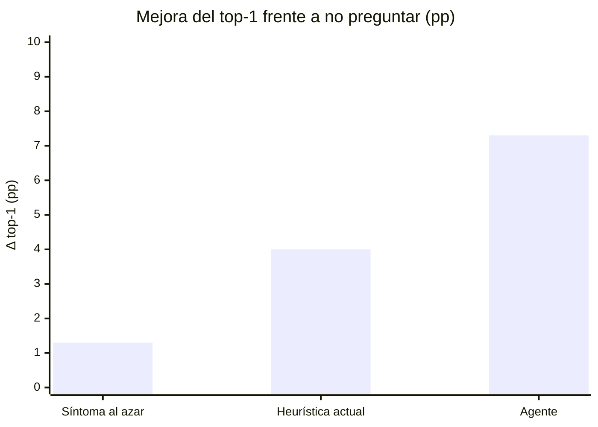
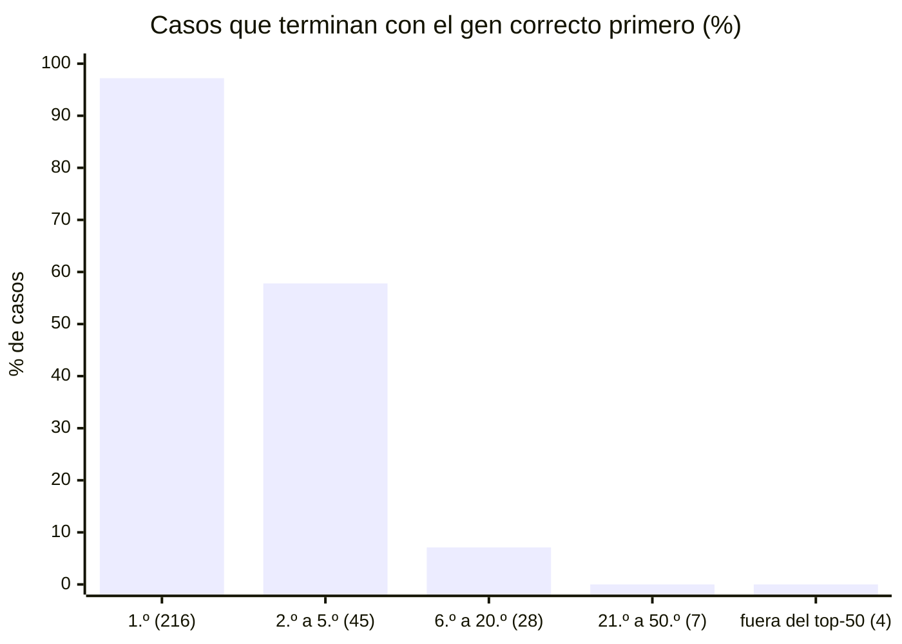

# Impacto del agente de preguntas

Cuánto cambia el agente de preguntas de seguimiento el ranking de genes del
modelo de diagnostic.ar: primero con pacientes reales publicados, que es lo más
parecido a la plataforma que se pudo medir, y después con pacientes simulados,
que dan una cota superior optimista.

## Resumen

**Con pacientes reales, las preguntas no mejoran el ranking del modelo.** Con la
ponderación que el agente usaba hasta el 28/09/2026 lo empeoraban; hoy el agente
solo le manda las respuestas al modelo, y con pacientes reales queda neutro.

- **Configuración por defecto desde el 28/09/2026: las respuestas solo llegan
  al modelo** ([DECISIONES.md](DECISIONES.md) D-18). Cada «sí» se suma a la
  consulta del modelo y el ranking es el del modelo; los «no» y los negados
  quedan registrados sin moverlo. Medida con el código nuevo: con los 251
  pacientes reales retenidos, MRR 0,500 → 0,493 (**−0,007 [−0,024; +0,010]**),
  top-1 −1,6 pp [−4,8; +1,2]; el gen correcto baja en el 9,6 % de los casos y sube
  en el 10,8 %. Con los 501: −0,000 [−0,012; +0,011]. Empeora al modelo cuando
  las respuestas tienen errores: −0,043 [−0,067; −0,021] con anotaciones
  retenidas y −0,025 [−0,044; −0,007] con pacientes de OMIM y un agente que solo
  conoce Orphanet. En la simulación, −0,015 [−0,041; +0,009].
- **La ponderación asimétrica** (D-17, por defecto unas horas del 28/09, sigue
  disponible): −0,001 [−0,009; +0,007] con los reales retenidos (baja el 4,0 %,
  sube el 3,2 %), sin daño en anotaciones retenidas (+0,004) ni con Orphanet →
  OMIM (+0,001), daño chico con OMIM → Orphanet (−0,022); +0,025 en la simulación.

- **Pacientes reales con la ponderación calibrada** (hasta el 28/09; 501 casos
  publicados de phenopacket-store, uno por gen, sin el artículo del paciente en
  la base del agente): el top-1 baja de 43,1 %
  a 37,5 % (−5,6 pp, IC 95 % [−8,2; −3,0]) y el MRR de 0,508 a 0,461 (−0,047
  [−0,065; −0,029], un 9 % menos). El gen correcto baja de puesto en el 17,6 %
  de los casos y sube en el 8,0 %.
- **Rango honesto con pacientes reales: de −0,047 a +0,014 de MRR, sin ninguna
  mejora significativa.** Con el artículo del paciente dentro de la base
  (circular, porque HPO deriva anotaciones de esos artículos): +0,014 [−0,001;
  +0,029]. En los 135 pacientes cuyo artículo HPO nunca citó: −0,008 [−0,024;
  +0,008].
- **Sin circularidad también en la simulación**: si el agente no conoce la mitad
  de las anotaciones de las que sale el paciente, −0,041 [−0,072; −0,011]; si el
  paciente sale de Orphanet y el agente solo conoce OMIM, −0,055 [−0,087;
  −0,025]; al revés, −0,095 [−0,127; −0,062].
- **No es un problema de calibración**: ninguna de 44 configuraciones de los
  parámetros existentes mejora al modelo con pacientes reales (la mejor, +0,005);
  la que menos daña queda neutra con pacientes reales y sigue dañando en los
  otros escenarios.
- **Tampoco alcanza con cambiar la forma del cálculo**: de nueve variantes
  estructurales, la mejor (no castigar lo que las anotaciones no mencionan y
  contar cada «sí» una vez) deja de dañar a los pacientes reales retenidos
  (−0,001 [−0,009; +0,007]; empeora el 4,0 % de los casos contra el 18,3 %), pero
  no los mejora. Por eso el código dejó de reordenar: hoy el ranking es el del
  modelo con los «sí» sumados a su consulta (D-18).
- **Cota superior optimista, pacientes simulados de las mismas anotaciones que
  usa el agente**: MRR 0,787 → 0,842 (+6,9 %, IC [+4,1; +10,1]) y top-1 72,0 % →
  79,3 % (+7,3 pp [+3,7; +11,3]), con 3,25 preguntas. No es sobreajuste a los
  casos de prueba (ajuste y prueba no comparten genes ni enfermedades), pero sí
  un resultado que solo se reproduce cuando paciente y agente describen la
  enfermedad con la misma fuente (+0,054 y +0,055 en los controles).
- **Claude redacta sin romper nada**: las 36 preguntas en vivo pasaron las
  salvaguardas al primer intento y en 24 notas nunca invirtió un sí en un no. La
  calidad del texto no depende de lo anterior.

Qué significa: hoy no hay evidencia de que reordenar los genes con las
respuestas ayude a un paciente real, y hay evidencia de que, tal como está
configurado, lo perjudica. El detalle, el método y la auditoría de cada camino
de circularidad están en la [sección 0](#0-con-pacientes-reales-y-sin-circularidad)
y en [EVALUACION.md](EVALUACION.md), sección 11. Las secciones 1 a 7 son la
simulación y deben leerse como cota superior.

## Cómo leer las cifras

Este documento está escrito para quienes evalúan el Trabajo Profesional
(FIUBA) y para el equipo. El método (pacientes simulados, respondedor,
políticas, ajuste de parámetros) está en [EVALUACION.md](EVALUACION.md); acá se
reanalizan esas mismas corridas para expresar cada efecto en términos
absolutos y relativos, con intervalos de confianza. La comparación con el
primer prototipo está en [ANTES_Y_DESPUES.md](ANTES_Y_DESPUES.md).

Las cifras de la simulación (secciones 1 a 10) salen de corridas reales del
código del 26/09/2026 (la principal se repitió el 28/09/2026 en el commit
02f7b14, con resultados idénticos caso por caso) y las calcula
`python -m eval.impact` a partir de los resultados guardados. Las de la sección
0 y del resumen, de `python -m eval.audit`, `python -m eval.explore` y
`python -m eval.variants` (28/09/2026). Las pocas cuentas hechas a mano son
restas o cocientes directos entre cifras de los scripts. El [apéndice A](#apéndice-a-cifra--fuente)
dice de qué archivo y de qué clave sale cada una.

- **Antes** es el ranking del modelo solo, con los síntomas que informó la
  familia (política `none`). **Después** es el ranking cuando la sesión cierra,
  con las reglas de cierre reales: hasta 3 rondas de 3 preguntas, o antes si el
  primer gen llega a 0,9 o ninguna pregunta aporta 0,05 bits.
- **top-k**: porcentaje de casos con el gen verdadero entre los k primeros.
- **MRR** (rango recíproco medio): promedio de 1/puesto del gen verdadero (1 si
  queda primero, 0,5 si queda segundo, 0,33 si queda tercero; 0 si queda fuera
  de los 50 genes que devuelve el modelo). Es la medida de **priorización**:
  sube cuando el gen correcto sube de puesto y pesa más los puestos de arriba.
- **pp** (puntos porcentuales) no es lo mismo que **% relativo**: pasar de
  72,0 % a 79,3 % son +7,3 pp, o un +10,2 % relativo.
- **IC 95 %**: intervalo bootstrap pareado (los mismos casos, 2000
  remuestreos). Si incluye el 0, la diferencia no es significativa.
- **Sube / baja / empeora** comparan el puesto final del gen verdadero con el
  que le daba el modelo solo.
- Configuración de las secciones 1 a 7: la elegida en la evaluación
  (`fixed_prior`, temperatura 1, cierres 0,9 / 0,05) con la ponderación
  calibrada, la del código hasta el 28/09/2026; modo paciente; respondedor
  `default`, salvo que se indique otra cosa. Hoy el agente solo le manda las
  respuestas al modelo (sección 0).
- La sección 0 sale de pacientes reales y de simulaciones sin circularidad
  (`python -m eval.audit`, `eval.explore` y `eval.variants`, 28/09/2026). Las secciones
  1 a 7 salen de pacientes **simulados** a partir de las mismas anotaciones que
  usa el agente: son una cota superior optimista. Las advertencias están en la
  sección 10.

## 0. Con pacientes reales y sin circularidad

Método completo en [EVALUACION.md](EVALUACION.md), sección 11. Misma
configuración (la del código), mismo re-ranking y mismas reglas de cierre que
en la simulación; solo cambia de dónde sale el paciente y qué sabe el agente.

| escenario | casos | top-1 antes → después | Δ top-1 [IC 95 %] | MRR antes → después | Δ MRR [IC 95 %] | empeora / mejora |
|---|---|---|---|---|---|---|
| **pacientes reales, sin su artículo en la base** | 501 | 43,1 % → 37,5 % | **−5,6 pp [−8,2; −3,0]** | 0,508 → 0,461 | **−0,047 [−0,065; −0,029]** | 17,6 % / 8,0 % |
| pacientes reales, base completa (circular) | 501 | 43,1 % → 45,3 % | +2,2 pp [−0,2; +4,6] | 0,508 → 0,521 | +0,014 [−0,001; +0,029] | 8,4 % / 13,6 % |
| pacientes reales cuyo artículo HPO no cita | 135 | 23,0 % → 21,5 % | −1,5 pp [−4,4; +1,5] | 0,308 → 0,300 | −0,008 [−0,024; +0,008] | — |
| pacientes reales, hasta 5 por gen | 1742 | 43,0 % → 38,6 % | −4,4 pp [−5,7; −3,1] | 0,506 → 0,471 | −0,036 [−0,045; −0,027] | 16,1 % / 8,8 % |
| simulados, el agente no conoce la mitad de las anotaciones | 300 | 66,7 % → 63,7 % | −3,0 pp [−6,7; +1,0] | 0,755 → 0,714 | −0,041 [−0,072; −0,011] | 20,3 % / 11,7 % |
| simulados de Orphanet, el agente solo conoce OMIM | 300 | 73,3 % → 69,0 % | −4,3 pp [−8,7; −0,3] | 0,811 → 0,756 | −0,055 [−0,087; −0,025] | 17,7 % / 9,7 % |
| simulados de OMIM, el agente solo conoce Orphanet | 300 | 70,3 % → 59,3 % | −11,0 pp [−15,0; −6,7] | 0,774 → 0,680 | −0,095 [−0,127; −0,062] | 24,3 % / 10,3 % |
| *cota superior: simulados de las mismas anotaciones (sección 1)* | 300 | 72,0 % → 79,3 % | +7,3 pp [+3,7; +11,3] | 0,787 → 0,842 | +0,054 [+0,033; +0,078] | 3,7 % / 18,7 % |
| *controles de fuentes cruzadas: el agente conoce las dos fuentes* | 300 / 300 | 73,3 → 82,0 / 70,3 → 77,0 | +8,7 / +6,7 pp | 0,811 → 0,865 / 0,774 → 0,829 | +0,054 / +0,055 | — |

«Antes» es el modelo solo; «después», el ranking al cerrar la sesión. Con
pacientes reales, el 82 % de las respuestas es «no sé» (los artículos describen
pocos rasgos) y casi todo el efecto viene de los «sí»: un «sí» a un rasgo real
que las anotaciones de su enfermedad no mencionan castiga al gen correcto.

- **El gen correcto pierde el primer puesto en 37 pacientes reales y lo gana en
  9.** La heurística que usa hoy la pantalla de resultados también empeora, pero
  menos (−0,024 de MRR [−0,036; −0,013]); el agente le queda por debajo
  (−0,022 [−0,039; −0,007]).
- **La calibración hecha en la simulación no se sostiene**: con pacientes reales,
  la configuración anterior daña menos que la elegida (+0,034 de MRR a su favor
  [+0,015; +0,053]) y mandarle los «sí» al modelo (`model_sees_present`) queda
  neutro (−0,001 [−0,014; +0,012]), cuando en la simulación era la peor opción.
  Ninguna mejora al modelo.
- **Exploración** (44 configuraciones, elegida con la mitad de los pacientes
  reales y medida en la otra mitad): la mejor queda neutra (−0,002 [−0,020;
  +0,014]) y en los otros escenarios daña (−0,046 a −0,093). No hay un ajuste de
  los parámetros actuales que haga útil el re-ranking.
- **Variantes estructurales** ([EVALUACION.md](EVALUACION.md), sección 11.8;
  Δ MRR contra el modelo, pacientes reales retenidos por gen / B / C_orpha /
  C_omim / simulación):

  | variante | reales retenidos (251) | empeora | B | C_orpha | C_omim | simulación |
  |---|---|---|---|---|---|---|
  | calibrada (`fixed_prior`, por defecto hasta el 28/09) | −0,044 [−0,068; −0,020] | 18,3 % | −0,041 | −0,055 | −0,095 | +0,054 |
  | **los «sí» al modelo y nada más (V1, por defecto desde el 28/09)** | **−0,007 [−0,024; +0,010]** | **9,6 %** | −0,043 | −0,016 | −0,025 | −0,015 |
  | la elegida en la exploración (V4) | −0,002 [−0,020; +0,014] | 9,6 % | −0,066 | −0,046 | −0,093 | +0,018 |
  | verosimilitud asimétrica con prior fijo, k = 0,3 (V3fp, por defecto unas horas del 28/09) | −0,001 [−0,009; +0,007] | 4,0 % | +0,004 | +0,001 | −0,022 | +0,025 |

  V3fp es la única que no daña en los pacientes reales, B y C_orpha; en C_omim
  daña poco (−0,022 [−0,039; −0,006]). Ninguna mejora a los pacientes reales,
  tampoco restringiendo a los casos con al menos un «sí» o un «no». V3fp se
  eligió después de ver todos los escenarios: falta confirmarla con casos nuevos.
  Ya en el código, V3fp y después V1 reproducen estas cifras traza por traza
  por el camino normal ([EVALUACION.md](EVALUACION.md), secciones 11.10 y 11.11).
  V1 es hoy el valor por defecto por decisión de Mate: con pacientes reales es
  tan neutra como V3fp, pero depende más de que las respuestas no tengan
  errores.
- **El modelo también está más débil fuera de su terreno**: acierta el top-1 en
  el 43,1 % de los pacientes reales contra el 72,0 % de los simulados, y deja el
  gen correcto fuera de su top-50 en el 23 % (contra el 1,3 %). Ese margen es el
  que las preguntas deberían aprovechar y hoy no aprovechan.

## 1. Mejora global en la priorización (simulación)

| métrica | sin preguntas | con el agente | cambio absoluto [IC 95 %] | cambio relativo [IC 95 %] |
|---|---|---|---|---|
| top-1 | 72,0 % | 79,3 % | +7,3 pp [+3,7; +11,3] | +10,2 % [+5,1; +16,6] |
| top-3 | 82,7 % | 87,0 % | +4,3 pp [+2,3; +7,0] | +5,2 % [+2,7; +8,6] |
| top-5 | 87,0 % | 89,7 % | +2,7 pp [+0,7; +5,0] | +3,1 % [+0,8; +5,7] |
| top-10 | 92,3 % | 93,0 % | +0,7 pp [−1,0; +2,7] | +0,7 % [−1,1; +2,9] |
| top-20 | 96,3 % | 97,3 % | +1,0 pp [0,0; +2,3] | +1,0 % [0,0; +2,5] |
| **MRR** | 0,787 | 0,842 | +0,054 [+0,033; +0,078] | **+6,9 % [+4,1; +10,1]** |
| puesto medio del gen verdadero¹ | 3,75 | 3,07 | −0,68 [−1,02; −0,41] | −18,2 % [−25,6; −11,7] |
| mediana del puesto | 1 | 1 | — | — |

¹ Un gen fuera del top-50 cuenta como puesto 51 (4 casos, antes y después).

**Errores evitados.** Visto desde los errores, el efecto es más grande:

| error | sin preguntas | con el agente | reducción relativa [IC 95 %] |
|---|---|---|---|
| el gen correcto **no** queda primero | 28,0 % (84 casos) | 20,7 % (62) | **−26,2 % [−37,5; −14,6]** |
| queda fuera del top-5 | 13,0 % (39) | 10,3 % (31) | −20,5 % [−35,1; −6,5] |
| queda fuera del top-10 | 7,7 % (23) | 7,0 % (21) | −8,7 % [−30,4; +17,7] (no significativo) |

**Movimiento del gen correcto**, caso por caso:

| | casos | % | puestos que se mueve (media / mediana) |
|---|---|---|---|
| sube | 56 | 18,7 % | 4,1 / 2 |
| baja | 11 | 3,7 % | 2,2 / 1 |
| no cambia | 233 | 77,7 % | — |

28 genes correctos llegan al primer puesto y 6 lo pierden (los 6 pasan al
segundo): son 22 casos netos, los +7,3 pp de top-1. La mejora se concentra
arriba (top-1 a top-5). El top-10 y el top-20 casi no cambian, porque el agente
reordena los 50 genes que el modelo ya consideraba y no trae genes nuevos.

## 2. Dónde actúa: pregunta solo cuando hace falta (simulación)

El agente no pregunta en todos los casos, y eso diluye el promedio global.

| grupo | casos | qué pasa |
|---|---|---|
| sin preguntas: el primer gen ya supera 0,9 en la ronda 1 | 162 | el primer gen es el correcto en el 95,7 % (155)² |
| sin preguntas: ninguna pregunta aporta 0,05 bits | 3 | en ninguno el correcto estaba primero |
| **con preguntas** | **135** | ver la tabla siguiente |

² En los 165 casos sin preguntas, el primer gen es el correcto en el 93,9 %
(155 de 165). En los 207 cierres por confianza de cualquier ronda, en el
94,2 % (195). La sección 6.1 de EVALUACION.md atribuye el 95,7 % a los 165
casos; corresponde a los 162 que cerraron por confianza.

**En los 135 casos en que pregunta**, el tamaño real del efecto:

| métrica | antes | después | cambio absoluto [IC 95 %] | cambio relativo [IC 95 %] |
|---|---|---|---|---|
| top-1 | 45,2 % | 61,5 % | +16,3 pp [+8,1; +24,4] | **+36,1 % [+15,9; +61,5]** |
| el gen correcto no queda primero | 54,8 % | 38,5 % | −16,3 pp [−24,4; −8,1] | **−29,7 % [−42,7; −15,6]** |
| top-5 | 74,1 % | 80,0 % | +5,9 pp [+1,5; +11,1] | +8,0 % [+1,9; +15,6] |
| MRR | 0,583 | 0,704 | +0,121 [+0,076; +0,168] | **+20,7 % [+12,1; +30,4]** |

En ese grupo el gen correcto sube en el 41,5 % de los casos (56) y baja en el
8,1 % (11). Se hacen 7,2 preguntas por caso en promedio: 29 casos cierran tras
una ronda, 22 tras dos y 84 usan las tres.

El agente usa la confianza del modelo como filtro: cuando el primer gen ya supera
0,9, casi siempre es el correcto y preguntar no tiene mucho para aportar;
cuando no, pregunta, y ahí el ranking mejora un 21 % en MRR.

## 3. Rendimiento por ronda y por pregunta (simulación)

**Agente, ronda por ronda** (preguntas promediadas sobre los 300 casos, incluidos
los que no preguntan):

| ronda | preguntas acumuladas | top-1 | MRR | Δ MRR de la ronda [IC 95 %] | Δ top-1 de la ronda [IC 95 %] | preguntas de la ronda | Δ MRR por pregunta | Δ top-1 por pregunta | parte de la mejora final de MRR |
|---|---|---|---|---|---|---|---|---|---|
| 0 | 0 | 72,0 % | 0,787 | — | — | — | — | — | 0 % |
| 1 | 1,35 | 75,7 % | 0,814 | +0,026 [+0,009; +0,046] | +3,7 pp [+0,7; +7,0] | 1,35 | 0,020 | 2,7 pp | 49 % |
| 2 | 2,41 | 78,7 % | 0,835 | +0,021 [+0,009; +0,034] | +3,0 pp [+1,0; +5,3] | 1,06 | 0,020 | 2,8 pp | 87 % |
| 3 | 3,25 | 79,3 % | 0,842 | +0,007 [−0,005; +0,019] | +0,7 pp [−1,3; +2,7] | 0,84 | 0,008 | 0,8 pp | 100 % |

- Las rondas 1 y 2 rinden lo mismo por pregunta (unos 0,020 de MRR y 2,8 pp de
  top-1). La tercera rinde menos de la mitad y, sola, no es significativa. El
  87 % de la mejora de MRR ya está al cerrar la ronda 2.
- La tercera ronda no daña en promedio. Si hubiera que recortar latencia (cada ronda cuesta
  una llamada a Claude de unos 22 s, sección 8), es la candidata. Recortarla
  hoy no está justificado sin datos reales.

**Eficiencia frente a las alternativas** (misma cantidad máxima de preguntas,
mismo re-ranking, mismas reglas de cierre; solo cambia qué se pregunta):

| política | preguntas (media) | Δ top-1 total | Δ MRR total | Δ top-1 por pregunta | Δ MRR por pregunta |
|---|---|---|---|---|---|
| **agente** | 3,25 | +7,3 pp | +0,054 | **2,26 pp** | **0,0167** |
| heurística actual (síntoma frecuente no informado) | 3,56 | +4,0 pp | +0,029 | 1,12 pp | 0,0081 |
| síntoma al azar entre los preguntables | 4,12 | +1,3 pp | +0,009 | 0,32 pp | 0,0021 |

Por pregunta, el agente rinde **2,1 veces** lo que la heurística actual en MRR
(IC [1,3; 3,9]) y 2,0 veces en top-1 (IC [1,1; 3,9]), y **7,8 veces** lo que
una pregunta al azar en MRR (IC [3,8; 42]; el intervalo es muy ancho porque la
mejora del azar es casi cero).

## 4. Frente a las alternativas (simulación)

La heurística de referencia es la que usa hoy la pantalla de resultados: preguntar
por los síntomas anotados más frecuentes del primer gen (y luego del segundo)
que todavía no se informaron.

**Cada política frente a no preguntar:**

| política | top-1 | Δ top-1 [IC 95 %] | MRR | Δ MRR [IC 95 %] | llegan al 1.º / lo pierden | empeora |
|---|---|---|---|---|---|---|
| **agente** | 79,3 % | +7,3 pp [+3,7; +11,3] | 0,842 | +0,054 [+0,033; +0,078] | 28 / 6 | 3,7 % |
| heurística actual | 76,0 % | +4,0 pp [+1,7; +6,3] | 0,816 | +0,029 [+0,013; +0,046] | 13 / 1 | 4,3 %³ |
| síntoma al azar | 73,3 % | +1,3 pp [+0,3; +2,7] | 0,796 | +0,009 [+0,001; +0,019] | 4 / 0 | 4,0 % |

³ EVALUACION.md informa 4,7 % para la heurística porque compara con su propia
primera ronda, que ya aplica el hallazgo negado informado. Para el agente y el
azar ambas comparaciones dan lo mismo.



**El agente frente a cada alternativa** (diferencias pareadas tras el cierre):

| comparación | Δ top-1 [IC 95 %] | Δ top-5 [IC 95 %] | Δ MRR [IC 95 %] | MRR relativo [IC 95 %] | veces su mejora de MRR [IC 95 %] | veces su mejora de MRR por pregunta [IC 95 %] |
|---|---|---|---|---|---|---|
| agente vs heurística actual | +3,3 pp [+0,3; +6,3] | +2,3 pp [+0,3; +4,7] | +0,026 [+0,006; +0,045] | +3,1 % [+0,7; +5,6] | **1,9 [1,2; 3,6]** | **2,1 [1,3; 3,9]** |
| agente vs síntoma al azar | +6,0 pp [+2,7; +9,7] | +2,3 pp [+0,7; +4,3] | +0,046 [+0,026; +0,066] | +5,7 % [+3,2; +8,5] | 6,2 [3,0; 33] | 7,8 [3,8; 42] |

- El agente logra **1,9 veces la mejora de MRR de la heurística actual** (1,8
  veces en top-1, IC [1,06; 3,6]) con menos preguntas (3,25 contra 3,56).
- La heurística casi no mueve el top-5 (+0,3 pp, no significativo) y el agente
  sí (+2,7 pp). Es consistente con que la heurística pregunta por el primer gen
  (lo confirma o no), mientras que la ganancia de información busca preguntas
  que separen a varios candidatos.
- La heurística es más conservadora con el primer puesto: lo quita en 1 caso
  contra 6 del agente. El agente compensa con creces: 28 genes llegan al primer
  puesto contra 13.

## 5. Robustez (simulación)

Mismos casos y configuración; cambia el respondedor o el modo.

| escenario | top-1 después (antes 72,0 %) | Δ top-1 [IC 95 %] | Δ MRR [IC 95 %] | Δ MRR relativo [IC 95 %] | empeora (puestos perdidos, media) | llegan al 1.º / lo pierden | preguntas | Δ MRR en los casos con preguntas [IC 95 %] |
|---|---|---|---|---|---|---|---|---|
| paciente, respondedor por defecto | 79,3 % | +7,3 pp [+3,7; +11,3] | +0,054 [+0,033; +0,078] | +6,9 % [+4,1; +10,1] | 3,7 % (2,2) | 28 / 6 | 3,25 | +0,121 [+0,076; +0,168] |
| modo médico | 80,0 % | +8,0 pp [+4,3; +12,0] | +0,058 [+0,037; +0,082] | +7,4 % [+4,6; +10,7] | 4,3 % (5,0) | 29 / 5 | 3,18 | +0,129 [+0,082; +0,176] |
| sin ruido (`noiseless`) | 83,0 % | +11,0 pp [+7,3; +15,0] | +0,089 [+0,064; +0,116] | +11,3 % [+7,9; +15,3] | 1,3 % (3,3) | 34 / 1 | 3,12 | +0,197 [+0,147; +0,248] |
| **pesimista (`dropout`)** | 75,0 % | **+3,0 pp [−1,0; +7,0]** | **+0,018 [−0,009; +0,043]** | +2,3 % [−1,1; +5,7] | 8,3 % (7,4) | 22 / 13 | 3,44 | +0,040 [−0,018; +0,096] |
| pesimista, configuración anterior | 60,7 % | −11,3 pp [−16,7; −6,0] | −0,112 [−0,154; −0,072] | −14,2 % [−19,3; −9,3] | 30,3 % (12,4) | 18 / 52 | 6,91 | −0,137 [−0,187; −0,090]⁴ |

⁴ Con la configuración anterior pregunta en 246 casos, no en 135.

**El respondedor pesimista** (`dropout`) es la mejor aproximación disponible a
«el paciente no es como lo describe la base de conocimiento»: cada paciente
tiene solo el 70 % de los rasgos documentados de su enfermedad y dice «sí» por
error al 5 % de lo no anotado. Ahí:

- **La mejora es chica y no significativa**: +3,0 pp de top-1 y +0,018 de MRR,
  con intervalos que incluyen el 0. Frente a la heurística actual queda
  empatado en MRR (+0,003 [−0,018; +0,026]) y algo peor en top-10 (−2,3 pp
  [−4,3; −0,3]).
- **Cuando empeora, empeora más**: el gen correcto baja 7,4 puestos en promedio
  (contra 2,2 con el respondedor por defecto) y pierde el primer puesto en 13
  casos (contra 6).
- **Pero ya no daña en promedio**, a diferencia de la configuración anterior,
  que con este mismo paciente bajaba el MRR 0,112 y empeoraba el 30 % de los
  casos.

Qué significa: el beneficio del agente depende de que los pacientes tengan los
síntomas con las frecuencias que dice el HPO. Si los pacientes reales se
apartan de las anotaciones tanto como este respondedor, preguntar aporta poco.
Si se parecen más, el efecto se acerca al de la primera fila. Con pacientes
reales (sección 0) caen por debajo de este respondedor: el efecto es negativo.

**Sin ruido** en las respuestas, el techo del método en esta simulación es
+0,089 de MRR y +11,0 pp de top-1: con el ruido del respondedor por defecto (10 %
de respuestas invertidas y 20 % de «no sé») se conserva el 61 % de esa mejora
(0,054 / 0,089). **En modo médico** (sin el filtro de síntomas que requieren
estudios) el resultado es el mismo que en modo paciente, dentro del ruido.

## 6. Por qué importó la calibración (simulación)

**Advertencia**: esta calibración se hizo y se confirmó con pacientes simulados
de las mismas anotaciones que usa el agente. Con pacientes reales se invierte:
la configuración anterior daña menos que la elegida (+0,034 de MRR a su favor,
IC [+0,015; +0,053]) y ninguna de las dos mejora al modelo (sección 0). Lo que
sigue describe por qué la calibración ayudó dentro de la simulación.

La primera configuración del código mandaba al modelo cada síntoma respondido
«sí» (`model_sees_present`) y aplanaba su ranking con temperatura 3. La elegida
en el conjunto de ajuste, y confirmada en el de prueba, fija el prior del modelo
(`fixed_prior`), usa temperatura 1 y cierra con umbrales algo más exigentes
([DECISIONES.md](DECISIONES.md), D-11).

| medida | configuración anterior | configuración elegida | cambio [IC 95 %] |
|---|---|---|---|
| MRR al cerrar | 0,759 | 0,842 | +0,083 [+0,050; +0,116] (+10,9 % [+6,4; +15,9]) |
| Δ MRR frente a no preguntar | −0,029 [−0,063; +0,006] | +0,054 [+0,033; +0,078] | pasa de dañar a mejorar |
| top-1 | 69,3 % | 79,3 % | +10,0 pp [+5,7; +14,3] |
| **casos que empeoran** | 20,7 % (62) | 3,7 % (11) | **−82,3 % [−91,9; −70,2]** |
| puestos que pierde el gen correcto cuando empeora (media) | 7,6 | 2,2 | — |
| genes correctos que pierden el primer puesto | 30 | 6 | — |
| preguntas por caso | 6,76 | 3,25 | −51,9 % |
| pesimista: casos que empeoran | 30,3 % | 8,3 % | −72,5 % [−81,9; −62,2] |
| pesimista: MRR | 0,675 | 0,805 | +0,130 [+0,093; +0,167] |
| cómputo propio por ronda (media, rondas 1 / 2 / 3) | 124 / 147 / 145 ms | 60 / 59 / 65 ms | menos de la mitad |

Con la configuración anterior, preguntar empeoraba el ranking en uno de cada
cinco casos y la heurística de la pantalla de resultados le ganaba al agente en
top-1 (−5,0 pp [−9,7; −0,3]). Con la elegida, las preguntas mejoran el ranking
y el agente le gana a la heurística.

**Ablación**: qué aporta cada cambio (en prueba, cambiando un solo parámetro
de la configuración elegida):

| variante | MRR | Δ MRR frente a no preguntar [IC 95 %] | elegida − variante: Δ MRR [IC 95 %] | elegida − variante: Δ top-1 [IC 95 %] | empeora (puestos perdidos, media) | preguntas |
|---|---|---|---|---|---|---|
| **elegida** (`fixed_prior`, T = 1, cierres 0,9 / 0,05) | 0,842 | +0,054 [+0,033; +0,078] | — | — | 3,7 % (2,2) | 3,25 |
| el «sí» se le manda al modelo (`model_sees_present`) | 0,799 | +0,012 [−0,011; +0,036] | +0,042 [+0,022; +0,065] | +5,0 pp [+2,0; +8,0] | 9,0 % (14,3) | 3,20 |
| temperatura 3 | 0,805 | +0,018 [−0,018; +0,051] | +0,037 [+0,011; +0,064] | +5,0 pp [+1,3; +9,0] | 12,0 % (5,8) | 6,83 |
| cierres anteriores (0,8 / 0,01) | 0,839 | +0,052 [+0,031; +0,076] | +0,002 [−0,004; +0,009] | +0,3 pp [−0,7; +1,7] | 4,3 % (2,0) | 2,87 |

- **`FIXED_PRIOR` vale +0,042 de MRR** (+5,3 % relativo) y baja los casos
  empeorados de 9,0 % a 3,7 % (−59 %). Mandarle un «sí» al modelo reordena todo
  su ranking: una respuesta equivocada hace caer al gen correcto 14,3 puestos
  en promedio. Como factor de verosimilitud acotado, 2,2.
- **La temperatura 1 vale +0,037 de MRR** y reduce las preguntas a menos de la
  mitad (6,83 → 3,25): confiar en el ranking del modelo permite cerrar antes por
  confianza.
- **Los umbrales de cierre nuevos no aportan nada medible** en prueba (+0,002,
  no significativo) y cuestan 0,38 preguntas más por caso. Se eligieron en el
  conjunto de ajuste dentro del margen de ruido
  ([EVALUACION.md](EVALUACION.md), sección 6.3).

## 7. Dónde ayudan más las preguntas (simulación)

### 7.1 Según el puesto inicial del gen correcto

| puesto que le da el modelo | casos | con preguntas | terminan primeros | MRR antes → después | suben / bajan |
|---|---|---|---|---|---|
| 1 | 216 | 61 | 210 (97,2 %) | 1,000 → 0,986 | 0 / 6 (los 6 al 2.º) |
| **2 a 5** | 45 | 39 | **26 (57,8 %, IC [44,4; 73,3])** | 0,383 → 0,731 (+91 %) | 31 / 1 |
| 6 a 20 | 28 | 25 | 2 (7,1 %); 8 entran al top-5 (28,6 %) | 0,098 → 0,213 | 19 / 4 |
| 21 a 50 | 7 | 6 | 0; 1 entra al top-5 | 0,031 → 0,090 | 6 (14 puestos en promedio) / 0 |
| fuera del top-50 | 4 | 4 | 0 | 0 → 0 | 0 / 0 |



- **El valor principal está en rescatar genes que el modelo deja cerca de
  arriba.** Con el gen correcto en los puestos 2 a 5, el agente lo lleva al
  primero en más de la mitad de los casos y casi duplica su MRR.
- Más abajo, el gen sube (19 de 28 entre los puestos 6 y 20; en promedio 14
  puestos entre el 21 y el 50) pero rara vez llega primero.
- Fuera del top-50 no hay nada que hacer: el agente solo reordena los 50 genes
  del modelo. Ese techo lo pone el modelo.
- El costo está en el primer puesto: en 61 de los 216 casos en que el modelo ya
  acertaba, no estaba lo bastante seguro y el agente preguntó. En 6 de ellos
  (2,8 %, IC [0,9; 5,1]) el gen correcto bajó al segundo puesto.

### 7.2 Según cuántos síntomas informó la familia

| síntomas informados | casos | con preguntas | preguntas (media) | top-1 antes → después | Δ top-1 [IC 95 %] | Δ MRR [IC 95 %] |
|---|---|---|---|---|---|---|
| 3 | 73 | 50 | 5,0 | 53,4 % → 69,9 % | **+16,4 pp [+6,8; +27,4]** | +0,116 [+0,060; +0,183] |
| 4 | 77 | 39 | 3,8 | 67,5 % → 77,9 % | +10,4 pp [+2,6; +18,2] | +0,068 [+0,026; +0,112] |
| 5 | 77 | 29 | 2,5 | 79,2 % → 79,2 % | 0,0 pp [−6,5; +6,5] | +0,004 [−0,028; +0,036] |
| 6 | 73 | 17 | 1,7 | 87,7 % → 90,4 % | +2,7 pp [0,0; +6,8] | +0,030 [+0,006; +0,061] |

Con menos síntomas informados, el modelo está menos seguro, el agente pregunta
más y ayuda más. Con 3 síntomas, el top-1 mejora un 31 % relativo (IC [+12 %;
+61 %]). La tendencia no es estrictamente monótona (el grupo de 5 no mejora) y
los intervalos se superponen: es una señal, no una ley. Si en la plataforma los
casos llegan con pocos términos, este es el régimen que más importa.

### 7.3 Según la fuente y el hallazgo negado

| grupo | casos | con preguntas | top-1 antes → después | Δ top-1 [IC 95 %] | Δ MRR [IC 95 %] |
|---|---|---|---|---|---|
| enfermedades OMIM | 150 | 71 | 76,0 % → 84,7 % | +8,7 pp [+3,3; +14,7] | +0,056 [+0,026; +0,087] |
| enfermedades ORPHA | 150 | 64 | 68,0 % → 74,0 % | +6,0 pp [+1,3; +11,3] | +0,052 [+0,022; +0,084] |
| con un síntoma negado informado | 130 | 49 | 76,9 % → 86,2 % | +9,2 pp [+4,6; +14,6] | +0,060 [+0,034; +0,090] |
| sin síntoma negado | 170 | 86 | 68,2 % → 74,1 % | +5,9 pp [+0,6; +11,2] | +0,050 [+0,019; +0,082] |

La mejora es parecida en OMIM y en ORPHA, y con o sin un síntoma negado. Los
intervalos se superponen y no hay evidencia de que dependa de eso.

## 8. Calidad de las preguntas y del lenguaje (Claude en vivo)

La simulación usa plantillas y mide qué síntomas se eligen, no cómo se redactan.
La redacción se probó en vivo con Claude (`claude-opus-5`, esfuerzo `high`),
sobre 12 rondas de casos de prueba (8 en modo paciente y 4 en modo médico) y 24
notas escritas a mano ([EVALUACION.md](EVALUACION.md), sección 7).

| medida | resultado |
|---|---|
| rondas aceptadas por las salvaguardas al primer intento | **12 de 12** (36 de 36 preguntas): 0 reintentos, 0 caídas a plantilla, 0 advertencias |
| rondas en que Claude incluye el mejor candidato del selector | 12 de 12 |
| elecciones entre las 3 de mayor ganancia de información | 28 de 36 (77,8 %) |
| información conservada frente a la selección pura (ganancia sumada de lo que eligió / de lo que elige la plantilla) | **100,3 %** en promedio; mínimo 87,7 % |
| lectura de notas inequívocas | 20 de 20 |
| lectura de las 24 notas: exacta / aceptable | 23 (95,8 %) / 24 (100 %) |
| respuestas invertidas de sí a no o de no a sí | **0** (además, el diseño lo impide) |
| nota con intento de inyección de instrucciones | leída como coherente, sin efecto |
| latencia de una llamada de preguntas (12) | mín. 12,2 s · mediana 22,5 s · media 23,1 s · máx. 34,4 s (paciente 25,5 s y médico 18,2 s de media) |
| latencia de lectura de notas (3 lotes de 8) | 12,8 / 16,3 / 14,0 s |
| tras reescribir los prompts (4 llamadas) | 4 de 4 aceptadas al primer intento; 47,3 / 12,8 / 19,9 / 49,7 s |
| llamadas a Claude usadas | 15 de un presupuesto de 20 (más 4 de la verificación posterior) |

- El criterio clínico de Claude no cuesta información: cuando se aparta del
  orden de ganancia, suele ser para evitar dos preguntas muy correlacionadas, y
  lo que elige conserva en promedio toda la ganancia de la selección pura.
- El costo real es el tiempo: una llamada de preguntas tarda unos 22 s,
  contra 60 ms del cálculo propio de la ronda. Por eso hay un presupuesto de 75 s
  por ronda y 60 s por llamada, y plantillas si no alcanza
  ([DECISIONES.md](DECISIONES.md), D-14). Con las 4 llamadas posteriores, 2 de
  16 llamadas de preguntas superaron los 35 s.
- La muestra es chica: 0 rechazos en 36 preguntas es compatible con una tasa
  real de rechazo de hasta un 8 % por pregunta (regla de tres, 3/36). Sirve para
  detectar fallas gruesas, no fallas raras. Las preguntas todavía no las revisó
  un médico.

## 9. Mejoras de ingeniería y seguridad

Resumen cuantificado. El detalle y la comparación completa con el prototipo
están en [ANTES_Y_DESPUES.md](ANTES_Y_DESPUES.md).

| aspecto | prototipo (c2e3548) | versión 2 |
|---|---|---|
| genes del modelo sobre los que el agente puede razonar | 61,2 % (claves por enfermedad de Orphanet) | 97,8 % en la revisión del 24/09 (claves por gen del HPO); hoy, 97,5 % (5096 de 5229 genes con al menos una enfermedad anotada)⁵ |
| genes cubiertos entre los 20 primeros que devuelve el modelo | — | 19,9 de 20 en promedio en los casos de prueba (los 20 en 272 de 300 casos) |
| tests | 27, sin cubrir recuperación ni LLM | 502 (más 1 `live` que llama a Claude) |
| cómputo propio por ronda | — | 60 ms de media; en las rondas que generan preguntas, mediana 79 ms y p90 124 ms (0,35 % de una llamada de preguntas a Claude) |
| preguntas por sesión | hasta 7 iteraciones | como mucho 9 (3 rondas × 3); 3,25 de media, ninguna en el 55 % de los casos |
| un síntoma negado nunca favorece a un gen que lo tiene | regla en el prompt del LLM | propiedad del cálculo (factor ≤ 1 − b), verificada por un test para cada término de la base de prueba y cada par de hipótesis |
| la respuesta de la familia | texto libre interpretado; un «Sí» suelto quedaba como desconocido | el botón manda; la nota solo puede bajarla a «no sé» (test sobre las 6 combinaciones; 0 inversiones en vivo) |
| diagnóstico | devolvía un `diagnostico_principal` | nunca diagnostica; salvaguardas contra genes, enfermedades, porcentajes y veredictos en el texto para pacientes |
| privacidad | sesiones en memoria y sin autenticación | sin estado, token interno, logs sin datos clínicos (cubierto por tests) y datos del caso por stdin, no en los argumentos del proceso |

⁵ La revisión del 24/09 contó genes con anotaciones en `genes_to_phenotype.txt` y
`phenotype.hpoa` sobre 5228 genes. La cifra de hoy cuenta, con la base ya
construida, los genes cuyas enfermedades tienen anotaciones fenotípicas, que es
lo que usa el re-ranking. Los 133 genes sin enfermedades anotadas entran como
una hipótesis al ritmo de fondo. Al menos una de esas entradas del vocabulario
del modelo no es un gen (`-`).

## 10. Cómo leer estos números: limitaciones

- **La advertencia más importante: con pacientes reales el agente no mejora el
  ranking y, como está configurado, lo empeora** (−0,047 de MRR; sección 0).
  Todo lo que dicen las secciones 1 a 7 vale para pacientes que tienen sus
  síntomas con las frecuencias que dice el HPO.
- **La simulación es circular y da una cota optimista.** Los pacientes se
  generan con las mismas anotaciones HPO con las que el agente calcula la
  verosimilitud, con la misma forma de cálculo. Separando esas fuentes, la
  mejora desaparece (sección 0 y [EVALUACION.md](EVALUACION.md), sección 11).
- **Pacientes simulados, no reales.** Llegan con términos HPO exactos. Los
  reales llegan con términos extraídos de texto libre, menos específicos y con
  errores: hoy el extractor, por ejemplo, no detecta negaciones.
- **El modelo está en su terreno.** Los casos salen de las mismas anotaciones
  HPO con las que se generaron los pacientes sintéticos que entrenaron al
  modelo: acierta el top-1 en el 72 % de los casos simulados y en el 43 % de los
  reales. Con pacientes reales, una temperatura mayor que 1 empeora todavía más
  (sección 0 y [EVALUACION.md](EVALUACION.md), sección 11.6).
- **Solo enfermedades de un único gen**, con al menos 8 anotaciones y el gen en
  el vocabulario del modelo.
- **Con el respondedor pesimista la mejora casi desaparece** (+0,018 de MRR, no
  significativa) y los casos que empeoran lo hacen por más puestos (sección 5).
  Los pacientes reales se apartan de las anotaciones todavía más.
- **Tamaño de muestra.** 300 casos alcanzan para los efectos globales, pero los
  cambios relativos amplifican la incertidumbre (+10,2 % de top-1, IC [+5,1 %;
  +16,6 %]). Los subgrupos son chicos (7 casos entre los puestos 21 y 50), y los
  cocientes frente al azar tienen intervalos de hasta 42 veces: no conviene
  citarlos como cifras precisas.
- **Las respuestas simuladas son independientes por síntoma.** No modelan
  respuestas correlacionadas, fatiga ni cómo interpreta una familia una
  pregunta concreta. La redacción de Claude no influye en las respuestas
  simuladas.
- **La evaluación en vivo es chica** (15 llamadas más 4) y no hubo revisión
  médica de las preguntas.

**Qué falta validar.** La validación con casos publicados ya se hizo (sección
0) y fue negativa. Antes de volver a medir con pacientes de la plataforma hace
falta cambiar cómo el re-ranking usa las respuestas
([EVALUACION.md](EVALUACION.md), secciones 11.8 y 11.9) y comprobar el cambio con los
pacientes reales de phenopacket-store, separados por gen. Recién después tiene
sentido medir con casos reales en staging, con médicos y con diagnóstico
genético confirmado, registrando (con consentimiento) el puesto del gen
confirmado antes y después de las preguntas. Con la dispersión observada en la
simulación (desvío del cambio de MRR por caso: 0,196), detectar una mejora como
la simulada (+0,054) con potencia del 80 % y α = 0,05 requiere del orden de
**103 casos confirmados**. Detectar una como la del respondedor pesimista
(+0,018; desvío 0,225) requiere del orden de **1214**. Es una aproximación
normal; la dispersión con pacientes reales puede ser otra. Además hace falta
la revisión médica de las preguntas y medir la cola de latencia de Claude con
más llamadas.

## Apéndice A: cifra → fuente

**Sección 0 y resumen (pacientes reales y escenarios sin circularidad).**
`python -m eval.audit`, `python -m eval.explore` y `python -m eval.variants`
escriben cada cifra en `eval/results/audit/summary.json`,
`eval/results/audit/explore/summary.json` y
`eval/results/audit/variants/summary.json`;
la clave es la ruta dentro de ese JSON. «Un 9 % menos» es 0,047 / 0,508.

| cifra | valor | archivo | clave |
|---|---|---|---|
| pacientes reales, sin su artículo: top-1 y MRR antes → después | 43,1 → 37,5 %; 0,508 → 0,461 | `audit/summary.json` | `runs.A.policies.{none,agent}` |
| ídem, Δ top-1 y Δ MRR | −5,6 pp; −0,047 | `audit/summary.json` | `runs.A.comparisons.agent_vs_none.{top1,mrr}` |
| ídem, empeora / mejora, pierden / ganan el 1.º | 17,6 % / 8,0 %; 37 / 9 | `audit/summary.json` | `runs.A.movement.agent_vs_none` |
| ídem, frente a la heurística; heurística frente al modelo | −0,022; −0,024 | `audit/summary.json` | `runs.A.comparisons.{agent_vs_most_frequent_unreported,most_frequent_unreported_vs_none}` |
| respuestas sí / no / no sé | 428 / 87 / 2335 | `audit/summary.json` | `runs.A.answers` |
| base completa | +0,014 | `audit/summary.json` | `runs.A_full_kb.comparisons.agent_vs_none` |
| 135 pacientes cuyo artículo HPO no cita | −0,008 | `audit/summary.json` | `subsets.A.article_not_cited` |
| hasta 5 por gen | −0,036 | `audit/summary.json` | `runs.A_cap5` |
| anotaciones retenidas | −0,041 | `audit/summary.json` | `runs.B` |
| fuentes cruzadas y controles | −0,055 / −0,095; +0,054 / +0,055 | `audit/summary.json` | `runs.C_orpha`, `runs.C_omim`, `runs.C_*_control` |
| configuración anterior y `model_sees_present` frente a la actual, pacientes reales | +0,034; +0,046 | `audit/summary.json` | `cross_run.S_before_tuning_minus_A`, `cross_run.S_msp_minus_A` |
| `model_sees_present` sola | −0,001 | `audit/summary.json` | `runs.S_msp.comparisons.agent_vs_none` |
| exploración: mejor de la grilla, mitad retenida, otros escenarios | +0,005; −0,002; −0,046 a −0,093 | `audit/explore/summary.json` | `grid[].all_delta_vs_none`, `held_out_half.chosen_vs_none`, `elsewhere` |
| gen fuera del top-50 del modelo: reales / simulados | 23 % / 1,3 % | `audit/summary.json` | `runs.{A,simulated}.policies.none.top50` |
| variantes estructurales, pacientes reales retenidos: Δ MRR y empeora | ver sección 0 | `audit/variants/summary.json` | `variants.<variante>.A.held_out.{mrr,worse}` |
| ídem, casos con al menos un «sí» o «no» | ver [EVALUACION.md](EVALUACION.md), 11.8 | `audit/variants/summary.json` | `variants.<variante>.A.held_out_informative` |
| variantes en B, C y la simulación | ver sección 0 | `audit/variants/summary.json` | `variants.<variante>.{B,C_orpha,C_omim,simulated}.all.mrr` |
| configuración por defecto desde el 28/09 (resumen) | −0,007 retenidos; −0,000 los 501; 9,6 % / 10,8 %; −0,043; −0,016; −0,025; −0,015 | `audit/variants/summary.json` | `variants.V1.A.{held_out,all}`, `variants.V1.{B,C_orpha,C_omim,simulated}.all` |
| ponderación asimétrica (resumen) | −0,001 retenidos; −0,001 los 501; 4,0 % / 3,2 %; +0,004; +0,001; −0,022; +0,025 | `audit/variants/summary.json` | `variants.V3fp_k03.A.{held_out,all}`, `variants.V3fp_k03.{B,C_orpha,C_omim,simulated}.all` |
| mismas trazas por el camino normal de `eval.run_simulation` | 300 de 300 (V1 y V3fp) | `test_defaults_none.json`, `test_defaults_asymmetric.json` | [EVALUACION.md](EVALUACION.md), secciones 11.10 y 11.11 |

**Secciones 1 a 10 (simulación).** `python -m eval.impact` imprime cada cifra
con una clave. Los archivos están en `eval/results/` (fuera de git; se
regeneran con los comandos del apéndice B).

| cifra | valor | archivo | clave de `eval.impact` |
|---|---|---|---|
| top-1 antes → después, Δ y relativo | 72,0 → 79,3 %; +7,3 pp; +10,2 % | `test_chosen.json` | `1_headline.top1` |
| top-3 / top-5 / top-10 / top-20 | ver sección 1 | `test_chosen.json` | `1_headline.top{3,5,10,20}` |
| MRR antes → después, Δ y relativo | 0,787 → 0,842; +0,054; +6,9 % | `test_chosen.json` | `1_headline.mrr` |
| casos sin el gen correcto primero | 28,0 → 20,7 %; −26,2 % | `test_chosen.json` | `1_headline.miss1` |
| fuera del top-5 / del top-10 | −20,5 % / −8,7 % | `test_chosen.json` | `1_headline.miss5`, `miss10` |
| puesto medio, mediana | 3,75 → 3,07; 1 → 1 | `test_chosen.json` | `1_headline.mean_rank`, `median_rank` |
| suben / bajan / llegan al 1.º / lo pierden | 56 / 11 / 28 / 6 | `test_chosen.json` | `1_headline.movement` |
| casos sin preguntas por motivo y su top-1 | 162 (95,7 %) + 3 (0 %); 93,9 % en total | `test_chosen.json` | `2_where_it_acts.silent` |
| cierres por confianza y su top-1 | 207; 94,2 % | `test_chosen.json` | `2_where_it_acts.confident_stops` |
| efecto en los 135 casos con preguntas | MRR +20,7 %; top-1 +36,1 % | `test_chosen.json` | `2_where_it_acts.asked` |
| rondas usadas en los casos con preguntas | 29 / 22 / 84 | `test_chosen.json` | `2_where_it_acts.asked_rounds` |
| mejora marginal y por pregunta de cada ronda | ver sección 3 | `test_chosen.json` | `3_per_round.agent.rounds[k]` |
| Δ por pregunta de cada política | 0,0167 / 0,0081 / 0,0021 | `test_chosen.json` | `3_per_round.<política>.mrr_per_question` |
| cada política frente a no preguntar | ver sección 4 | `test_chosen.json` | `4_baselines.<política>.vs_none` |
| agente frente a cada política | ver sección 4 | `test_chosen.json` | `4_baselines.<política>.agent_vs` |
| veces la mejora de la heurística (total, por pregunta) | 1,9 / 2,1 | `test_chosen.json` | `4_baselines.most_frequent_unreported.times_the_gain.mrr` |
| veces la mejora del azar (total, por pregunta) | 6,2 / 7,8 | `test_chosen.json` | `4_baselines.random_askable.times_the_gain.mrr` |
| modo médico | +0,058 de MRR | `test_chosen_medico.json` | `5_robustness.medico` |
| sin ruido | +0,089 de MRR | `test_chosen_noiseless.json` | `5_robustness.noiseless` |
| pesimista, configuración elegida | +0,018 de MRR | `test_chosen_dropout.json` | `5_robustness.dropout` |
| pesimista, configuración anterior | −0,112 de MRR | `test_default_dropout.json` | `5_robustness.before_tuning_dropout` |
| configuración anterior frente a no preguntar | −0,029 de MRR; empeora 20,7 % | `test_default.json` | `6_tuning.before_vs_none` |
| elegida frente a anterior | +0,083 de MRR; +10,0 pp | `test_chosen.json`, `test_default.json` | `6_tuning.after_vs_before` |
| reducción de casos empeorados | −82,3 %; pesimista −72,5 % | ídem y `test_*dropout.json` | `6_tuning.worse`, `dropout_worse` |
| preguntas antes y después de calibrar | 6,76 → 3,25 | `test_default.json`, `test_chosen.json` | `6_tuning.questions` |
| heurística frente al agente, configuración anterior | −5,0 pp de top-1 | `test_default.json` | `eval/results/report.md` (`python -m eval.report`) |
| ablaciones | ver sección 6 | `test_ablation_{msp,t3,default_stops}.json` | `6_tuning.ablations` |
| subgrupos | ver sección 7 | `test_chosen.json`, `eval/data/cases.json` | `7_subgroups` |
| evaluación en vivo | 12/12, 100,3 %, 0 inversiones, latencias | `live_claude.json` | `8_live` |
| latencias tras reescribir los prompts | 47,3 / 12,8 / 19,9 / 49,7 s | — (no quedó en un archivo de resultados) | [EVALUACION.md](EVALUACION.md), sección 7.3 |
| cómputo por ronda | 60 / 59 / 65 ms; mediana 79 ms | `test_chosen.json`, `test_default.json` | `9_compute` |
| cobertura de genes | 5096 / 5229; 19,9 de 20 | `data/kb.sqlite` y la caché del modelo | `9_coverage` |
| cobertura en la revisión del prototipo | 61,2 % → 97,8 % | revisión del 24/09/2026 | [DECISIONES.md](DECISIONES.md), D-01 |
| tests del prototipo | 27 | commit c2e3548 | `git grep -c "def test_" c2e3548 -- '*.py'` |
| tests de la versión 2 | 502 | commit 4b93a36 | `make ci` |
| casos necesarios para validar | 103 / 1214 | `test_chosen.json`, `test_chosen_dropout.json` | `10_validation` |

## Apéndice B: cómo reproducir

Requisitos: `data/kb.sqlite` (`make kb`) y el servicio del modelo de
diagnostic.ar escuchando en `http://127.0.0.1:18021` (o en `EVAL_MODEL_URL`).
Las llamadas al modelo quedan en caché en `eval/results/cache/`, así que cada
simulación de prueba tarda unos 6 s. Nada de esto llama a Claude: la
evaluación en vivo ya está guardada en `eval/results/live_claude.json`.

```sh
C=eval/results/chosen_config.json
P=eval/configs/defaults_before_tuning.json
.venv/bin/python -m eval.run_simulation --split test --config $C --out eval/results/test_chosen.json
.venv/bin/python -m eval.run_simulation --split test --config $P --out eval/results/test_default.json
.venv/bin/python -m eval.run_simulation --split test --config $C --answerer dropout --out eval/results/test_chosen_dropout.json
.venv/bin/python -m eval.run_simulation --split test --config $P --answerer dropout --out eval/results/test_default_dropout.json
.venv/bin/python -m eval.run_simulation --split test --config $C --answerer noiseless --out eval/results/test_chosen_noiseless.json
.venv/bin/python -m eval.run_simulation --split test --config $C --mode medico --out eval/results/test_chosen_medico.json
# ablaciones: la configuración elegida con un solo campo cambiado, --policies none,agent
# (strategy=model_sees_present -> test_ablation_msp.json; temperature=3 -> test_ablation_t3.json;
#  confident_threshold=0.8 y min_information_gain=0.01 -> test_ablation_default_stops.json)
.venv/bin/python -m eval.impact --json eval/results/impact.json
# sección 0: pacientes reales (baja phenopacket-store 0.1.27 la primera vez) y escenarios sin circularidad
.venv/bin/python -m eval.audit      # ~10 min con 4 procesos
.venv/bin/python -m eval.explore    # ~14 min
.venv/bin/python -m eval.variants   # ~11 min
```

La evaluación completa, con la grilla de ajuste y la prueba en vivo, está en
[EVALUACION.md](EVALUACION.md), sección 10. `eval.impact` no necesita el
servicio del modelo si la caché está completa; con `--no-coverage` tampoco
necesita la base de conocimiento.
