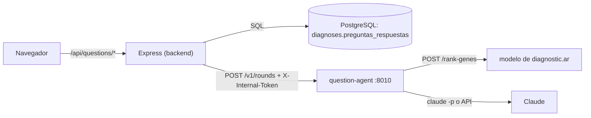

# Integración con la plataforma diagnostic.ar

Cómo usa la plataforma al agente: el contrato, las rutas de Express, la
configuración de los dos lados, el despliegue y lo que falta para ponerlo en
marcha. El lado de la plataforma vive en el repositorio de diagnostic.ar, en las
ramas `feat/question-agent-backend` (backend, compose, release) y
`feat/question-agent-ui` (interfaz). Arquitectura interna del agente en
[ARQUITECTURA.md](ARQUITECTURA.md).

> **Estado (2026-09-26):** nada está desplegado. El agente no corre en staging ni
> en producción, y cualquier paso sobre esos entornos necesita el visto bueno
> explícito de Mate.



El agente no publica puertos: solo Express lo alcanza, por la red interna del
proyecto.

## 1. Contrato `POST /v1/rounds` (versión 2)

Fuente de verdad: `src/diagnosticar_preguntas/api/schemas.py`. Ejemplo completo
(ronda 1 en ambos modos y cierre en la ronda 2):
[contrato/rondas-ejemplo.json](contrato/rondas-ejemplo.json). La plataforma copia
ese ejemplo en `frontend/mocks/fixtures.json` (clave `questions`); si cambia uno,
cambia el otro. `tests/api/test_contract_example.py` valida el ejemplo contra los
esquemas.

### Pedido

| Campo | Tipo | Regla |
|---|---|---|
| `mode` | `"paciente"` \| `"medico"` | Para quién se escriben los textos de esta respuesta. |
| `round` | entero 1–4 | Ronda que se pide. La 1 no lleva respuestas; con `round` > 3 se cierra sin preguntas. |
| `present_hpo_ids` | 1–100 ids `HP:0000000` | Hallazgos presentes informados antes de preguntar. |
| `absent_hpo_ids` | 0–100 ids | Hallazgos negados informados antes de preguntar; disjuntos con los presentes. Se aceptan, no se vuelven a preguntar y quedan registrados; con la configuración por defecto no mueven el ranking. |
| `sex`, `age_years`, `onset_years` | `"male"` \| `"female"`, números 0–130; opcionales | Sexo, edad actual y edad exacta de inicio informados. Van al modelo en cada llamada de la ronda y solo los lee su ajuste ft-v1.1 ([DECISIONES.md](DECISIONES.md), D-20). |
| `answers[]` | hasta 9 | Todas las respuestas de la sesión, cada término una sola vez y nunca sobre un hallazgo informado. |
| `answers[].hpo_id`, `.answer` | id, `"si"` \| `"no"` \| `"no_se"` | El botón que se tocó. |
| `answers[].note` | texto ≤ 280, opcional | Nota libre. |
| `answers[].reading` | `{effective_answer, note_summary}` u omitido | La lectura que el agente ya devolvió para esa respuesta, copiada de `interpreted_answers`. Solo puede decir lo mismo que el botón o `no_se`. Las notas con `reading` no se vuelven a leer. |
| `finish` | booleano | Cerrar ahora, con o sin respuestas nuevas. |

### Respuesta

| Campo | Contenido |
|---|---|
| `round`, `mode` | La ronda respondida y el modo en que se escribieron sus textos (igual al pedido). |
| `status` | `"questions"` o `"finished"`. |
| `finish_reason` | `null` o `"user_finished"`, `"max_rounds"`, `"confident"`, `"no_useful_questions"`. |
| `questions[]` | `id` (`r<ronda>-<hpo_id>`), `hpo_id`, `label` (etiqueta oficial en español, para chips como "No presenta: …"), `text`, `help`, y solo en modo médico `genes_if_yes` (hasta 5 genes asociados al síntoma; el modelo puede subirlos si la respuesta es «sí»), `genes_if_no` (con la configuración por defecto, siempre `[]`: un «no» no mueve nada) y `rationale` (de qué genes es típico el síntoma); en modo paciente esos tres son `null`. |
| `ranking[]` | Hasta 50 genes: `gene_id`, `gene_symbol`, `score` (suma 1), `model_score`, `model_rank`. Mismos campos iniciales que un resultado de `/rank-genes`. Por defecto es el ranking del propio modelo para los hallazgos informados más cada «sí» efectivo: `model_rank` coincide con el puesto y `score` es `model_score` renormalizado ([DECISIONES.md](DECISIONES.md), D-18). Por eso no sirve para mostrar cómo cambió la lista: para eso hay que compararlo con el ranking anterior a las preguntas (el del diagnóstico). |
| `specialties`, `confidence` | Tal cual de la llamada al modelo de la ronda. Con la configuración por defecto esa llamada lleva los hallazgos informados más cada «sí», así que cambian a medida que llegan «sí». |
| `interpreted_answers[]` | Por respuesta: `answer`, `effective_answer` y `note_summary`. Es lo que se reenvía como `reading`. |
| `summary` | Resumen de cierre para conversar con el médico (solo al terminar). |
| `warnings[]` | Avisos para mostrar, por ejemplo "Algunas preguntas se generaron sin IA." |
| `versions` | `agent`, `knowledge_base` (`kb1+hpo.2026-02-16`) y `llm_model` (`null` si todo vino de plantillas). |

Errores: `{"error": "<código>"}` con 401, 413, 422 (`invalid-request`,
`no-known-hpo-ids`), 503 (`busy`, `model-unavailable`, con `Retry-After`) o 500;
tabla completa en [ARQUITECTURA.md](ARQUITECTURA.md), sección 9.

## 2. Rutas de Express y formato para el navegador

`backend/src/routes/questions.ts`, montadas en `/api/questions`, todas con
sesión iniciada:

| Ruta | Cuerpo / respuesta |
|---|---|
| `GET /api/questions/status` | `{enabled}`: si `QUESTION_AGENT_URL` está configurada. Con `false` la interfaz esconde la función. |
| `POST /api/questions/rounds` | Cuerpo `{diagnosisId, mode, answers: [{hpoId, answer, note}] (hasta 3), finish}`. Responde la ronda en camelCase: `round`, `mode`, `status`, `finishReason`, `questions[]` (`id`, `hpoId`, `label`, `text`, `help`, `genesIfYes`, `genesIfNo`, `rationale`), `ranking[]` (`geneId`, `geneSymbol`, `score`, `modelScore`, `modelRank`), `specialties`, `confidence`, `interpretedAnswers[]`, `summary`, `warnings`. `versions` no se manda. |
| `GET /api/questions/:diagnosisId` | `{session: null}` o `{session: {finished, rounds: [{round, mode, questions, answers}], latest}}`, para retomar después de recargar. |

Qué hace Express en cada `POST` (`backend/src/services/questionSession.ts`):

- **Evidencia desde la base, nunca desde el navegador**: presentes = los códigos
  de `symptoms_extracted` del diagnóstico (lo que recibió `/rank-genes`);
  ausentes = las entradas `negated` de `phenotypes` que no estén también
  presentes.
- **Sesión**: las respuestas tienen que cubrir exactamente las preguntas
  pendientes; se reenvían todas las anteriores, cada una con la lectura que el
  agente ya le dio. Un pedido sin respuestas con una ronda pendiente, o el mismo
  pedido repetido tras perder la respuesta, se responde desde la base sin llamar
  al agente.
- **Modo**: el de cada pedido, que la interfaz toma de "Ver detalle médico"; cada
  ronda guardada recuerda el suyo. En modo paciente Express vuelve a quitar
  `genesIfYes` y `genesIfNo`.
- **Qué puede decir la interfaz**: con la configuración por defecto solo un «sí»
  cambia la lista (a través del modelo); un «no» y los negados quedan
  registrados para la consulta y no reordenan nada, así que la interfaz no debe
  decir ni sugerir lo contrario (por ejemplo, genes que «suben con un no»:
  `genesIfNo` llega vacío). Para mostrar cuánto se movió un gen, la referencia
  es el ranking anterior a las preguntas, no `modelRank`, que con la
  configuración por defecto coincide con el puesto.
- **Guardado**: `diagnoses.preguntas_respuestas` (JSONB), con compare-and-set
  contra el valor leído; la respuesta del agente se guarda completa.
- **Límites por cuenta**: 60 `POST` y 120 `GET` por minuto; 20 rondas por hora
  (`QUESTION_AGENT_ROUNDS_PER_HOUR`) que solo cuentan si llegan al agente y se
  devuelven si el agente contestó `busy` o `no-known-hpo-ids`; además un tope
  global de 50 rondas cada 5 horas para toda la instalación
  (`QUESTION_AGENT_GLOBAL_ROUNDS_PER_5H`, error `global_limit`), contado en
  Postgres bajo un lock; una ronda en curso por cuenta y proceso. La respuesta del agente se valida con zod.
- **Errores hacia el navegador**: siempre `{error, code}`, con `error` en
  castellano para mostrar y `code` para que la interfaz decida. Los del agente
  se traducen así: `no-known-hpo-ids` → 400 `no_usable_symptoms`; `busy` y
  `model-unavailable` → 503 `unavailable` con el `Retry-After` del agente (hasta
  60 s); `invalid-request`, 401, 413, 500, fallas de red y respuestas fuera de
  contrato → 503 `unavailable`; sin respuesta a tiempo → 504 `timeout`. Nunca se
  reenvía el cuerpo del agente. La tabla completa de códigos (incluidos
  `answers_mismatch`, `finished`, `conflict`, `rate_limited`, `round_in_flight`
  y `disabled`) está en `docs/INTEGRATION_PLAN.md` de la plataforma.

La interfaz (`frontend/src/app/nuevo/question-panel.tsx`,
`frontend/src/lib/question-session.ts`) espera 110 s por ronda, para que el 504
del backend llegue antes, y ante un resultado incierto (timeout, conflicto)
relee la sesión guardada en lugar de reenviar respuestas.

## 3. Configuración de los dos lados

Backend (`.env` de la plataforma, `backend/src/config.ts`):

| Variable | Por defecto | Qué hace |
|---|---|---|
| `QUESTION_AGENT_URL` | (vacía) | URL del agente. Vacía apaga la función. Con compose: `http://question-agent:8010`. |
| `QUESTION_AGENT_TOKEN` | (vacío) | Va como `X-Internal-Token`. En producción, con la URL puesta, es obligatorio y de 32 caracteres o más. |
| `QUESTION_AGENT_TIMEOUT_MS` | `100000` | Cuánto espera Express una ronda. |
| `QUESTION_AGENT_ROUND_BUDGET_S` | `75` | Solo en compose: se pasa al agente como `PREGUNTAS_ROUND_BUDGET_S`. |
| `QUESTION_AGENT_ROUNDS_PER_HOUR` | `20` | Rondas por cuenta y por hora. |
| `QUESTION_AGENT_GLOBAL_ROUNDS_PER_5H` | `50` | Rondas para toda la instalación cada 5 horas. |
| `QUESTION_AGENT_TAG` | `latest` | Etiqueta de la imagen `diagnosticar-question-agent`. |

Agente (servicio `question-agent` de `docker-compose.yml`): compose fija
`PREGUNTAS_PORT=8010`, pasa `PREGUNTAS_SERVICE_TOKEN` desde
`QUESTION_AGENT_TOKEN` y `PREGUNTAS_ROUND_BUDGET_S` desde
`QUESTION_AGENT_ROUND_BUDGET_S` (así los dos lados no se desfasan), usa
`PREGUNTAS_MODEL_SERVICE_URL` (por defecto `http://host.docker.internal:18020`),
`PREGUNTAS_LLM_PROVIDER` (`claude-cli`) y `PREGUNTAS_LLM_MODEL`
(`claude-opus-5`), y deja pasar, solo si están definidas,
`PREGUNTAS_MODEL_SERVICE_TIMEOUT_S`, `PREGUNTAS_LLM_TIMEOUT_S`,
`PREGUNTAS_LLM_EFFORT`, `PREGUNTAS_MAX_CONCURRENT_ROUNDS`, `PREGUNTAS_LOG_LEVEL`,
`CLAUDE_CODE_OAUTH_TOKEN` y `ANTHROPIC_API_KEY`. El resto usa los valores por
defecto del agente ([README](../README.md#configuración)). Entre ellos, qué hacen
las respuestas: `PREGUNTAS_RERANK_STRATEGY` (`model_sees_present`) y
`PREGUNTAS_ANSWER_WEIGHTING` (`none`; o `asymmetric` / `calibrated`, con
`PREGUNTAS_ANSWER_WEIGHT`) y `PREGUNTAS_RERANK_NEGATIONS` (`true`: los «no» van
al modelo como `excluded_hpo_ids`) y `PREGUNTAS_SELECTOR` (`q2b`; `legacy` vuelve
al selector anterior); para cambiarlos en la plataforma hay que agregarlos
a la lista de variables que compose deja pasar ([DECISIONES.md](DECISIONES.md),
D-18, D-19). Con la API del modelo sin actualizar, Q2b elige sobre el ranking
sin re-ranker (los «no» no lo mueven); al actualizarla, sin cambiar nada del
agente, ya los usa.

**Invariante de tiempos.** El backend tiene que esperar más que el peor caso
del agente: cola (`PREGUNTAS_QUEUE_TIMEOUT_S`, 10 s) + presupuesto de la ronda
(`PREGUNTAS_ROUND_BUDGET_S`, 75 s) + llamada al modelo
(`PREGUNTAS_MODEL_SERVICE_TIMEOUT_S`, 10 s) = 95 s < 100 s. Si se sube el
presupuesto o el timeout del modelo, hay que subir `QUESTION_AGENT_TIMEOUT_MS`
con ellos; si no, Express abandona rondas que el agente termina y la cuota se
gasta igual.

## 4. Local, staging y release

**Local.** `docker compose --profile question-agent up -d` y
`QUESTION_AGENT_URL=http://question-agent:8010` en el `.env` de la plataforma. El
servicio está detrás de un perfil para que un `up` común no necesite la imagen.

**Staging.** Los pasos están en `STAGING.md` de la plataforma, sección "Follow-up
questions (question agent)". En resumen: el servicio no tiene etiquetas de
Traefik ni está en `traefik_net` (red compartida con contenedores de otros
equipos), llega al modelo por `http://model:18020` en la red del proyecto, usa
`STAGING_CLAUDE_CODE_OAUTH_TOKEN` como `CLAUDE_CODE_OAUTH_TOKEN`, y se enciende
con `QUESTION_AGENT_TOKEN`, `QUESTION_AGENT_TAG` y `QUESTION_AGENT_URL` en
`.env.staging` más `COMPOSE_PROFILES=question-agent ops/staging.sh up vX.Y.Z`.
Se apaga dejando `QUESTION_AGENT_URL` vacía. **Nada de esto se ejecutó**: requiere
el visto bueno de Mate.

**Release.** `.github/workflows/release.yml` de la plataforma tiene el job
`publish-question-agent` (detalle en `CI_CD.md`, "The question agent image"). La
imagen se construye con `services/question-agent/Dockerfile` de diagnostic.ar-api
(fijado por `GATEWAY_COMMIT` en `.github/recognizer.env`), con este repositorio
como contexto de build `agent`:

```text
leer los pins -> checkout de diagnostic.ar-api (API_DEPLOY_KEY) y de este
  repositorio (QUESTION_AGENT_DEPLOY_KEY) -> build :candidate
  -> pytest dentro de la imagen (-m 'not live') -> Trivy HIGH,CRITICAL
  -> verificar que no corre como root -> push
```

El pin está en `.github/question-agent.env`:
`QUESTION_AGENT_REPO=MarBL00126/diagnosticar-question-agent` y
`QUESTION_AGENT_COMMIT`. En la rama `feat/question-agent-backend` está vacío y el
job se saltea sin fallar; la rama `integration/question-agent` lo fija al commit
de este repositorio que se despliega. Un
valor que no sea un SHA completo de 40 caracteres hace fallar el release. El
comando de tests dentro de la imagen es el que documenta
`services/question-agent/Dockerfile` de diagnostic.ar-api.

## 5. Qué falta para ponerlo en marcha

1. Publicar la rama `feat/agente-v2` de este repositorio (hecho el 2026-09-28).
2. Crear una clave de despliegue de solo lectura en este repositorio y cargar su
   parte privada como secreto `QUESTION_AGENT_DEPLOY_KEY` en el de la plataforma.
3. Fijar el SHA completo del commit a desplegar en `QUESTION_AGENT_COMMIT`
   (`.github/question-agent.env`).
4. Integrar las ramas de la plataforma (backend y UI) y sacar un release, que
   publica la imagen.
5. Generar `QUESTION_AGENT_TOKEN` (`openssl rand -hex 32`).
6. Credenciales del LLM: `CLAUDE_CODE_OAUTH_TOKEN` (de `claude setup-token`) para
   `claude-cli`, o `ANTHROPIC_API_KEY` con `PREGUNTAS_LLM_PROVIDER=anthropic`.
7. Configurar `QUESTION_AGENT_URL` y `QUESTION_AGENT_TAG`, levantar el perfil
   `question-agent` y comprobar que `GET /healthz` diga `status: "ok"`.

Para producción, además, `docker-compose.prod.yml` hoy no menciona al agente, y
el proveedor previsto es `anthropic` (D-12 en [DECISIONES.md](DECISIONES.md)).
Cada paso sobre staging o producción espera la aprobación explícita de Mate.
