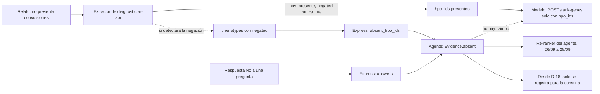
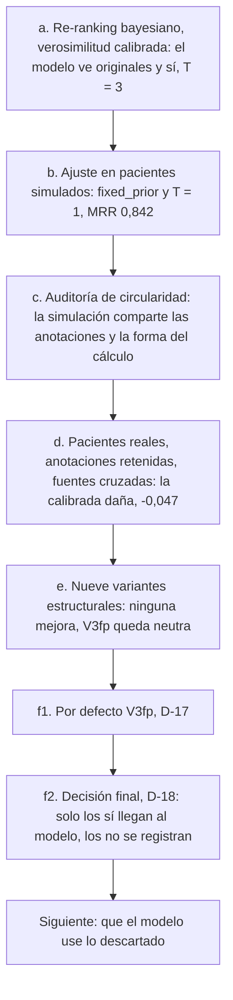

# Intento de usar los síntomas negados y las respuestas «no»

Este documento es un traspaso. Cuenta qué se hizo en el agente de preguntas
para aprovechar lo que una familia o un médico **descarta** (un hallazgo negado
en el relato, un «no» a una pregunta), por qué no funcionó y qué hace falta para
retomarlo **del lado del modelo de diagnostic.ar**. Está escrito para quien
siga esa línea, para el equipo y para quienes evalúan el Trabajo Profesional
(FIUBA).

Cada cifra dice de dónde sale: una sección de [EVALUACION.md](EVALUACION.md),
[IMPACTO.md](IMPACTO.md) o [ARQUITECTURA.md](ARQUITECTURA.md), un archivo de
resultados de `eval/results/` (fuera de git; se regenera con los comandos de la
sección 5) o un conteo sobre `data/` con el comando que lo reproduce. «Δ MRR»
es siempre agente menos modelo solo, con intervalo de confianza del 95 %
bootstrap pareado (2000 remuestreos, [EVALUACION.md](EVALUACION.md) §1).

> **Actualización del 03/10/2026: los «no» de los botones ahora viajan al modelo
> como `excluded_hpo_ids`** (`PREGUNTAS_RERANK_NEGATIONS`), por la puerta
> sellada de rr-v1 (EXP-B-003). Lo que dice cada punto de abajo sobre los «no»
> es el estado del 28/09; el estado vigente, con la evidencia y sus límites, está
> en la [sección 6](#6-desde-el-03102026-los-no-de-las-preguntas-llegan-al-re-ranker-del-modelo).
>
> **Estado del 28/09/2026 ([DECISIONES.md](DECISIONES.md) D-18)**
>
> - **Qué ve el modelo.** Cada ronda consulta `POST /rank-genes` con los
>   hallazgos informados más las respuestas efectivas «sí»
>   (`PREGUNTAS_RERANK_STRATEGY=model_sees_present`).
> - **Qué se muestra.** El ranking es el del propio modelo para esa consulta
>   (`PREGUNTAS_ANSWER_WEIGHTING=none`): ninguna anotación lo reordena.
> - **Los «no» y los negados** se registran (`interpreted_answers`, y la sesión
>   en `diagnoses.preguntas_respuestas`) pero no mueven ninguna lista. En modo
>   médico, `genes_if_no` llega vacío.
> - **Siguen seleccionables**, sin cambiar código: `asymmetric` (V3fp, D-17),
>   `calibrated` (D-11) y `fixed_prior` ([ARQUITECTURA.md](ARQUITECTURA.md) §4).
> - **Interfaz.** «Original» (la lista del modelo) es la vista por defecto;
>   «Con tus respuestas» es opcional y lleva la aclaración «La lista con tus
>   respuestas es orientativa: todavía estamos evaluando si mejora el orden.».
>   Los negados del relato y los «No» se muestran como «No presenta…», con
>   «Quedan registrados para la consulta; hoy no cambian el orden de ninguna
>   lista.» (`docs/QUESTION_PANEL_DESIGN.md` de la plataforma, rama
>   `feat/question-agent-ui`, §2.9, §5.8 y §5.9).
> - **Próxima línea de trabajo:** que el modelo use lo que se descarta. Es lo
>   que prepara este documento.

## 1. El problema

El modelo de diagnostic.ar **solo recibe hallazgos presentes**. Su entrada es
`POST /rank-genes` con `{"hpo_ids": [...], "top_k": n}` (README de
`diagnostic.ar-api`, sección «Rank Genes»; el agente arma ese mismo cuerpo en
[`ranking/model_client.py`](../src/diagnosticar_preguntas/ranking/model_client.py)).
No hay campo para una ausencia. El documento de diseño de la carga de síntomas
de la plataforma (`docs/SYMPTOM_INPUT_DESIGN.md`, rama `main`) ya lo marcaba:
«El modelo solo recibe `hpo_ids`» y «Agregar un toggle "presente / descartado"
a los chips no cambiaría el ranking en absoluto».

Lo que no es un hallazgo presente le llega al agente por tres caminos, y ninguno llega al modelo:

| Origen | Cómo llega al agente | Qué pasaba con ella |
|---|---|---|
| Hallazgos negados de la extracción («no presenta convulsiones») | Express arma `absent_hpo_ids` con las entradas `negated` de `phenotypes` que no estén también presentes ([INTEGRACION.md](INTEGRACION.md) §2) | Entraban al re-ranking igual que un «no» ([EVALUACION.md](EVALUACION.md) §11.1, paso 3). |
| Respuesta «no» a una pregunta | `answers[].answer = "no"`; la nota solo puede bajarla a «no sé» (D-06) | Ídem. |
| «No sé» | `answers[].answer = "no_se"` | Nunca fue evidencia: no se usa ni se vuelve a preguntar ([ARQUITECTURA.md](ARQUITECTURA.md) §2, paso 3). |

Los dos primeros se juntan en `Evidence.absent`
([`agent/evidence.py`](../src/diagnosticar_preguntas/agent/evidence.py),
`build_evidence`). Como el modelo no los recibe, la única palanca que tenía el
agente era **reordenar la salida del modelo** con lo que las anotaciones HPO
dicen de cada síntoma.

**Problema aguas arriba.** Hoy el extractor de texto libre de la plataforma no
detecta negaciones: probado el 24/09/2026 contra staging, nunca marca `negated`,
y «El paciente no presenta convulsiones» vuelve como convulsiones **presente**
en 12 de 12 frases de prueba. El arreglo es del extractor, en
`diagnostic.ar-api` (`docs/SYMPTOM_INPUT_DESIGN.md` de la plataforma, sección
«Manejar negaciones»; también [EVALUACION.md](EVALUACION.md) §9). Mientras eso
siga así, desde el relato no llega ningún `absent_hpo_ids`, y una negación
escrita puede llegar al modelo como un hallazgo presente.



## 2. Qué se intentó, en orden



### 2.1 (a) Re-ranking bayesiano con verosimilitud calibrada

El ranking del modelo es el prior; cada hipótesis es un par gen–enfermedad
(D-03). Cada respuesta multiplica cada hipótesis por la probabilidad de esa
respuesta si el paciente tuviera esa enfermedad, calculada con
`phenotype.hpoa` ([ARQUITECTURA.md](ARQUITECTURA.md) §4.2 y §4.3;
[`ranking/likelihood.py`](../src/diagnosticar_preguntas/ranking/likelihood.py)):

| Caso de la anotación de $d$ sobre $t$ | $P(t \mid d)$ | Factor de un «sí» | Factor de un «no» o un negado |
|---|---|---|---|
| Anota $t$ o un descendiente | noisy-OR de las frecuencias (0,3 si falta), con piso $b$ = 0,1 | $P$ | $1 - P$ |
| Tiene `NOT` sobre $t$ o un ancestro | $\varepsilon$ = 0,02 | 0,02 | 0,98 |
| No dice nada de $t$ | $b$ = 0,1 | 0,1 | 0,9 |

Todo se recorta a $[\varepsilon, 1 - \varepsilon]$. Un «no» nunca favorece a
una hipótesis que anota el término ([ARQUITECTURA.md](ARQUITECTURA.md) §4.5,
con test). Los valores de
$b$ y de la frecuencia faltante son los elegidos en (b); antes eran 0,05 y 0,5
([EVALUACION.md](EVALUACION.md) §5).

La primera versión, además, le mandaba al modelo cada «sí»
(`model_sees_present`) y aplanaba su ranking con temperatura 3. Los «no» y los
negados solo podían actuar por la verosimilitud.

### 2.2 (b) Ajuste con pacientes simulados

500 casos simulados desde las mismas anotaciones (HPO 2026-02-16), 200 para
ajustar y 300 para probar, con un respondedor ruidoso (10 % de respuestas
invertidas, 20 % «no sé») y uno pesimista (`dropout`: el paciente tiene el 70 %
de los rasgos anotados) ([EVALUACION.md](EVALUACION.md) §2, §3). En PRUEBA:

| Configuración | Qué ve el modelo | Δ MRR [IC 95 %] | Empeora | Fuente |
|---|---|---|---|---|
| Inicial: `model_sees_present`, T = 3 | originales + «sí» | −0,029 [−0,063; +0,006] | 20,7 % | §6.2 |
| Inicial, respondedor `dropout` | originales + «sí» | **−0,112 [−0,154; −0,072]** | 30,3 % | §6.4 |
| Elegida: `fixed_prior`, T = 1 | solo originales | **+0,054 [+0,033; +0,078]** | 3,7 % | §6.1 |
| Elegida, respondedor `dropout` | solo originales | +0,018 [−0,009; +0,043] | 8,3 % | §6.4 |
| Elegida con `model_sees_present` | originales + «sí» | +0,012 [−0,011; +0,036] | 9,0 % | §6.3 |
| Elegida con T = 3 | solo originales | +0,018 [−0,018; +0,051] | 12,0 % | §6.3 |

Los negados en la simulación: 130 de los 300 casos llevan un término negado
(§2). Antes de cualquier respuesta, ese negado mueve el MRR +0,000005 (§11.2,
camino e), y la mejora final es parecida con negado (+0,060 [+0,034; +0,090]) y
sin él (+0,050 [+0,019; +0,082]) ([IMPACTO.md](IMPACTO.md) §7.3). El negado
simulado se sortea entre términos que la enfermedad verdadera no respalda de
ninguna forma (§2), así que nunca contradice al diagnóstico real: es la única
vía indirecta por la que el simulador filtra información (§11.2, camino e).

### 2.3 (c) Auditoría de circularidad

La pregunta fue si el 0,842 era sobreajuste. Lo relevante para las negaciones
([EVALUACION.md](EVALUACION.md) §11.2):

| Camino | Qué se encontró | Impacto medido |
|---|---|---|
| a. El paciente simulado sale de las mismas anotaciones y del mismo noisy-OR que usa el agente | La probabilidad de responder «sí» o «no» es la misma que el agente usa para interpretarla. | Toda la mejora depende de compartir las anotaciones: +0,054 con la misma fuente; −0,041 a −0,095 sin ella. |
| b. Hiperparámetros ajustados sobre el simulador | El fondo elegido (0,1) es el más cercano a la tasa de «sí» espurios del respondedor (0,116). | Con pacientes reales la elección de estrategia se invierte (+0,046 a favor de `model_sees_present`). |
| c. El modelo está en su terreno | Se entrenó solo con pacientes sintéticos generados de las anotaciones HPO (preprint citado en §11.2). | top-1 del modelo 72,0 % simulado contra 43,1 % real; gen en el top-50: 98,7 % contra 77,0 %. |
| g. Anotaciones derivadas de los mismos artículos | Las anotaciones citan el artículo del paciente en 366 de 501 casos (73 %). | Con el artículo en la base: +0,014; sin él: −0,047. |

Las particiones AJUSTE / PRUEBA estaban limpias (camino f): no es sobreajuste
a los casos de prueba, es optimismo del simulador (§11.7).

### 2.4 (d) Pacientes reales, anotaciones retenidas y fuentes cruzadas

Con la ponderación calibrada y `fixed_prior` (los valores por defecto de
entonces), sin reajustar nada ([EVALUACION.md](EVALUACION.md) §11.3 a §11.5;
[IMPACTO.md](IMPACTO.md) §0):

| Escenario | Casos | Δ MRR [IC 95 %] | Δ top-1 (pp) | Empeora / mejora | «sí» / «no» / «no sé» |
|---|---|---|---|---|---|
| **A**: phenopacket-store, un paciente por gen, sin su artículo en la base | 501 | **−0,047 [−0,065; −0,029]** | −5,6 [−8,2; −3,0] | 17,6 % / 8,0 % | 428 / 87 / 2335 |
| A con la base completa (circular) | 501 | +0,014 [−0,001; +0,029] | +2,2 [−0,2; +4,6] | 8,4 % / 13,6 % | 459 / 90 / 2208 |
| A, los 135 cuyo artículo HPO no cita | 135 | −0,008 [−0,024; +0,008] | −1,5 [−4,4; +1,5] | — | 113 / 21 / 760 |
| A, hasta 5 pacientes por gen | 1742 | −0,036 [−0,045; −0,027] | −4,4 [−5,7; −3,1] | 16,1 % / 8,8 % | 1404 / 368 / 8134 |
| A, lo que el artículo no menciona = «no» (cota) | 501 | −0,058 [−0,083; −0,035] | −5,6 [−8,6; −2,8] | — | 515 / 2185 / 0 |
| **B**: el agente no conoce la mitad de las anotaciones de las que sale el paciente | 300 | −0,041 [−0,072; −0,011] | −3,0 [−6,7; +1,0] | 20,3 % / 11,7 % | 184 / 780 / 248 |
| B con la base completa | 300 | −0,005 [−0,034; +0,023] | +1,7 [−1,7; +5,3] | — | 208 / 733 / 250 |
| **C_orpha**: paciente de Orphanet, agente solo con OMIM | 300 | −0,055 [−0,087; −0,025] | −4,3 [−8,7; −0,3] | 17,7 % / 9,7 % | — |
| **C_omim**: paciente de OMIM, agente solo con Orphanet | 300 | −0,095 [−0,127; −0,062] | −11,0 [−15,0; −6,7] | 24,3 % / 10,3 % | — |
| Controles de C (el agente conoce las dos fuentes) | 300 / 300 | +0,054 / +0,055 | +8,7 / +6,7 | — | — |

Lo que dice sobre las negaciones:

- **En A el negado informado ya daña solo**: antes de cualquier respuesta, el
  rasgo excluido del registro (hay uno informable en 424 de 501 casos) mueve el
  MRR −0,006 [−0,011; −0,001]; las respuestas agregan −0,041 [−0,059; −0,023]
  (§11.3).
- **Con registros reales casi no hay «no»**: 87 de 2850 respuestas (3,1 %); el
  82 % es «no sé», porque un artículo describe pocos rasgos (§11.3). Casi todo
  el daño de A viene de los «sí» a rasgos reales que las anotaciones no
  mencionan (factor 0,1).
- **Con más «no», más daño**: con los mismos 501 casos, leer el silencio del
  artículo como «no» (2185 «no») lleva el daño de −0,047 a −0,058. En B, donde
  predominan los «no» (780 de 1212 respuestas), el daño es −0,041; ahí los «no»
  pasan por la verosimilitud en las dos estrategias (§11.6).
- **No es un problema de parámetros**: ninguna de 44 configuraciones mejora a
  los pacientes reales (la mejor, +0,005 sobre los 501); la elegida en una mitad
  por gen queda en −0,002 [−0,020; +0,014] en la otra y daña en B y C (§11.6).
  Con `model_sees_present`, A queda en −0,001 [−0,014; +0,012].

### 2.5 (e) Variantes estructurales

Se cambió **la forma** en que las respuestas reordenan los genes, con la misma
selección de preguntas ([EVALUACION.md](EVALUACION.md) §11.8,
[`eval/variants.py`](../eval/variants.py)). $p$ es el noisy-OR de las
frecuencias anotadas, sin piso ni recorte. A se parte por gen en dos mitades
(250 para elegir, 251 retenidos para informar).

| Variante | «sí» | «no» y negados | A retenidos: Δ MRR | Empeora | B | C_orpha | C_omim | Simulación |
|---|---|---|---|---|---|---|---|---|
| **V1** | al modelo | neutros | −0,007 [−0,024; +0,010] | 9,6 % | −0,043 | −0,016 | −0,025 | −0,015 |
| V2 | al modelo; un presente excluido × 0,02 | neutros | −0,006 [−0,024; +0,010] | 9,2 % | −0,044 | −0,015 | −0,026 | −0,015 |
| V2 literal | al modelo | × 0,02 a las que excluyen el término | −0,007 [−0,024; +0,010] | 9,6 % | −0,044 | −0,016 | −0,025 | −0,018 |
| V3, k = 0,3 | al modelo y además × (1 + kp) | × (1 − kp) a las que lo anotan | −0,013 [−0,032; +0,004] | 10,8 % | −0,033 | −0,024 | −0,040 | +0,004 |
| V3, k = 0,5 | ídem | ídem | −0,018 [−0,037; +0,000] | 12,4 % | −0,040 | −0,020 | −0,047 | +0,022 |
| **V3fp, k = 0,3** | solo × (1 + kp) | × (1 − kp) a las que lo anotan | **−0,001 [−0,009; +0,007]** | **4,0 %** | +0,004 | +0,001 | −0,022 | +0,025 |
| V3fp, k = 0,5 | ídem | ídem | −0,005 [−0,015; +0,005] | 5,6 % | +0,000 | −0,007 | −0,044 | +0,036 |
| V4 (elegida en la exploración) | al modelo | calibrada, $\varepsilon$ = 0,1 | −0,002 [−0,020; +0,014] | 9,6 % | −0,066 | −0,046 | −0,093 | +0,018 |
| V5 (calibrada, por defecto hasta el 28/09) | × $P$ | × $(1 - P)$ | −0,044 [−0,068; −0,020] | 18,3 % | −0,041 | −0,055 | −0,095 | +0,054 |
| V5 anterior (antes del ajuste) | al modelo y × $P$ | × $(1 - P)$ | −0,012 [−0,033; +0,010] | 13,9 % | −0,221 | −0,251 | −0,283 | −0,029 |

Lectura desde las negaciones:

- **Las exclusiones explícitas casi nunca se disparan**: V2 ≈ V1, y V2 literal,
  que castiga justo a las enfermedades que coinciden con la respuesta, también
  da lo mismo que V1 (§11.8). No hay suficientes `NOT` en las anotaciones para
  que importen (sección 3.2).
- **Un «no» pesado de forma acotada (1 − kp) no ayuda ni daña con pacientes
  reales**: V3fp queda neutra, y restringida a los 122 casos retenidos con al
  menos un «sí» o un «no» da −0,002 [−0,019; +0,014] (§11.8).
- **Ninguna variante mejora a los pacientes reales retenidos.** V3fp se eligió
  después de ver A, B y C; hace falta un conjunto nuevo para confirmarla
  (§11.8).

### 2.6 (f) Por defecto V3fp, y la decisión final: solo los «sí» llegan al modelo

**28/09/2026, D-17.** El código pasó a la ponderación asimétrica (V3fp, k = 0,3)
sobre `fixed_prior`. Confirmada por el camino normal del código
([EVALUACION.md](EVALUACION.md) §11.10):

| Escenario | Casos | MRR modelo → agente | Δ MRR [IC 95 %] | Empeora / mejora |
|---|---|---|---|---|
| A, retenidos | 251 | 0,500 → 0,499 | −0,001 [−0,009; +0,007] | 4,0 % / 3,2 % |
| A, los 501 | 501 | 0,508 → 0,507 | −0,001 [−0,006; +0,005] | 5,4 % / 4,2 % |
| B | 300 | 0,755 → 0,759 | +0,004 [−0,008; +0,016] | 6,0 % / 8,7 % |
| C_orpha | 300 | 0,811 → 0,812 | +0,001 [−0,014; +0,017] | 4,7 % / 7,7 % |
| C_omim | 300 | 0,774 → 0,752 | −0,022 [−0,039; −0,006] | 8,3 % / 7,7 % |
| Simulación | 300 | 0,787 → 0,812 | +0,025 [+0,012; +0,039] | 2,0 % / 12,0 % |

**28/09/2026, D-18 (decisión de Mate).** El agente solo suma los «sí»
efectivos a la consulta del modelo y muestra el ranking del propio modelo; los
«no» y los negados quedan registrados para la consulta. Es la variante V1
(`model_sees_present` sin re-ranking: `AnswerWeighting.NONE` equivale a V1, la
asimétrica con k = 0 y sin exclusiones):

| Escenario (V1) | Δ MRR [IC 95 %] | Empeora / mejora | Fuente |
|---|---|---|---|
| A, retenidos (251) | −0,007 [−0,024; +0,010] | 9,6 % / 10,8 % | §11.8; `variants.V1.A.held_out` |
| A, los 501 | −0,000 [−0,012; +0,011] | 8,0 % / 11,4 % | `variants.V1.A.all` |
| A, 241 casos con al menos un «sí» o «no» | −0,000 [−0,024; +0,023] | 15,8 % / 23,2 % | `variants.V1.A.informative` |
| B | −0,043 [−0,067; −0,021] | 17,3 % / 6,3 % | §11.8; `variants.V1.B.all` |
| C_orpha | −0,016 [−0,040; +0,006] | 12,7 % / 8,3 % | `variants.V1.C_orpha.all` |
| C_omim | −0,025 [−0,044; −0,007] | 14,3 % / 9,7 % | `variants.V1.C_omim.all` |
| Simulación | −0,015 [−0,041; +0,009] | 14,3 % / 10,3 % | `variants.V1.simulated.all` |

Las claves son de `eval/results/audit/variants/summary.json`. Qué pesa en la
elección, a la vista de las tablas:

- Con pacientes reales, V1 y V3fp son **igual de neutras**; ninguna mejora al
  modelo.
- V1 es la única en la que la lista que se muestra es **la del modelo**, sin
  nada que dependa de cuán bien describan las anotaciones a cada paciente.
- El costo de V1 está en B y en C: ahí el respondedor simulado invierte el 10 %
  de las respuestas y un «sí» falso reordena todo el ranking del modelo
  (§11.8). Los registros publicados de A no tienen ese error; una familia real
  sí puede equivocarse, y eso no está medido.
- Los «no» quedan fuera de la cuenta hasta que el modelo pueda usarlos
  directamente.

## 3. Por qué no funcionó

### 3.1 Las anotaciones describen enfermedades, no pacientes

Todo lo que el agente podía hacer con un «no» pasaba por `phenotype.hpoa`. Pero
que una enfermedad **no mencione** un síntoma no dice que sus pacientes no lo
tengan:

- Con la calibrada, un «sí» a un síntoma que la enfermedad no anota la
  multiplica por 0,1 contra hasta 0,98 de las que lo anotan: un factor 9 por
  respuesta ([EVALUACION.md](EVALUACION.md) §11.1). Con registros reales, esos
  «sí» son los que dañan (§11.3).
- En el otro sentido, un «no» a un síntoma frecuente que el paciente no tiene
  castiga a la enfermedad verdadera; la asimétrica lo acota a un 30 % por
  respuesta, pero no lo elimina ([ARQUITECTURA.md](ARQUITECTURA.md) §4.6).
- Dos curaciones independientes de la misma enfermedad (OMIM y Orphanet)
  alcanzan para pasar de +0,054 a −0,055 o −0,095 (§11.5).

### 3.2 Las negaciones explícitas son escasas del lado de las enfermedades y abundantes del lado de los pacientes

| Fuente | Qué describe | Negaciones | Sobre | Proporción | Cómo se contó |
|---|---|---|---|---|---|
| `phenotype.hpoa` v2026-02-16, aspecto P | enfermedades | 720 filas `NOT` (0 con frecuencia «Excluded»); las 720 son de ORPHA, 0 de OMIM (149 008 filas) y 0 de DECIPHER (294) | 264 965 filas | 0,27 % | comando 1 (sección 5) |
| Base del agente (`data/kb.sqlite`) | enfermedades | 720 anotaciones negadas; 350 enfermedades con al menos una | 264 370 anotaciones; 12 974 enfermedades anotadas | 0,27 %; 2,7 % | comando 2; [ARQUITECTURA.md](ARQUITECTURA.md) §3 |
| phenopacket-store 0.1.27 | pacientes publicados | 132 795 rasgos con `excluded: true`; 9030 fenopaquetes con al menos uno | 224 863 rasgos (92 068 observados); 10 377 fenopaquetes | 59,1 %; 87,0 % | comando 3 (rasgos tal como están en los archivos, sin filtrar) |
| Casos de A | pacientes publicados | mediana de 4 rasgos excluidos por paciente (10 observados) | 501 | — | [EVALUACION.md](EVALUACION.md) §11.3 |
| Respuestas en A | preguntas del agente | 87 «no» | 2850 respuestas | 3,1 % | §11.3 |
| Extractor de la plataforma | relatos | 0 negaciones detectadas | 12 frases de prueba | 0 % | `docs/SYMPTOM_INPUT_DESIGN.md` de la plataforma |

Consecuencias:

- Una verosimilitud armada con anotaciones casi no tiene negaciones de las que
  tomar evidencia: por eso V2 ≈ V1.
- Los registros de pacientes sí traen negaciones en abundancia, pero lo que un
  artículo excluye rara vez coincide con lo que el agente pregunta: 87 «no» en
  2850 respuestas.
- Un modelo que aprenda a usar lo descartado necesita datos con la forma de
  un paciente, no de una enfermedad.

### 3.3 El modelo está fuera de su terreno con pacientes reales

- top-1 del modelo: 72,0 % en la simulación contra 43,1 % con pacientes reales;
  gen verdadero en el top-50: 98,7 % contra 77,0 %
  ([EVALUACION.md](EVALUACION.md) §11.2, camino c).
- La red en la que se basa se entrenó solo con pacientes sintéticos generados de
  las anotaciones HPO, según su preprint («Solving the Diagnostic Odyssey with
  Synthetic Phenotype Data», bioRxiv 10.64898/2026.03.19.712946; citado en
  §11.2, camino c, y §11.3). Este repositorio no documenta si ese generador usa
  las anotaciones `NOT`; con 720 filas en todo `phenotype.hpoa`, a lo sumo
  podría usar muy pocas.
- El modelo también se beneficia del artículo del paciente: top-1 de 50,5 %
  cuando las anotaciones lo citan contra 23,0 % cuando no (§11.2, camino g).

### 3.4 El agente no puede suplir lo que el modelo no recibe

El re-ranking solo puede reordenar los 50 genes que devuelve el modelo y solo
con lo que las anotaciones dicen de cada síntoma (§3.1). Con pacientes reales,
esa información no alcanza para mejorar al modelo en ninguna de las formas
probadas: 44 configuraciones de parámetros y nueve variantes estructurales
(§11.6, §11.8). Incluso los «sí» verdaderos, mandados al modelo (V1), dejan el
MRR igual en A: −0,000 [−0,012; +0,011].

## 4. Qué necesita y qué tiene disponible el trabajo del lado del modelo

### 4.1 Fuentes de datos con negaciones

| Fuente | Qué aporta | Dónde está | Cuidado |
|---|---|---|---|
| `phenotype.hpoa` (HPO v2026-02-16, la versión con la que se entrenó el modelo, D-02) | 720 exclusiones `NOT` por enfermedad, solo de Orphanet | `data/sources/phenotype.hpoa` (lo deja `make kb`), fijado por sha256 en [`kb/sources.py`](../src/diagnosticar_preguntas/kb/sources.py) | Muy pocas (sección 3.2). |
| phenopacket-store 0.1.27 (Monarch Initiative) | 132 795 rasgos excluidos en 10 377 pacientes publicados, con gen causal y PMID | `data/phenopacket-store/0.1.27/all_phenopackets.zip`, que [`eval/phenopackets.py`](../eval/phenopackets.py) baja y verifica | Es también el conjunto de evaluación; HPO deriva anotaciones de esos artículos (sección 4.2). |
| Extracción de la plataforma | Negaciones del relato de cada familia, en el campo `negated` de `/extract-hpo` | `diagnostic.ar-api` | Hoy nunca se marca (sección 1). |
| Respuestas «no» guardadas | Lo que cada familia descartó, por diagnóstico | `diagnoses.preguntas_respuestas` (D-09) | Son datos clínicos: cualquier uso requiere consentimiento ([IMPACTO.md](IMPACTO.md) §10). |

### 4.2 Arnés de evaluación para reutilizar

Requisitos ([EVALUACION.md](EVALUACION.md) §10 y el «Cómo reproducir» al final
de §11): `make install`, `make kb` (deja `data/kb.sqlite` y
`data/sources/phenotype.hpoa`), el servicio del modelo escuchando en
`EVAL_MODEL_URL` (por defecto `http://127.0.0.1:18021`) y la corrida simulada
`eval/results/test_chosen.json` (§10), que el resumen de `eval.audit` usa como
referencia.

```sh
.venv/bin/python -m eval.audit --only A    # A: pacientes reales (baja phenopacket-store 0.1.27 la primera vez)
.venv/bin/python -m eval.audit --only B    # B: anotaciones retenidas
.venv/bin/python -m eval.audit --only C    # C: fuentes cruzadas, en las dos direcciones, con sus controles
.venv/bin/python -m eval.audit             # A, B, C y la sensibilidad S: 20 corridas, ~10 min con 4 procesos
.venv/bin/python -m eval.variants          # variantes estructurales sobre A, B, C y la simulación, ~12 min
.venv/bin/python -m eval.audit --summary-only   # rehace eval/results/audit/summary.json sin simular
```

| Pieza | Dónde | Para qué sirve del lado del modelo |
|---|---|---|
| Release fijada | `RELEASE = "0.1.27"`, `SHA256 = "d0c70005bb09b87035087516252b6b539fbc0415be7c664b73c9cde7eedf205a"` en [`eval/phenopackets.py`](../eval/phenopackets.py) | Rechaza otro archivo: las cifras se pueden repetir. |
| Casos | `select` y `to_case`: un gen causal, gen en el vocabulario del modelo, ≥ 6 rasgos observados; se informan de 3 a 6 observados no emparentados y un excluido si hay (semilla 20260928) | Mismos 501 pacientes (uno por gen) o 1742 (hasta 5 por gen). |
| Respuestas del registro | `RecordedPatient`: «sí» si el término o un descendiente fue observado, «no» si él o un ancestro fue excluido, «no sé» si no | Da los «no» reales para probar un modelo que los reciba. |
| Base sin el artículo del paciente | `HpoaReferences.annotations_without` y `AnnotationOverlay` en [`eval/kb_views.py`](../eval/kb_views.py) | Rehace las anotaciones sin las filas que citan el PMID del paciente. |
| Partición por gen | `gene_halves` en [`eval/explore.py`](../eval/explore.py): 250 genes para elegir, 251 para informar | Elegir cualquier cosa en una mitad e informar en la otra. |
| Métricas | `paired_bootstrap` en [`eval/metrics.py`](../eval/metrics.py): top-k, MRR, empeora / mejora, IC pareado | Las mismas de todo el proyecto. |
| Tests | [`tests/eval/test_decircularised.py`](../tests/eval/test_decircularised.py) | Fijan que el agente solo oye los hallazgos informados y las respuestas. |

Tres cuidados; los dos primeros salieron de la auditoría:

1. **El artículo del paciente dentro de los datos.** Las anotaciones HPO citan
   el artículo del paciente en 366 de los 501 casos de A (y en 7266 de los
   10 377 fenopaquetes); con él adentro, el agente pasaba de −0,047 a +0,014
   (§11.2, camino g). Si el modelo se reentrena con `phenotype.hpoa` o con
   phenopacket-store, hay que sacar del entrenamiento las filas y los pacientes
   de los PMID que se evalúan, e informar también el subconjunto de los 135
   cuyo artículo HPO no cita.
2. **Separar por gen, no por paciente.** STXBP1 tiene 462 fenopaquetes (§11.3):
   partir por paciente deja el mismo gen, y a menudo el mismo artículo, de los
   dos lados. `gene_halves` ya lo hace por gen.
3. **La caché del modelo no conoce la versión del modelo.**
   `CachedModelClient` ([`eval/harness.py`](../eval/harness.py)) guarda cada
   respuesta en `eval/results/cache/model/` con una clave hecha solo de los ids
   y `top_k`. Con otro modelo, o con ausentes en la consulta, hay que usar otro
   directorio o sumar esos datos a la clave; si no, se miden respuestas del
   modelo anterior.

### 4.3 Métricas y la vara a superar

La vara es **el modelo solo, en A** (política `none`; `eval/results/audit/summary.json`,
`runs.A.policies.none`):

| Conjunto | Casos | top-1 | top-5 | top-10 | top-50 | MRR | Fuente |
|---|---|---|---|---|---|---|---|
| A, un paciente por gen | 501 | 43,1 % | 58,1 % | 64,1 % | 77,0 % | 0,508 | [EVALUACION.md](EVALUACION.md) §11.2 y §11.3 |
| A, mitad retenida por gen | 251 | — | — | — | — | 0,500 | §11.10 |
| A, los 135 cuyo artículo HPO no cita | 135 | 23,0 % | — | — | — | 0,308 | [IMPACTO.md](IMPACTO.md) §0 |
| A, hasta 5 por gen | 1742 | 43,0 % | — | — | — | 0,506 | [IMPACTO.md](IMPACTO.md) §0 |

Qué comparar: el mismo modelo con y sin los ausentes en la entrada, sobre los
mismos casos, con Δ pareado e IC. Dos entradas posibles, de menor a mayor:

1. **El excluido informado** del caso (`Case.absent`, uno en 424 de 501): es lo
   que tendría la plataforma si el extractor detectara negaciones.
2. **Además, los «no» de las preguntas** (`RecordedPatient`): es lo que
   agregaría el agente.

Una cota superior, que no representa a una familia, es pasar todos los rasgos
excluidos del registro.

### 4.4 Dónde se enchufa en el agente

El agente ya separa qué se le manda al modelo de cómo se reordena después, así
que un modelo que acepte ausentes entra sin rediseñar nada:

| Pieza | Archivo | Hoy | Con un modelo que acepte ausentes |
|---|---|---|---|
| Contrato del agente | [`api/schemas.py`](../src/diagnosticar_preguntas/api/schemas.py) (`absent_hpo_ids`, respuestas `"no"`) | Ya llegan | Sin cambios. |
| Evidencia | [`agent/evidence.py`](../src/diagnosticar_preguntas/agent/evidence.py) (`build_evidence`) | `Evidence.absent` = negados ∪ «no» | Sin cambios. |
| Qué se manda | [`ranking/strategy.py`](../src/diagnosticar_preguntas/ranking/strategy.py) (`RerankStrategy`, `model_query`) | Solo presentes: los originales, o además los «sí» | Una estrategia más que devuelva también los ausentes. |
| Cliente | `ModelClient.rank` en [`domain.py`](../src/diagnosticar_preguntas/domain.py) y `HttpModelClient.rank` en [`ranking/model_client.py`](../src/diagnosticar_preguntas/ranking/model_client.py) | Cuerpo `{hpo_ids, top_k}`; `ModelRanking.query_hpo_ids` registra lo enviado | El campo de ausentes que defina el modelo, y registrarlos también en `ModelRanking`. |
| Ronda | [`agent/round.py`](../src/diagnosticar_preguntas/agent/round.py) (`RoundService.run`) | `model_query` → `self._model.rank(query, …)` | Pasar los ausentes. |
| Re-ranker | [`ranking/reranker.py`](../src/diagnosticar_preguntas/ranking/reranker.py) (`AnswerWeighting`, `resolve_evidence`) | `none` por defecto; `asymmetric` y `calibrated` seleccionables. `resolve_evidence` supone que el modelo no ve ningún ausente | Con `none`, nada. Si se combina con otra ponderación, sacar de `absent` lo que el modelo ya vio, como hace `unseen_present` con los presentes, para no contarlo dos veces. |
| Arnés | [`eval/harness.py`](../eval/harness.py) (`AgentConfig`, `CachedModelClient`) | Configuraciones por nombre; caché por ids y `top_k` | Clave de caché con ausentes y versión del modelo. |
| Plataforma | Express arma `absent_hpo_ids` desde `phenotypes[].negated` ([INTEGRACION.md](INTEGRACION.md) §2); la primera consulta a `/rank-genes` la hace la plataforma | Solo `hpo_ids` | Para que la lista «Original» use los negados, esa primera consulta también tiene que mandarlos. |

### 4.5 Preguntas abiertas

1. **Cómo representar un ausente en el modelo** y cómo generar ausentes
   realistas para entrenar, si los datos sintéticos salen de anotaciones con
   0,27 % de filas `NOT`.
2. **Cómo distinguir «no lo tiene» de «no se mencionó»**: es la diferencia que
   rompió la verosimilitud calibrada (sección 3.1), y en los registros reales el
   82 % de las respuestas es «no sé».
3. **Si la selección de preguntas tiene que cambiar.** Hoy la ganancia de
   información se calcula con la verosimilitud calibrada y supone que un «no»
   mueve la lista ([ARQUITECTURA.md](ARQUITECTURA.md) §5,
   [`selection/information_gain.py`](../src/diagnosticar_preguntas/selection/information_gain.py));
   con D-18 un «no» no mueve nada (desde el 03/10, ver la sección 6.5).
4. **Por qué los «sí» verdaderos no ayudan al modelo.** Con V1, mandarle al
   modelo los «sí» del registro deja el MRR igual en A (sección 2.6). Puede ser
   el modelo o la elección de preguntas; no está medido por separado.
5. **Un conjunto de confirmación que nadie haya mirado**, por ejemplo genes o
   casos de una release posterior de phenopacket-store: V3fp y V1 se eligieron
   después de ver A, B y C ([EVALUACION.md](EVALUACION.md) §11.8).
6. **Validación clínica.** Con casos confirmados de la plataforma y
   consentimiento: del orden de 103 casos para detectar una mejora como la
   simulada (+0,054) y de 1214 para una como la del respondedor pesimista
   (+0,018) ([IMPACTO.md](IMPACTO.md) §10).

## 5. Cómo reproducir las cifras de este documento

Las de EVALUACION e IMPACTO, con los comandos de la sección 4.2. Los conteos de
la sección 3.2, desde la raíz del repositorio y después de `make kb` y de una
corrida de `eval.audit` (que baja phenopacket-store):

```sh
# 1. filas de phenotype.hpoa (aspecto P) y filas NOT, por fuente
grep -v '^#' data/sources/phenotype.hpoa | awk -F'\t' '$11=="P"{split($1,a,":"); t[a[1]]++; if($3=="NOT") n[a[1]]++} END{for(k in t) print k, t[k], n[k]+0}'

# 2. anotaciones, negadas, enfermedades con alguna negada y enfermedades anotadas en la base
.venv/bin/python - <<'EOF'
import sqlite3
con = sqlite3.connect("file:data/kb.sqlite?mode=ro", uri=True)
print(con.execute("select count(*), sum(negated), count(distinct case when negated then disease_id end), count(distinct disease_id) from annotation").fetchone())
EOF

# 3. fenopaquetes, con algún excluido, rasgos observados y excluidos, medianas
.venv/bin/python - <<'EOF'
import json, statistics, zipfile
z = zipfile.ZipFile("data/phenopacket-store/0.1.27/all_phenopackets.zip")
obs, exc = [], []
for name in z.namelist():
    if name.endswith(".json"):
        f = json.loads(z.read(name)).get("phenotypicFeatures", [])
        exc.append(sum(bool(x.get("excluded")) for x in f))
        obs.append(len(f) - exc[-1])
print(len(exc), sum(e > 0 for e in exc), sum(obs), sum(exc), statistics.median(obs), statistics.median(exc))
EOF
```

Salidas esperadas: (1) `OMIM 149008 0`, `ORPHA 115663 720`, `DECIPHER 294 0`
(en cualquier orden); (2) `(264370, 720, 350, 12974)`; (3)
`10377 9030 92068 132795 7 7`.

## 6. Desde el 03/10/2026: los «no» de las preguntas llegan al re-ranker del modelo

Este apartado no corrige lo anterior: las secciones 1 a 5 describen lo que se
midió y decidió hasta el 28/09/2026 y siguen valiendo para los intentos del
agente. Lo que cambia es la decisión sobre los «no» de los botones, por
evidencia nueva del lado del modelo
([DECISIONES.md](DECISIONES.md), nota del 03/10/2026 en D-18).

### 6.1 Qué cambió y por qué

| | Hasta el 28/09 (D-18) | Desde el 03/10 |
|---|---|---|
| «Sí» efectivos | Van al modelo | Igual |
| «No» efectivos de los botones | Solo se registran | Van al modelo como `excluded_hpo_ids` (`PREGUNTAS_RERANK_NEGATIONS`) |
| Negados del texto (`absent_hpo_ids`) | Solo se registran | Igual: nunca se mandan |
| «No sé» | No se usa | Igual: nunca se manda |
| Re-ranking propio del agente | `none` | Igual |

La razón es el experimento EXP-B-003 de `diagnostic.ar-training`
(`docs/experiments/`), con la puerta sellada de `rr-v1[neg=0.5]`, el re-ranker
que baja a los genes que anotan un síntoma negado. Es otro mecanismo que el que
D-18 descartó: no usa la verosimilitud calibrada del agente sino una única
señal de negación con peso 0,5, elegida en S3-dev (EXP-S3-001).

### 6.2 Lo que la evidencia muestra

- **Pacientes simulados entrevistados como lo hace la app (S3-test, 9990 casos,
  6,89 preguntas por caso, 0,76 «sí» y 6,13 «no»; EXP-B-003).** Δ MRR
  +0,0044 [+0,0032; +0,0057] frente al modelo con los «sí», con IC pareado por
  gen. Ayuda al 17,6 % de los casos y perjudica al 3,9 % (tope fijado de
  antemano: 5 %).
- **Pacientes reales (R1-test, 2548; EXP-B-003).** Sin regresión: Δ MRR −0,0025
  [−0,0070; +0,0013], y exactamente 0 sin términos excluidos. R1 es un control
  de daño, no una prueba de eficacia: sus negados son ausencias que los autores
  eligieron informar (EXP-B-001, adenda 1).
- **Las respuestas del S3 son «no» a preguntas sobre las características de los
  candidatos.** Eso es lo que hace el agente, y por eso se manda solo eso.

### 6.3 Lo que la evidencia no muestra

- **No hay medición con usuarios reales.** S3 es simulado y sus respuestas
  salen de la verdad del simulador. La ganancia (+0,004) es chica.
- **Los negados del texto libre no ayudan.** La única evidencia es la de R1,
  donde un re-ranker aprendido ahí explota cómo se informan los negados y
  empeora con negados de entrevista (EXP-B-002; en S3, rr-v2 baja −0,030 y
  perjudica al 28 %, EXP-S3-001). Por eso `absent_hpo_ids` no se manda.
- **Nada sobre sexo, edad o inicio.** rr-v1 los usa con peso 0
  (EXP-S3-001, adenda 1), así que el agente no los manda.
- **Un «no» a preguntas que no son del tipo S3** (por ejemplo, un síntoma que
  no anota ningún candidato) no está validado.

### 6.4 Qué hace el interruptor y qué evidencia hay de la API

`PREGUNTAS_RERANK_NEGATIONS` (por defecto `true`) agrega `excluded_hpo_ids` a
cada llamada a `/rank-genes` de una ronda. Se envía solo si hay «no» efectivos
que no sean también presentes; sin ellos la llamada es la de siempre. No rige
con `fixed_prior` ni con una ponderación distinta de `none`, donde el agente ya
usa los «no» y mandarlos también los contaría dos veces. La llamada del resumen
con los hallazgos informados no lleva exclusiones.

La API actual **ignora** el campo. `services/genphenai/app/main.py` de
`MateAlv/diagnostic.ar-api` (último commit que toca el archivo: `2bcd14c`), `RankRequest(BaseModel)` solo
declara `hpo_ids` y `top_k`, sin `model_config` ni `extra`. El comportamiento
por defecto de pydantic es `extra="ignore"` (comprobado: instanciar el modelo
con un campo de más devuelve el objeto sin él), así que el pedido no se
rechaza. Por eso el valor por defecto es encendido: no cambia nada hasta que la
API acepte el campo y cargue el bundle `rerank-v1.0.0`
(`diagnostic.ar-model`, `docs/integracion-app-rerank-v1.md`, sección 1). Para
volver atrás sin redesplegar la API basta `PREGUNTAS_RERANK_NEGATIONS=false`.

Cuando la API aplica el re-ranker, su respuesta trae `rerank`
(por ejemplo `rr-v1[neg=0.5]`). Solo entonces el agente informa en el resumen
y en `genes_if_no` (modo médico) que un «no» mueve la lista; con una API que lo
ignora sigue diciendo que los «no» solo se registran, que es lo cierto. La web
tiene que seguir mostrando las listas con esa salvedad hasta que el despliegue
sea real (decisión de producto, fuera de este repositorio).

### 6.5 La selección de preguntas frente a la del S3

El cuestionador validado (EXP-S3-001) y el selector del agente, por separado:

| | S3 (validado) | Agente |
|---|---|---|
| Qué maximiza | Ganancia de información sobre los 10 mejores genes del modelo, con P(t \| gen) de la KB | Ganancia de información sobre el posterior de los 50 mejores genes, con P(t \| enfermedad) ponderada por frecuencia, con diversificación MMR |
| Candidatos | Términos anotados a esos genes | Términos anotados a sus enfermedades y ancestros hasta 2 pasos, preguntables (profundidad, ≤ 400 descendientes, no agrupadores) |
| Nunca pregunta | Un término informado ni sus ancestros ni descendientes | Informados y respondidos; ancestros de un presente; descendientes de un ausente o «no sé». Los descendientes de un presente sí se preguntaban, hasta este cambio |
| Cuántas | Q = 7, no adaptativo (un lote) | 3 por ronda, hasta 3 rondas (≤ 9), adaptativo |
| «No sé» | No existe | Se descuenta de la ganancia (`p_unknown` = 0,2) |

Las diferencias que se dejan como están, porque un «no» sigue pareciéndose al
validado: el agente mira más genes (50 en vez de 10) pero todo candidato nace
anotado a una enfermedad de las hipótesis y se descartan los de ganancia
despreciable, así que un «no» siempre baja a algún gen del ranking; las rondas
adaptativas y el límite de 9 no cambian qué es un «no»; el MMR y los términos
no agrupadores solo filtran preguntas.

**Lo que se cambió.** El agente podía preguntar por un descendiente de un
hallazgo presente (informado o respondido «sí»): por ejemplo, tras «Convulsiones»,
un «no» a «Crisis focales». El S3 nunca lo hace, y un «no» ahí es otro tipo de
señal (un subtipo descartado de algo que el paciente tiene, no un rasgo del
candidato que falta). Ahora esos descendientes se bloquean, como ya se
bloqueaban los ancestros (`selection/selector.py`, `_candidates`). Es el único
cambio de selección; pregunta por menos términos, nunca por otros.

**Lo que queda abierto.** El agente puede preguntar por un ancestro de un «no»
de una ronda anterior; el S3 no lo ve porque es de un solo lote y sin
términos emparentados. No se tocó: preguntar por la categoría después de
descartar un subtipo es legítimo, y no hay evidencia de que dañe. Tampoco se
agregó sexo ni edad a las llamadas al modelo.
